# Lab #8: Design and Print Something Useful

<small>***(Clicking on the images will enlarge them)***</small>

## 1. Research on Design Thinking and Functional Enclosures
Rooted in modern design-thinking principles, developing functional everyday items requires rigorous inquiry to bridge the gap between user habits and manufacturing realities.

*   **Design Thinking Principle: Asking Smart Questions**
    *   **Function:** According to the design-thinking guide *Great Questions Lead to Great Design*, probing questions challenge underlying assumptions, uncover unstated user needs, and shift focus from superficial symptoms to root causes. In mechanical design, continuous inquiry into constraints, user behaviors, and environmental factors ensures engineers optimize for real-world utility rather than perceived requirements.
    *   **Application:** Applied directly to portable hygiene storage by identifying pain points such as crushed toothbrush bristles, bacterial exposure in unsealed dopp kits, and toothpaste residue transfer.
    *   **Citation:** Toptal Designers. "Great Questions Lead to Great Design: A Guide to the Design-thinking Process."
*   **Functional Enclosure Design in Additive Manufacturing**
    *   **Function:** FDM-printed functional enclosures utilize parametric wall thicknesses, uniform shell offsets, and engineered snap-fit tolerances to provide robust protection in mobile environments while maintaining lightweight efficiency.
    *   **Industries:** Utilized in consumer goods, travel accessories, and field electronics packaging where custom-fit, durable protective cases are required on demand.
    *   **Citation:** ENGR 1202 / Mechanical Engineering Laboratory Design Standards (UNC Charlotte).

## 2. Design and Engineering
**Purpose:** To design and 3D print a durable, hygienic, and compact travel case specifically sized to protect a standard toothbrush during transport. Originally conceptualized and designed when taking the ENGR 1202 class for the toiletry case project, this enclosure utilizes parametric CAD modeling in PTC Creo to create a secure two-piece sliding assembly with precision mating tolerances. The design worked successfully on the first try with zero revisions or modifications required.

**Component Breakdown (2 Total Printed Parts)**

| Component | Function within Assembly | Material | Qty |
| :--- | :--- | :--- | :--- |
| Bottom Case | Houses the main body of the toothbrush; features an engineered male mating lip and snap-fit shoulder. | PETG | 1 |
| Top Case | Acts as the protective upper cover; features an internal female receiving channel and ergonomic outer radius. | PETG | 1 |

### CAD Procedure

**Phase 1: Bottom Case Modeling**
The bottom case was initiated with a symmetric pill/slot profile ($R = 0.50\text{ in}$) and extruded to $4.00\text{ in}$ depth. A shell feature hollowed out the interior ($0.07\text{ in}$ wall thickness). A secondary base extrusion and shell refined the bottom geometry, followed by an offset sketch and remove-material extrude ($0.30\text{ in}$ depth) to establish the male mating lip. A $76^{\circ}$ lead-in chamfer, internal base fillets ($0.10\text{ in}$), and snap-fit shoulder cut ($0.23\text{ in}$ depth) completed the lower housing.

  <figure style="display: inline-block; margin: 10px; vertical-align: top;">
    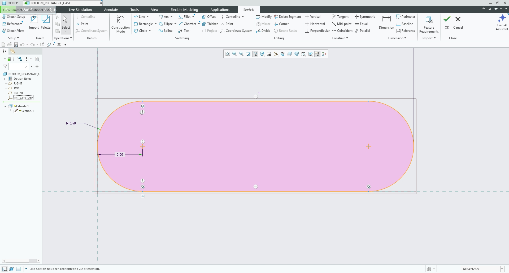
    <figcaption style="font-size: 0.85em; color: gray; margin-top: 5px;">
      1. Bottom Case Base Sketch
    </figcaption>
  </figure>
  <figure style="display: inline-block; margin: 10px; vertical-align: top;">
    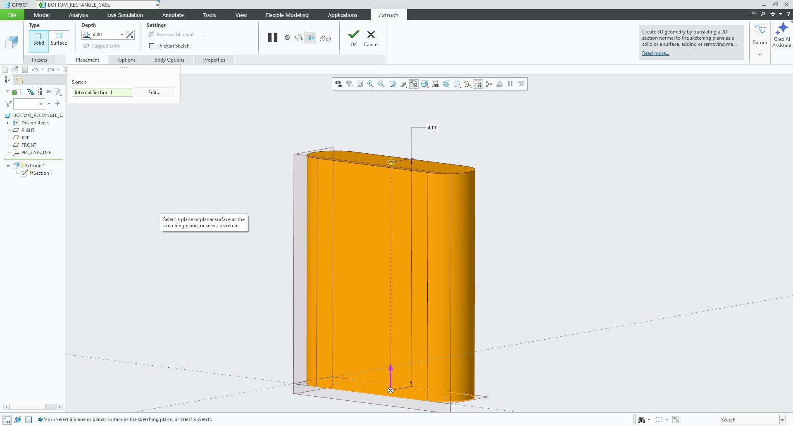
    <figcaption style="font-size: 0.85em; color: gray; margin-top: 5px;">
      2. Bottom Case Base Extrude (4.00 in)
    </figcaption>
  </figure>

  <figure style="display: inline-block; margin: 10px; vertical-align: top;">
    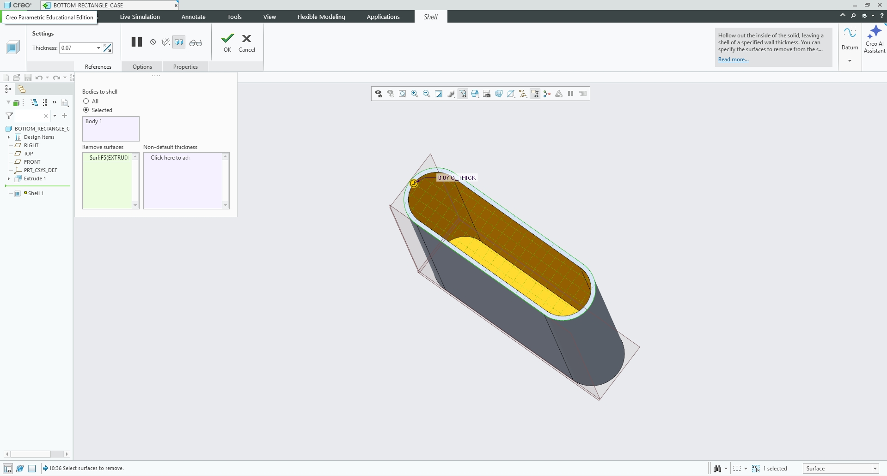
    <figcaption style="font-size: 0.85em; color: gray; margin-top: 5px;">
      3. Bottom Case Shell Feature (0.07 in)
    </figcaption>
  </figure>
  <figure style="display: inline-block; margin: 10px; vertical-align: top;">
    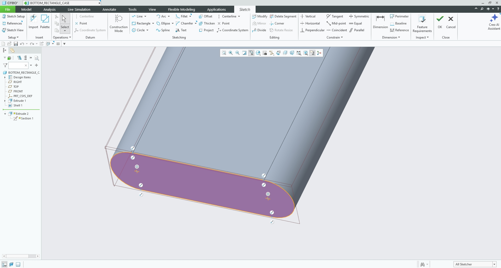
    <figcaption style="font-size: 0.85em; color: gray; margin-top: 5px;">
      4. Secondary Base Sketch
    </figcaption>
  </figure>

  <figure style="display: inline-block; margin: 10px; vertical-align: top;">
    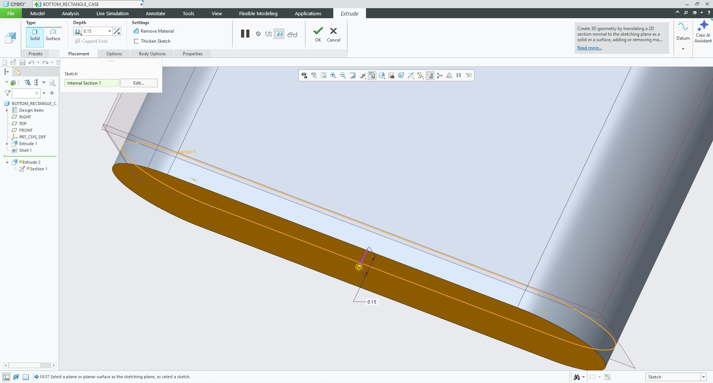
    <figcaption style="font-size: 0.85em; color: gray; margin-top: 5px;">
      5. Secondary Base Extrude (0.15 in)
    </figcaption>
  </figure>
  <figure style="display: inline-block; margin: 10px; vertical-align: top;">
    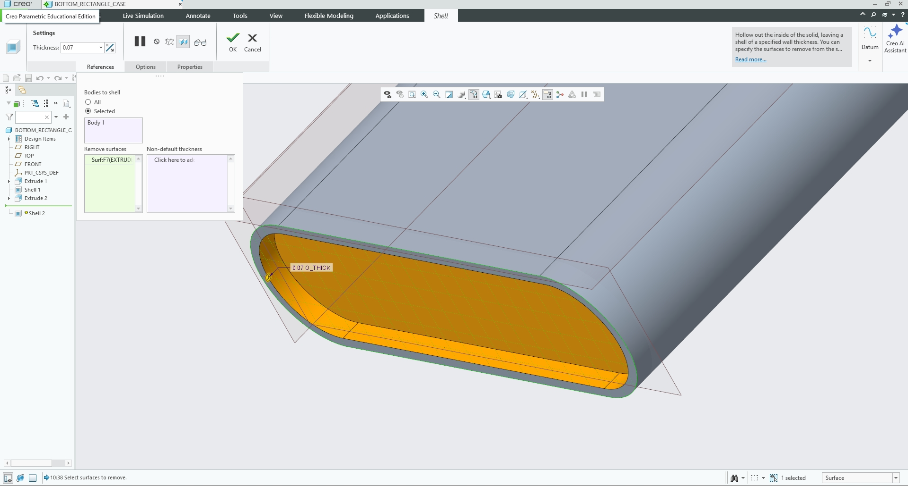
    <figcaption style="font-size: 0.85em; color: gray; margin-top: 5px;">
      6. Secondary Shell Feature (0.07 in)
    </figcaption>
  </figure>

  <figure style="display: inline-block; margin: 10px; vertical-align: top;">
    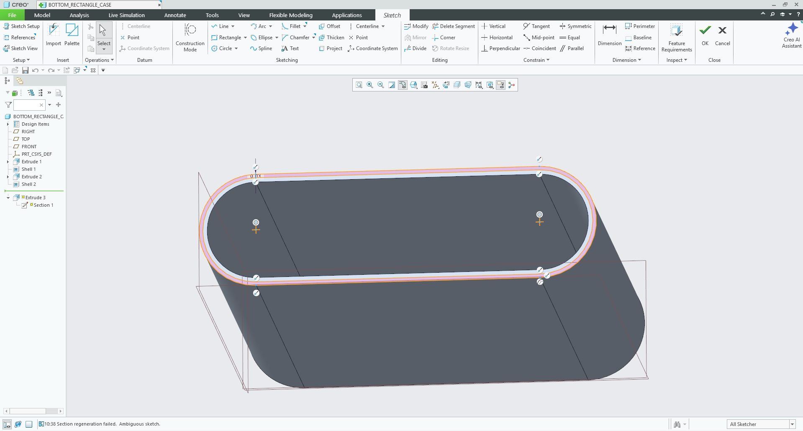
    <figcaption style="font-size: 0.85em; color: gray; margin-top: 5px;">
      7. Male Rim Connection Sketch
    </figcaption>
  </figure>
  <figure style="display: inline-block; margin: 10px; vertical-align: top;">
    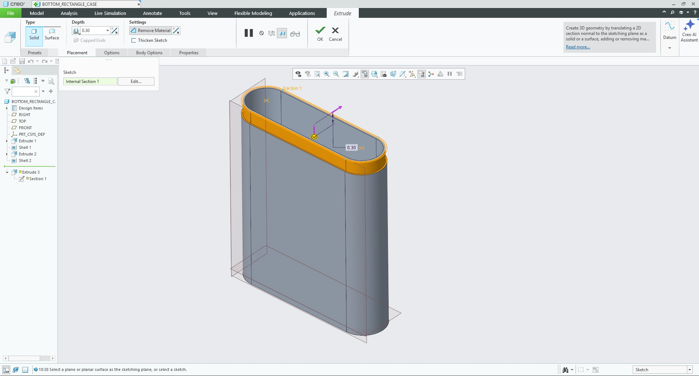
    <figcaption style="font-size: 0.85em; color: gray; margin-top: 5px;">
      8. Male Connection Cut Extrude (0.30 in)
    </figcaption>
  </figure>

  <figure style="display: inline-block; margin: 10px; vertical-align: top;">
    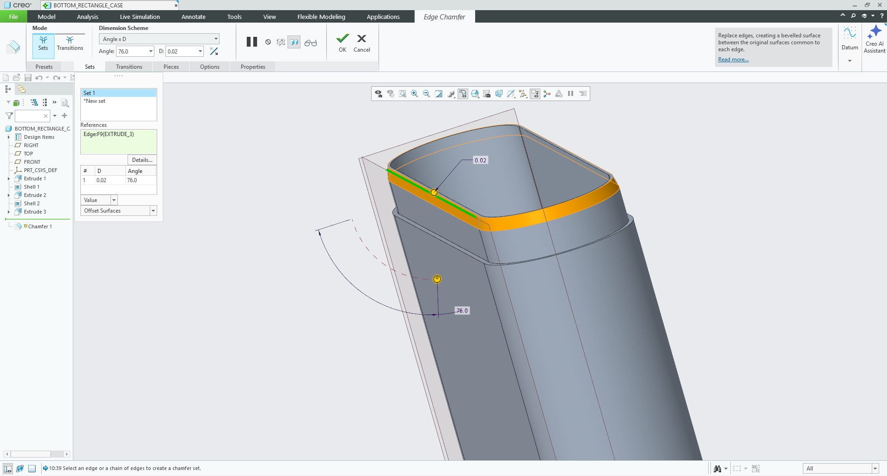
    <figcaption style="font-size: 0.85em; color: gray; margin-top: 5px;">
      9. Male Connection Chamfer (76 deg)
    </figcaption>
  </figure>
  <figure style="display: inline-block; margin: 10px; vertical-align: top;">
    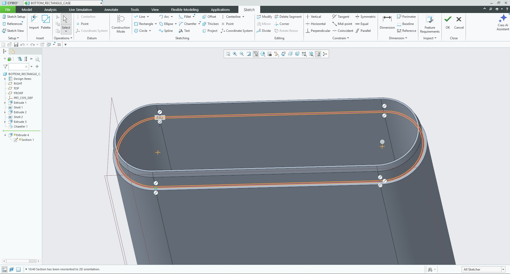
    <figcaption style="font-size: 0.85em; color: gray; margin-top: 5px;">
      10. Male Connection Base Sketch
    </figcaption>
  </figure>

  <figure style="display: inline-block; margin: 10px; vertical-align: top;">
    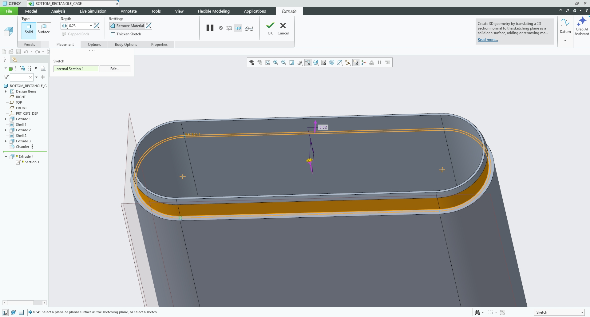
    <figcaption style="font-size: 0.85em; color: gray; margin-top: 5px;">
      11. Snap-Fit Shoulder Cut (0.23 in)
    </figcaption>
  </figure>
  <figure style="display: inline-block; margin: 10px; vertical-align: top;">
    
    <figcaption style="font-size: 0.85em; color: gray; margin-top: 5px;">
      12. Internal Base Fillets (R = 0.10 in)
    </figcaption>
  </figure>

  <figure style="display: inline-block; margin: 10px; vertical-align: top;">
    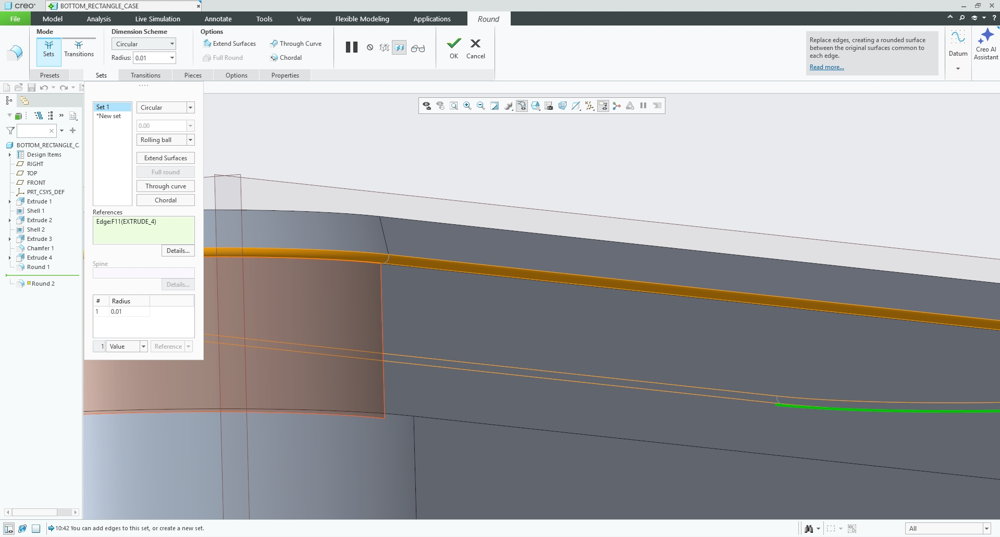
    <figcaption style="font-size: 0.85em; color: gray; margin-top: 5px;">
      13. Male Port Corner Round (R = 0.01 in)
    </figcaption>
  </figure>
  <figure style="display: inline-block; margin: 10px; vertical-align: top;">
    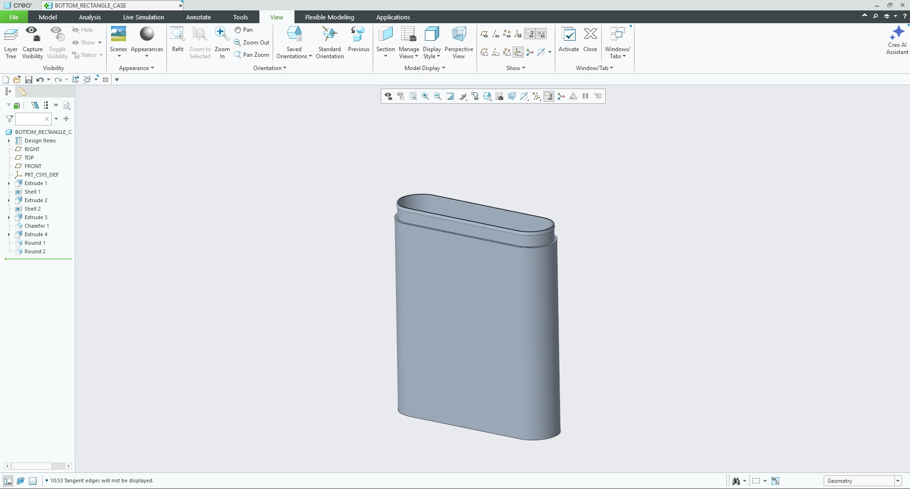
    <figcaption style="font-size: 0.85em; color: gray; margin-top: 5px;">
      14. Completed Bottom Case Model
    </figcaption>
  </figure>

**Phase 2: Top Case Modeling**
The top case was modeled with matching footprint dimensions ($R = 0.50\text{ in}$), extruded to $4.00\text{ in}$, and hollowed via a $0.07\text{ in}$ shell. External corner rounds ($0.25\text{ in}$) and internal base fillets ($0.10\text{ in}$) were added for ergonomics and stress relief. Reference datum planes (`DTM1`, `DTM2`) anchored the upper female receiving channel ($0.30\text{ in}$ depth) and upper mating shoulder extrusion ($0.03\text{ in}$) with smooth edge rounding (`Round 3`).

  <figure style="display: inline-block; margin: 10px; vertical-align: top;">
    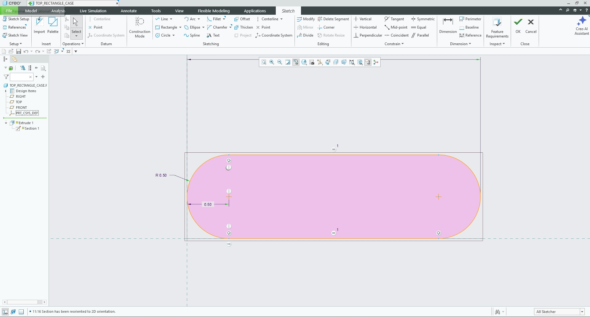
    <figcaption style="font-size: 0.85em; color: gray; margin-top: 5px;">
      15. Top Case Base Sketch
    </figcaption>
  </figure>
  <figure style="display: inline-block; margin: 10px; vertical-align: top;">
    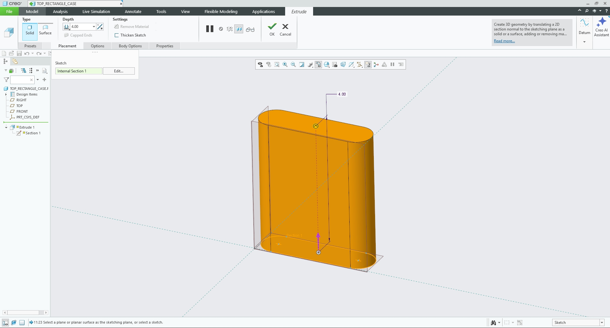
    <figcaption style="font-size: 0.85em; color: gray; margin-top: 5px;">
      16. Top Case Base Extrude (4.00 in)
    </figcaption>
  </figure>

  <figure style="display: inline-block; margin: 10px; vertical-align: top;">
    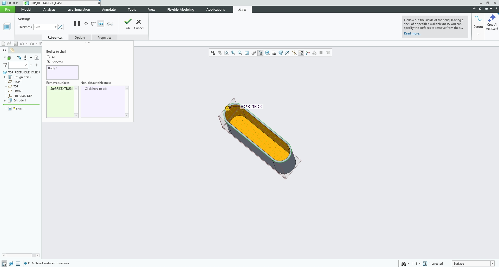
    <figcaption style="font-size: 0.85em; color: gray; margin-top: 5px;">
      17. Top Case Shell Feature (0.07 in)
    </figcaption>
  </figure>
  <figure style="display: inline-block; margin: 10px; vertical-align: top;">
    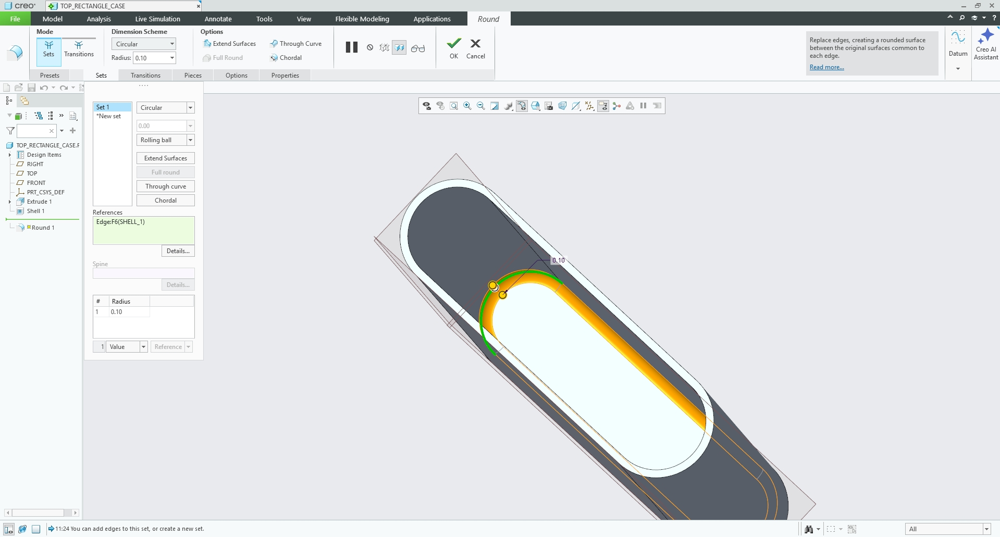
    <figcaption style="font-size: 0.85em; color: gray; margin-top: 5px;">
      18. Top Case Inner Fillets (R = 0.10 in)
    </figcaption>
  </figure>

  <figure style="display: inline-block; margin: 10px; vertical-align: top;">
    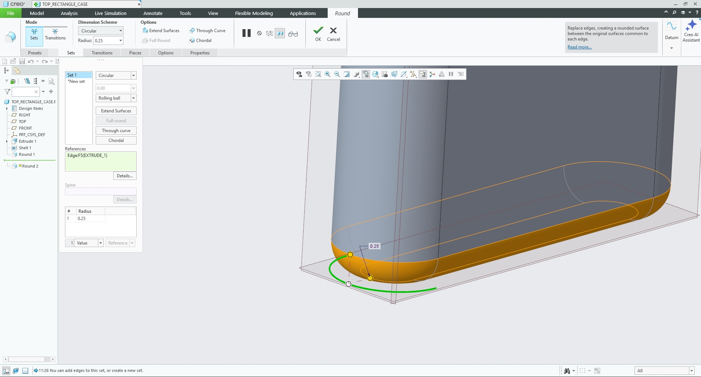
    <figcaption style="font-size: 0.85em; color: gray; margin-top: 5px;">
      19. Top Case Outer Fillets (R = 0.25 in)
    </figcaption>
  </figure>
  <figure style="display: inline-block; margin: 10px; vertical-align: top;">
    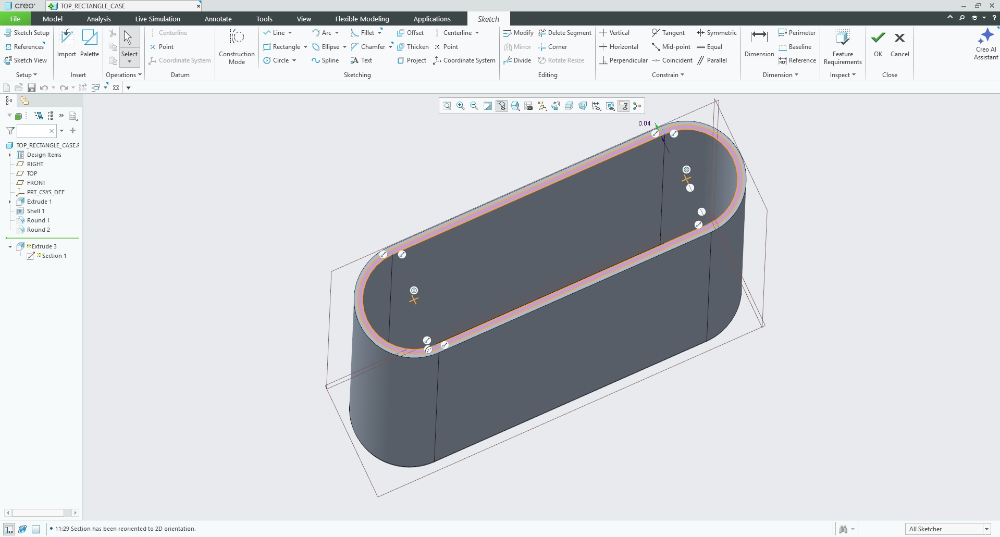
    <figcaption style="font-size: 0.85em; color: gray; margin-top: 5px;">
      20. Female Inner Rim Sketch
    </figcaption>
  </figure>

  <figure style="display: inline-block; margin: 10px; vertical-align: top;">
    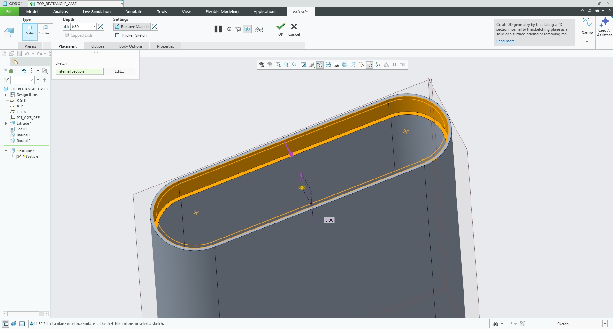
    <figcaption style="font-size: 0.85em; color: gray; margin-top: 5px;">
      21. Female Recess Cut (0.30 in)
    </figcaption>
  </figure>
  <figure style="display: inline-block; margin: 10px; vertical-align: top;">
    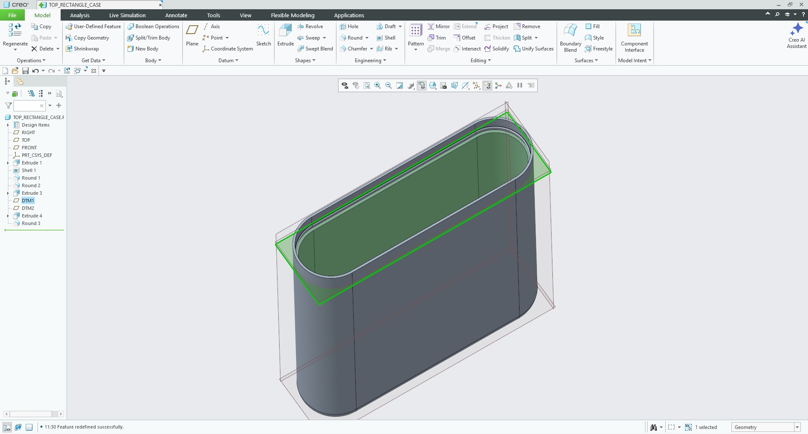
    <figcaption style="font-size: 0.85em; color: gray; margin-top: 5px;">
      22. Reference Datum Plane 1 (DTM1)
    </figcaption>
  </figure>

  <figure style="display: inline-block; margin: 10px; vertical-align: top;">
    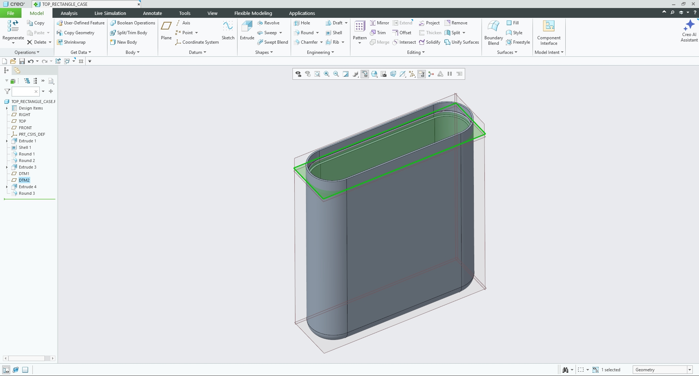
    <figcaption style="font-size: 0.85em; color: gray; margin-top: 5px;">
      23. Reference Datum Plane 2 (DTM2)
    </figcaption>
  </figure>
  <figure style="display: inline-block; margin: 10px; vertical-align: top;">
    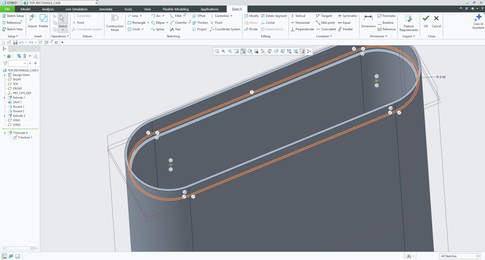
    <figcaption style="font-size: 0.85em; color: gray; margin-top: 5px;">
      24. Secondary Feature Sketch on DTM2
    </figcaption>
  </figure>

  <figure style="display: inline-block; margin: 10px; vertical-align: top;">
    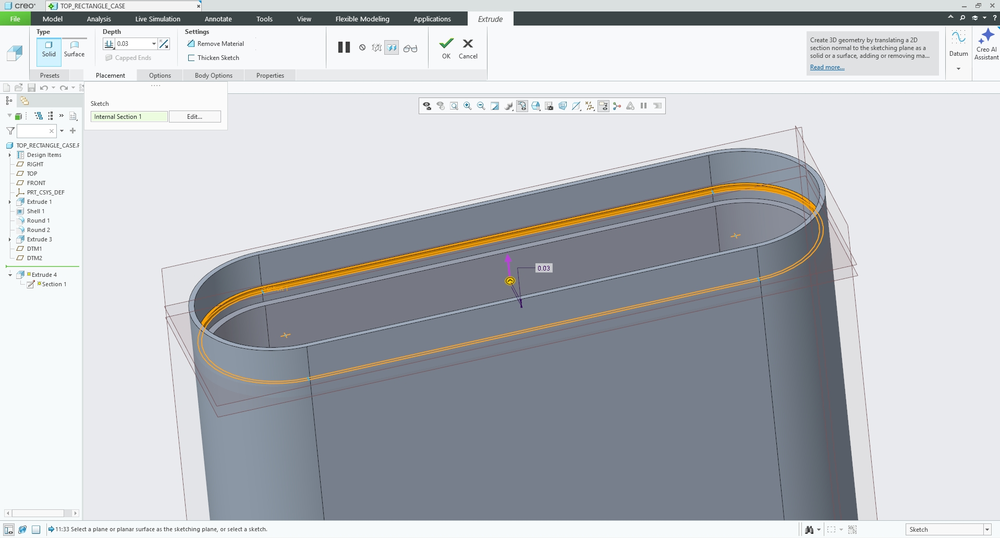
    <figcaption style="font-size: 0.85em; color: gray; margin-top: 5px;">
      25. Upper Mating Shoulder Extrude (0.03 in)
    </figcaption>
  </figure>
  <figure style="display: inline-block; margin: 10px; vertical-align: top;">
    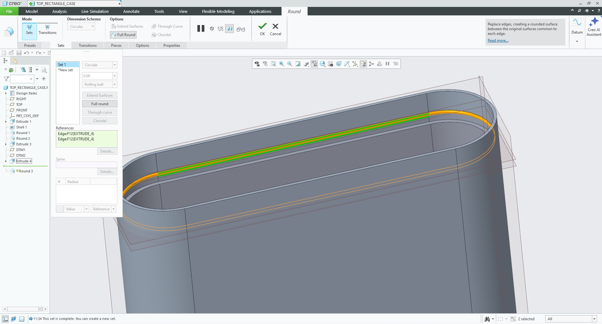
    <figcaption style="font-size: 0.85em; color: gray; margin-top: 5px;">
      26. Upper Mating Edge Fillets (Round 3)
    </figcaption>
  </figure>

  <figure style="display: inline-block; margin: 10px; vertical-align: top;">
    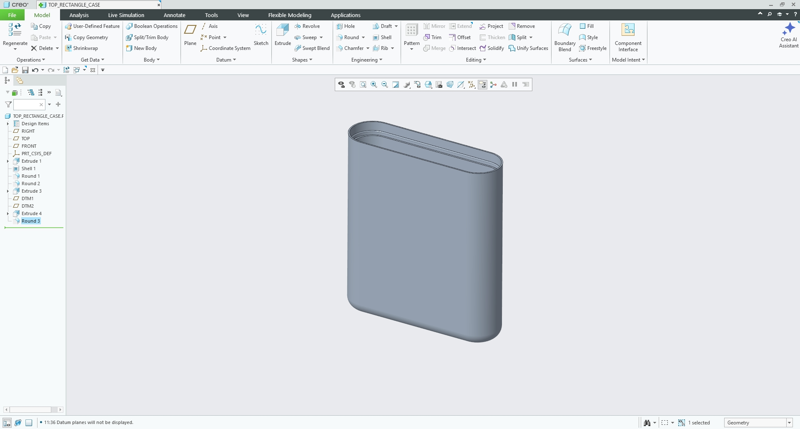
    <figcaption style="font-size: 0.85em; color: gray; margin-top: 5px;">
      27. Completed Top Case Model
    </figcaption>
  </figure>

## 3. Slicing & 3D Printing
The STL files were processed in PrusaSlicer for manufacturing on a Prusa Core One using Generic PETG filament. Both halves were oriented vertically along the Z-axis to align layer lines with longitudinal stress vectors and eliminate the need for supports.

**Slicing Strategy & Parameters:**
<ul style="list-style-type: disc !important; padding-left: 20px;">
  <li style="margin-bottom: 4px;">
    <b>Machine:</b> Prusa Core One (HF0.4 nozzle)
  </li>
  <li style="margin-bottom: 4px;">
    <b>Material:</b> Generic PETG (chosen for superior layer adhesion, toughness, and flexibility during snap-fit flexing)
  </li>
  <li style="margin-bottom: 4px;">
    <b>Infill:</b> 15% Gyroid infill (chosen for isotropic strength and optimal strength-to-weight ratio)
  </li>
  <li style="margin-bottom: 4px;">
    <b>Layer Height:</b> 0.20 mm (BALANCED profile)
  </li>
  <li style="margin-bottom: 4px;">
    <b>Perimeters:</b> 3 walls matching the 0.07 in CAD wall thickness (~1.78 mm)
  </li>
  <li style="margin-bottom: 4px;">
    <b>Supports / Raft:</b> None (zero supports; direct adhesion on textured PEI sheet)
  </li>
  <li style="margin-bottom: 4px;">
    <b>Total Print Time:</b> 1 hour 59 minutes (~2 hours)
  </li>
  <li style="margin-bottom: 4px;">
    <b>Filament Used:</b> 93.53 g (4.49 in³) for both parts combined
  </li>
</ul>

  <figure style="display: inline-block; margin: 5px; vertical-align: top;">
    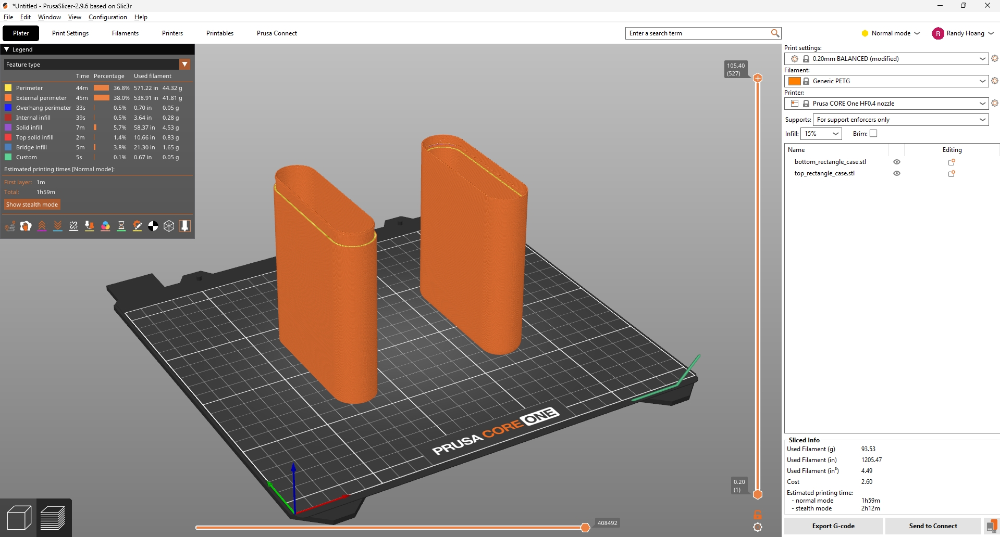
    <figcaption style="font-size: 0.85em; color: gray; margin-top: 5px;">
      28. PrusaSlicer Sliced Preview & Plate Layout
    </figcaption>
  </figure>
  <figure style="display: inline-block; margin: 5px; vertical-align: top;">
    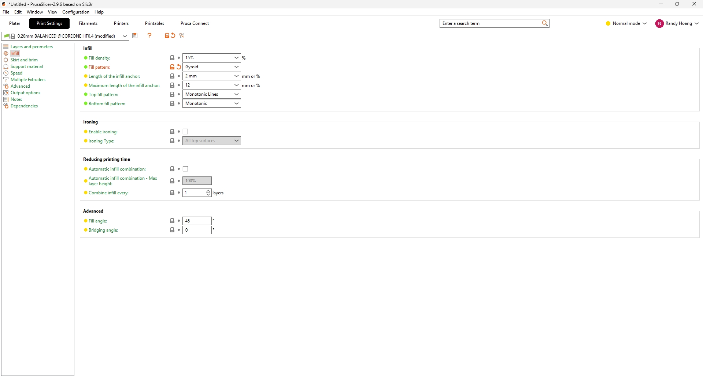
    <figcaption style="font-size: 0.85em; color: gray; margin-top: 5px;">
      29. PrusaSlicer 15% Gyroid Infill Settings
    </figcaption>
  </figure>

  <figure style="display: inline-block; margin: 10px; width: 50%; vertical-align: top;">
    <video width="100%" controls>
      <source src="printing_process.mp4" type="video/mp4">
      Your browser does not support the video tag.
    </video>
    <figcaption style="font-size: 0.85em; color: gray; margin-top: 8px; text-align: center;">
      Live 3D Printing Process on the Prusa Core One
    </figcaption>
  </figure>

## 4. Lessons Learned

**Time Breakdown**

| Task Phase | Expected Time | Actual Time |
| :--- | :--- | :--- |
| Research & Documentation | 1.0 hr | 1.0 hr |
| PTC Creo Modeling | 2.5 hrs | 2.5 hrs |
| PrusaSlicer Preparation | 0.5 hr | 0.5 hr |
| 3D Printing | 2.0 hrs | 2.0 hrs |
| Mechanical Testing & Fit Check | 0.5 hr | 0.5 hr |
| **Total** | **6.5 hrs** | **6.5 hrs** |

**Design & Manufacturing Reflection**
Originally conceptualized and designed during the ENGR 1202 class for the toiletry case project, this design emphasizes parametric feature control and tolerance stack-up in PTC Creo. The initial design worked successfully on the first try with zero revisions or modifications required. Incorporating a deliberate clearance offset and a $76^{\circ}$ lead-in chamfer ensured smooth closure engagement, while switching from brittle PLA to tough PETG provided the necessary flexibility for the snap-fit friction fit without fatigue failure. Printing upright without supports eliminated post-processing cleanup. Because the design consists solely of two mating halves connecting and disconnecting, no post-print assembly was required.

  <figure style="display: inline-block; margin: 5px; vertical-align: top;">
    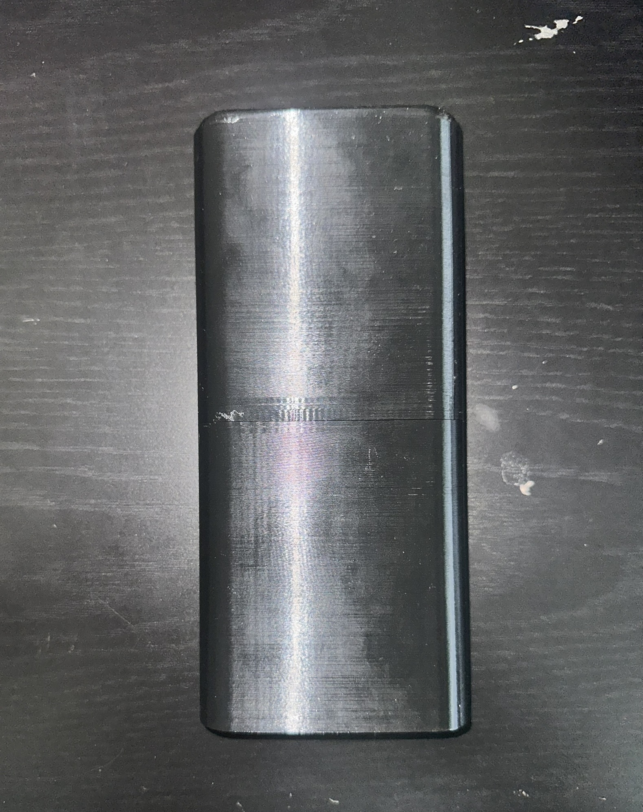
    <figcaption style="font-size: 0.85em; color: gray; margin-top: 5px;">
      30. Fully Assembled Case (Closed)
    </figcaption>
  </figure>
  <figure style="display: inline-block; margin: 5px; vertical-align: top;">
    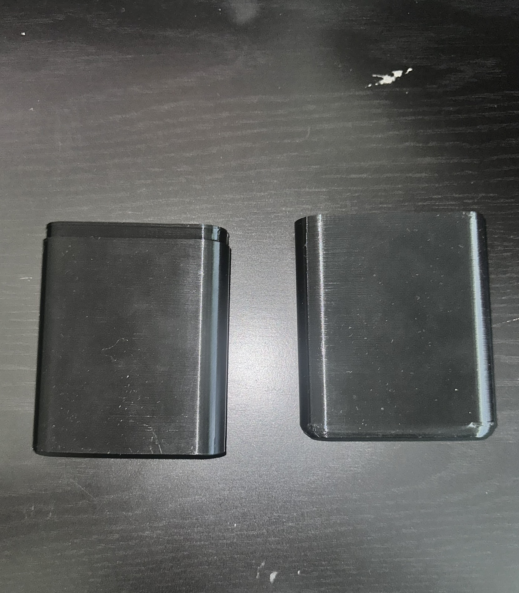
    <figcaption style="font-size: 0.85em; color: gray; margin-top: 5px;">
      31. Fully Assembled Case (Opened)
    </figcaption>
  </figure>

  <figure style="display: inline-block; margin: 10px; width: 50%; vertical-align: top;">
    <video width="100%" controls>
      <source src="case_operation.mp4" type="video/mp4">
      Your browser does not support the video tag.
    </video>
    <figcaption style="font-size: 0.85em; color: gray; margin-top: 8px; text-align: center;">
      Mechanical Opening & Closing Test (IRL)
    </figcaption>
  </figure>

## Resources

All design and print work was completed using:

<ul style="list-style-type: circle !important; padding-left: 20px;">
  <li style="list-style-type: circle !important; margin-bottom: 4px;">
    PTC Creo Parametric
  </li>
  <li style="list-style-type: circle !important; margin-bottom: 4px;">
    <a href="https://www.prusa3d.com/p/prusaslicer/" target="_blank">PrusaSlicer</a>
  </li>
  <li style="list-style-type: circle !important; margin-bottom: 4px;">
    Prusa CORE One 3D Printer
  </li>
  <li style="list-style-type: circle !important; margin-bottom: 4px;">
    "Great Questions Lead to Great Design: A Guide to the Design-thinking Process."
  </li>
  <li style="list-style-type: circle !important; margin-bottom: 4px;">
    ENGR 1202 Toiletry Case Project Guidelines (UNC Charlotte)
  </li>
  

</ul>

Total time from start to finish: ~6.5 hours (1.0 hour research/documentation, 2.5 hours CAD modeling, 0.5 hours slicing, 2.0 hours 3D printing in PETG, 0.5 hours mechanical testing and fit check).
