# Lab #9 Laser Cutter

<small>***(Clicking on the images will enlarge them)***</small>

## Design

The first thing my partner and I did was decide the variables that we would need for our own parts—namely the thickness and kerf measurements.

### Material Thickness
When beginning this part, my partner and I measured the wood given to us from three different points ($0.110\text{ in}$, $0.112\text{ in}$, $0.113\text{ in}$), getting an average value of **$0.1117\text{ in}$** for our piece of wood. This $0.1117\text{ in}$ value became our material thickness variable in the CAD parameters.

### Kerf Measurement
When putting a $2\text{ in} \times 2\text{ in}$ square into the laser cutter, we got a final kerf measurement of **$0.009\text{ in}$**, which was the difference in size from our CAD model to the physical laser-cut part ($0.004\text{ in}$ offset per side).

First, we added the $12\text{ mm} \times 12\text{ mm}$ square to SolidWorks:

  <figure style="display: inline-block; margin: 10px; vertical-align: top;">
    
    <figcaption style="font-size: 0.85em; color: gray; margin-top: 5px;">
      Showing the first kerf test
    </figcaption>
  </figure>
  <figure style="display: inline-block; margin: 10px; vertical-align: top;">
    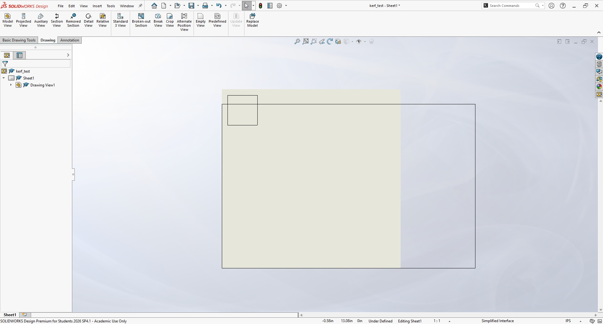
    <figcaption style="font-size: 0.85em; color: gray; margin-top: 5px;">
      Showing the second kerf test file
    </figcaption>
  </figure>

Next, we cut out this square and measured how far off it was. Below is a video of the kerf coupon being laser cut:

  <figure style="display: inline-block; margin: 10px; width: 50%; vertical-align: top;">
    <video width="100%" controls>
      <source src="Kerf_cutting.mp4" type="video/mp4">
      Your browser does not support the video tag.
    </video>
    <figcaption style="font-size: 0.85em; color: gray; margin-top: 8px; text-align: center;">
      Video of the kerf coupon being laser cut
    </figcaption>
  </figure>

After cutting, we measured the offset value ($0.004\text{ in}$):

  <figure style="display: inline-block; margin: 10px; vertical-align: top;">
    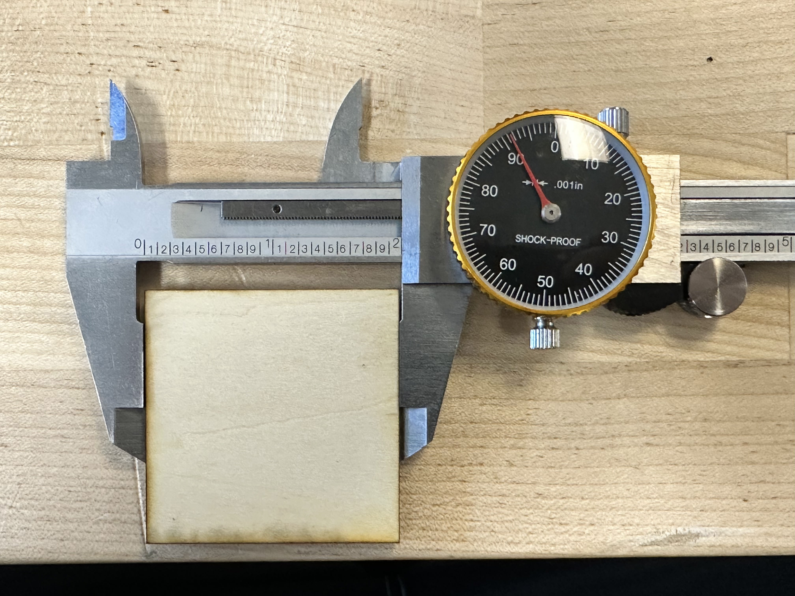
    <figcaption style="font-size: 0.85em; color: gray; margin-top: 5px;">
      Showing the offset of the wood to the first measurement
    </figcaption>
  </figure>

---

### Gear Ratio and Parametric Modeling

First, we added the global parameters in SolidWorks CAD to begin parametric modeling:

  <figure style="display: inline-block; margin: 10px; vertical-align: top;">
    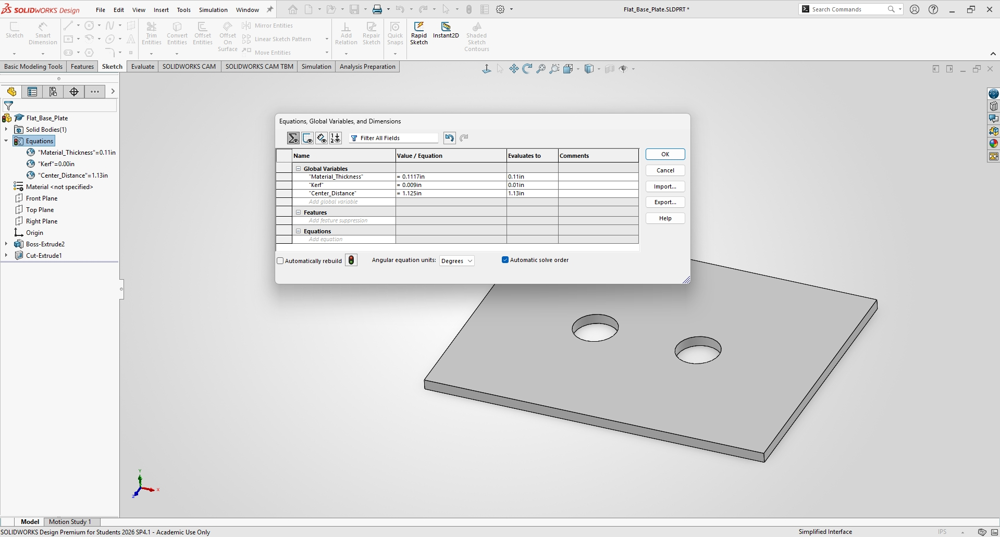
    <figcaption style="font-size: 0.85em; color: gray; margin-top: 5px;">
      Showing the first parametric decisions
    </figcaption>
  </figure>
  <figure style="display: inline-block; margin: 10px; vertical-align: top;">
    
    <figcaption style="font-size: 0.85em; color: gray; margin-top: 5px;">
      Showing the base width and length ($4.00\text{ in} \times 3.00\text{ in}$)
    </figcaption>
  </figure>

Next, we extruded this base to the desired height chosen by the thickness parameter:

  <figure style="display: inline-block; margin: 10px; vertical-align: top;">
    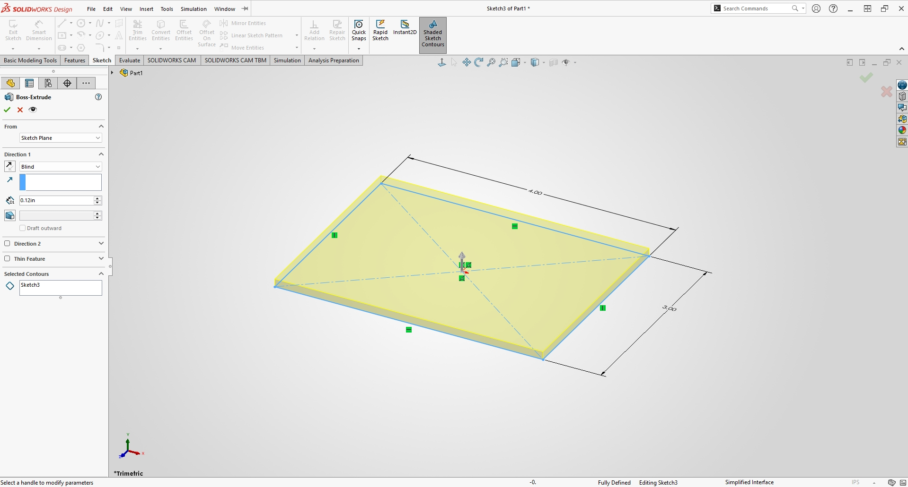
    <figcaption style="font-size: 0.85em; color: gray; margin-top: 5px;">
      Showing the base extrude
    </figcaption>
  </figure>
  <figure style="display: inline-block; margin: 10px; vertical-align: top;">
    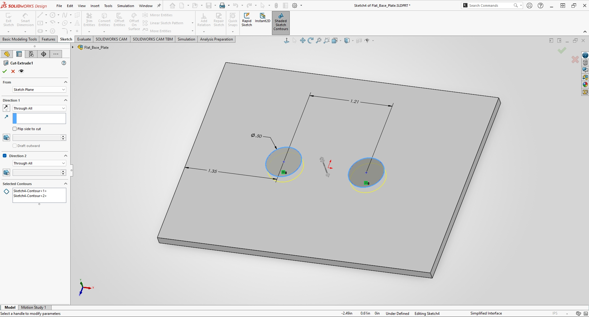
    <figcaption style="font-size: 0.85em; color: gray; margin-top: 5px;">
      Showing the mounting holes with center distance set by parametric equations
    </figcaption>
  </figure>

To build the gear train, we started by designing the smaller gear ($\varnothing 0.88\text{ in}$) with a central shaft bore so the gear could rotate smoothly:

  <figure style="display: inline-block; margin: 10px; vertical-align: top;">
    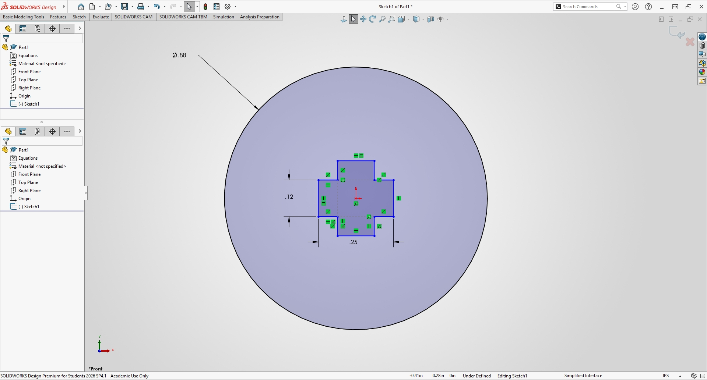
    <figcaption style="font-size: 0.85em; color: gray; margin-top: 5px;">
      Showing the small gear creation in 2D
    </figcaption>
  </figure>
  <figure style="display: inline-block; margin: 10px; vertical-align: top;">
    
    <figcaption style="font-size: 0.85em; color: gray; margin-top: 5px;">
      Showing the small gear extrusion
    </figcaption>
  </figure>

Using SolidWorks circular patterns, we generated the complete tooth profile around the edge:

  <figure style="display: inline-block; margin: 10px; vertical-align: top;">
    
    <figcaption style="font-size: 0.85em; color: gray; margin-top: 5px;">
      Showing the small gear circular pattern
    </figcaption>
  </figure>
  <figure style="display: inline-block; margin: 10px; vertical-align: top;">
    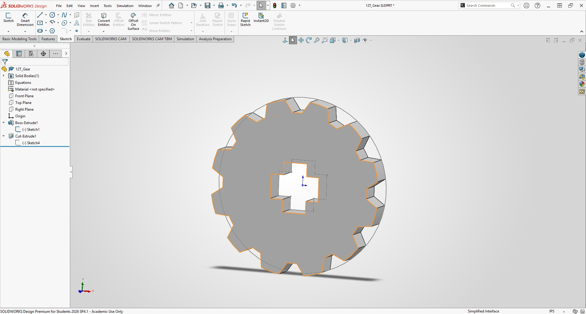
    <figcaption style="font-size: 0.85em; color: gray; margin-top: 5px;">
      Showing the completed smaller gear
    </figcaption>
  </figure>

From the smaller gear, we created the larger gear ($\varnothing 1.63\text{ in}$) by making a parametric copy and updating the dimensions and shaft fit diameter without rebuilding from scratch:

  <figure style="display: inline-block; margin: 10px; vertical-align: top;">
    
    <figcaption style="font-size: 0.85em; color: gray; margin-top: 5px;">
      Showing changing to a larger gear diameter
    </figcaption>
  </figure>
  <figure style="display: inline-block; margin: 10px; vertical-align: top;">
    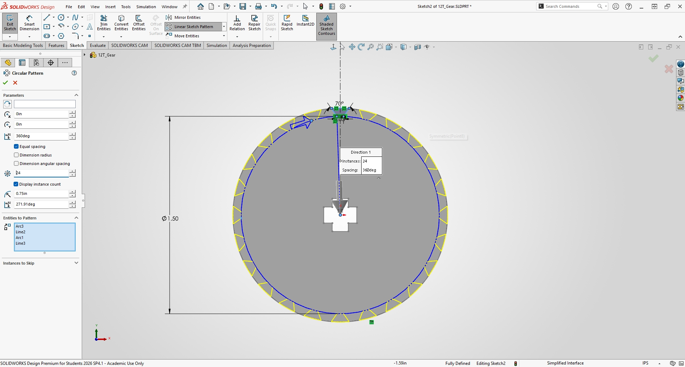
    <figcaption style="font-size: 0.85em; color: gray; margin-top: 5px;">
      Showing changing to a larger gear pattern
    </figcaption>
  </figure>

Since thickness is linked parametrically, the finished larger gear updated automatically:

  <figure style="display: inline-block; margin: 10px; vertical-align: top;">
    
    <figcaption style="font-size: 0.85em; color: gray; margin-top: 5px;">
      Showing finished larger gear
    </figcaption>
  </figure>

---

### Interlocking Shafts and Slotting Washers

Next, we designed the two shaft pins based on the inner gear bore dimensions:

  <figure style="display: inline-block; margin: 10px; vertical-align: top;">
    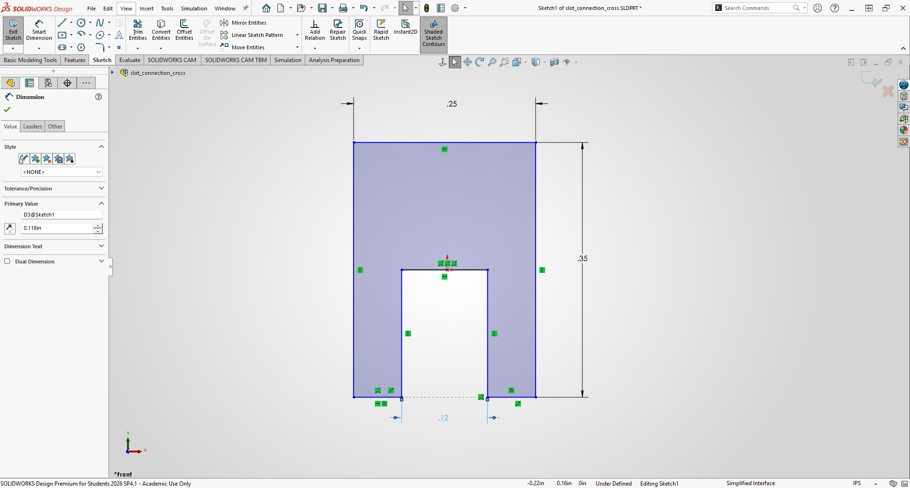
    <figcaption style="font-size: 0.85em; color: gray; margin-top: 5px;">
      Showing the start of the shaft sketch
    </figcaption>
  </figure>
  <figure style="display: inline-block; margin: 10px; vertical-align: top;">
    
    <figcaption style="font-size: 0.85em; color: gray; margin-top: 5px;">
      Showing the shaft extrusion
    </figcaption>
  </figure>

We then created retention washers with matching cross cutouts that fit the base plate holes so the shafts can rotate freely without excess friction:

  <figure style="display: inline-block; margin: 10px; vertical-align: top;">
    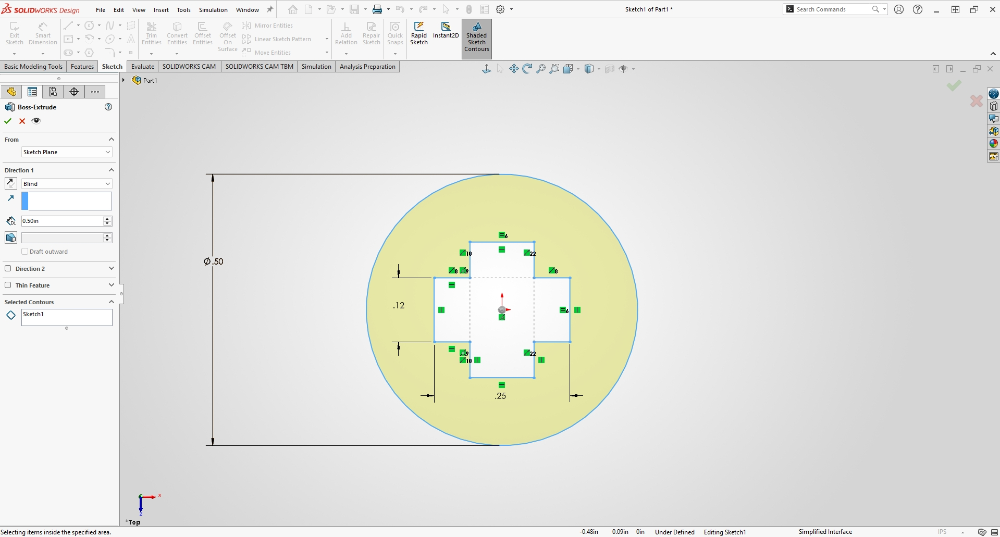
    <figcaption style="font-size: 0.85em; color: gray; margin-top: 5px;">
      Showing the first slotting hole washer sketch
    </figcaption>
  </figure>
  <figure style="display: inline-block; margin: 10px; vertical-align: top;">
    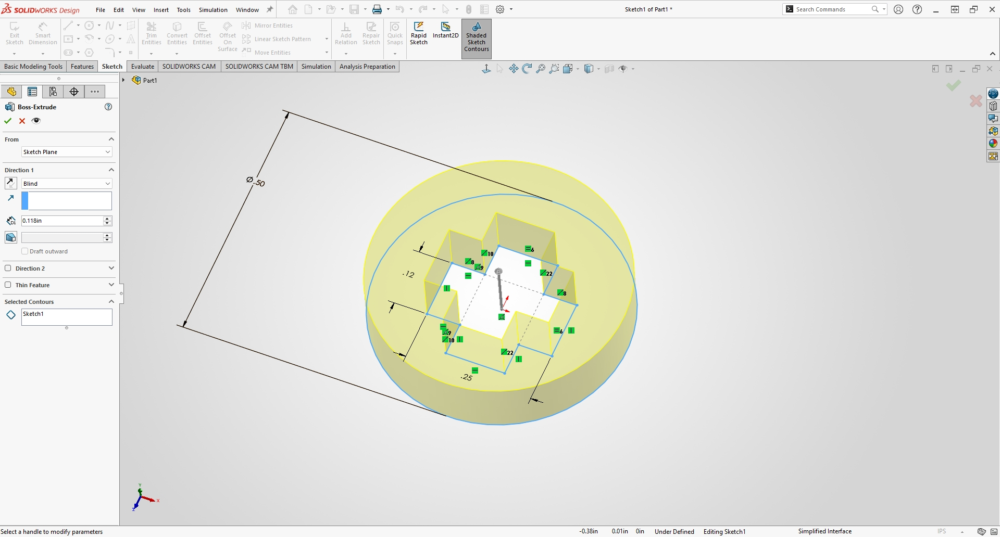
    <figcaption style="font-size: 0.85em; color: gray; margin-top: 5px;">
      Showing the slotting hole washer extrusion
    </figcaption>
  </figure>

We assembled the half-lap shaft pins into a separate cross-shaft sub-assembly to check fitment before mounting them to the plate:

  <figure style="display: inline-block; margin: 10px; vertical-align: top;">
    
    <figcaption style="font-size: 0.85em; color: gray; margin-top: 5px;">
      Showing the shafts fitting together pt. 1
    </figcaption>
  </figure>
  <figure style="display: inline-block; margin: 10px; vertical-align: top;">
    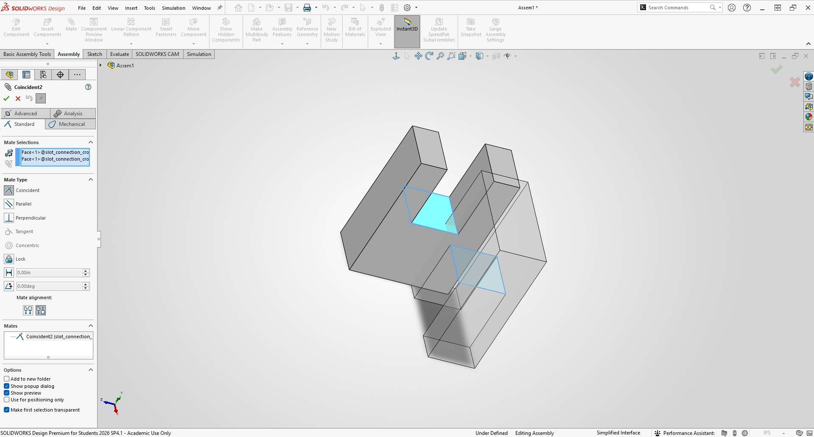
    <figcaption style="font-size: 0.85em; color: gray; margin-top: 5px;">
      Showing the shafts fitting together pt. 2
    </figcaption>
  </figure>

  <figure style="display: inline-block; margin: 10px; vertical-align: top;">
    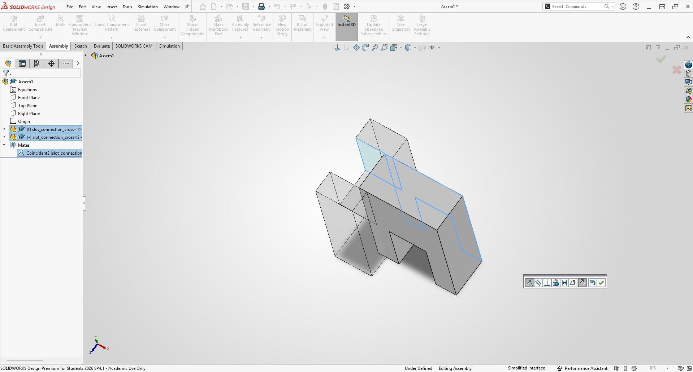
    <figcaption style="font-size: 0.85em; color: gray; margin-top: 5px;">
      Showing the shafts fitting together pt. 3
    </figcaption>
  </figure>
  <figure style="display: inline-block; margin: 10px; vertical-align: top;">
    
    <figcaption style="font-size: 0.85em; color: gray; margin-top: 5px;">
      Showing the shafts fitting together pt. 4
    </figcaption>
  </figure>

  <figure style="display: inline-block; margin: 10px; vertical-align: top;">
    
    <figcaption style="font-size: 0.85em; color: gray; margin-top: 5px;">
      Showing the completed cross-shaft sub-assembly
    </figcaption>
  </figure>

---

### Main Assembly Integration

Finally, we created a new SolidWorks assembly starting with the base plate, adding the slotting washers, cross shafts, driver gear, and secondary driven gear:

  <figure style="display: inline-block; margin: 10px; vertical-align: top;">
    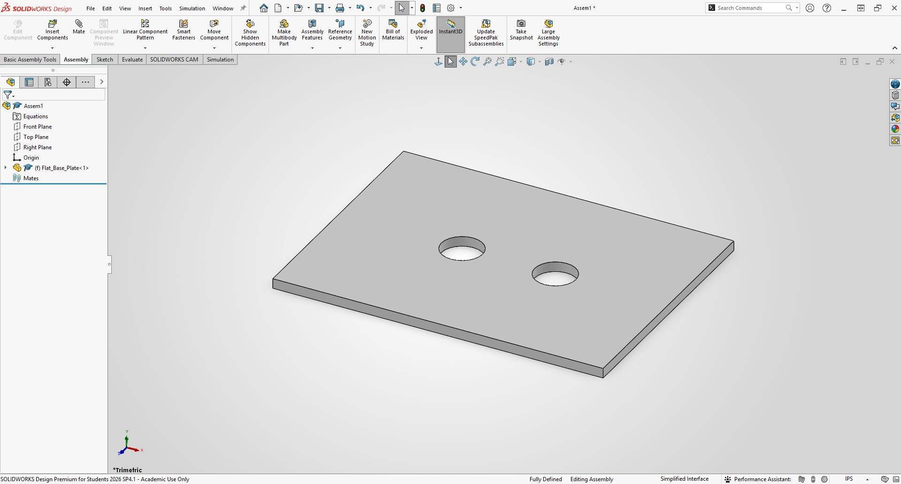
    <figcaption style="font-size: 0.85em; color: gray; margin-top: 5px;">
      Showing the start of the final assembly
    </figcaption>
  </figure>
  <figure style="display: inline-block; margin: 10px; vertical-align: top;">
    
    <figcaption style="font-size: 0.85em; color: gray; margin-top: 5px;">
      Showing the retention washers being slotted in
    </figcaption>
  </figure>

  <figure style="display: inline-block; margin: 10px; vertical-align: top;">
    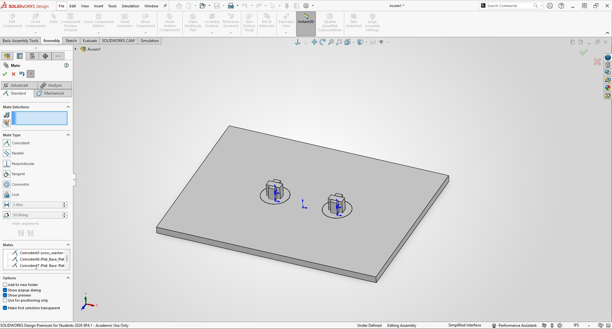
    <figcaption style="font-size: 0.85em; color: gray; margin-top: 5px;">
      Showing the cross shafts being added
    </figcaption>
  </figure>
  <figure style="display: inline-block; margin: 10px; vertical-align: top;">
    
    <figcaption style="font-size: 0.85em; color: gray; margin-top: 5px;">
      Showing the driver gear being added
    </figcaption>
  </figure>

  <figure style="display: inline-block; margin: 10px; vertical-align: top;">
    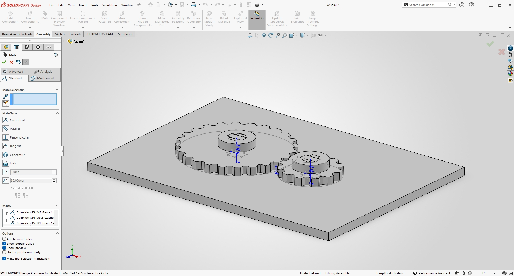
    <figcaption style="font-size: 0.85em; color: gray; margin-top: 5px;">
      Showing the secondary gear added and finishing the assembly
    </figcaption>
  </figure>

---

### Parameter Data Summary

| Variable Name | Value (in) | Unit Source (measured or chosen) | What it controls |
| :--- | :--- | :--- | :--- |
| **Thickness** | `0.1117` | Measured (Step 1) | The thickness of the material |
| **Kerf** | `0.0090` | Measured (Step 2) | The amount of material blown away by the laser |
| **Clearance** | `0.0020` | Chosen (Step 4) | Controls how tight the parts fit relative to each other |
| **Slot Width** | `0.500` radius | Chosen | Controls the size of the holes created to slot in the plates |
| **Hole Distance** | `1.1250` | Chosen | Controls the distance between holes on the base plate |

---

## Manufacturing & Process Research

### Process Explanation
Laser cutting works by using a high-powered, computer-controlled laser beam directed through optics to melt and burn away at a chosen material, while an auxiliary gas blows away any debris left. This is a viable manufacturing process because it is extremely accurate, enables rapid production cycles, and produces very smooth finishes without requiring additional tooling.

When comparing laser cutting to 3D printing, laser cutting is a subtractive process that operates very quickly, making it ideal for rapid iteration and mass production. Laser cutting is also highly versatile across different material sheets compared to typical FDM printing filaments.

### Vector Drawing Export and Software Layout
After designing the parts in SolidWorks, we created a 2D drawing and uploaded it as a PDF vector file into the laser cutting software:

  <figure style="display: inline-block; margin: 10px; vertical-align: top;">
    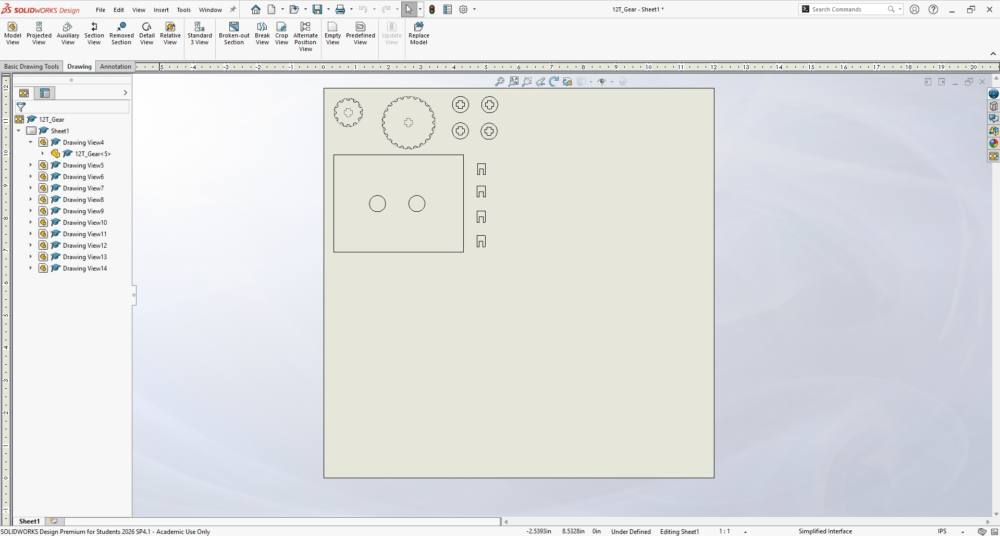
    <figcaption style="font-size: 0.85em; color: gray; margin-top: 5px;">
      Showing the parts in SolidWorks 2D drawing
    </figcaption>
  </figure>
  <figure style="display: inline-block; margin: 10px; vertical-align: top;">
    
    <figcaption style="font-size: 0.85em; color: gray; margin-top: 5px;">
      Showing the parts in PDF file uploaded to laser printing software
    </figcaption>
  </figure>

### Video Documentation
The videos of the parts being laser cut were trimmed to fit under the GitHub $25\text{ MB}$ file size limit:

  <figure style="display: inline-block; margin: 5px; vertical-align: top;">
    <video width="350" controls>
      <source src="Kit_cutting.mp4" type="video/mp4">
      Your browser does not support the video tag.
    </video>
    <figcaption style="font-size: 0.85em; color: gray; margin-top: 5px;">
      Laser cutting kit components — Part 1
    </figcaption>
  </figure>
  <figure style="display: inline-block; margin: 5px; vertical-align: top;">
    <video width="350" controls>
      <source src="Kit_cutting2.mp4" type="video/mp4">
      Your browser does not support the video tag.
    </video>
    <figcaption style="font-size: 0.85em; color: gray; margin-top: 5px;">
      Laser cutting kit components — Part 2
    </figcaption>
  </figure>

  <figure style="display: inline-block; margin: 10px; width: 50%; vertical-align: top;">
    <video width="100%" controls>
      <source src="Kit_cutting3.mp4" type="video/mp4">
      Your browser does not support the video tag.
    </video>
    <figcaption style="font-size: 0.85em; color: gray; margin-top: 8px; text-align: center;">
      Laser cutting kit components — Part 3
    </figcaption>
  </figure>

### Process Observations
Parts were arranged in the top-left corner of the sheet to save as much wood stock as possible and minimize scrap waste. Air quality and ventilation during cutting functioned well; smoke was pulled through exhaust vents immediately, and air assist suppressed flaming along the cut line. Edge profiles exhibited minor charring, which is standard for laser-cut wood stock.

---

### Laser Process Record

| Setting | Kerf Coupon | Production Cut |
| :--- | :--- | :--- |
| **Laser Cutter Number** | 1 | 1 |
| **Material Type** | Wood | Wood |
| **Nominal Thickness** | $1/8\text{ in}$ | $1/8\text{ in}$ |
| **Measured Thickness (Mean, in)** | `1.117` | `1.117` |
| **Speed** | $20\%$ | $20\%$ |
| **Power** | $100\%$ | $100\%$ |
| **Frequency** | $20\%$ | $20\%$ |
| **Number of Passes** | 4 | 1 |
| **Focus Method & How Confirmed** | Auto focus \| Confirmed by lowering laser head until spacer block slid snugly between nozzle tip and material surface without pinching | Auto focus \| Confirmed by lowering laser head until spacer block slid snugly between nozzle tip and material surface without pinching |
| **Air Assist ON? Exhaust ON?** | Yes \| Yes | Yes \| Yes |
| **Origin & Alignment Method** | Top-left corner of sheet using laser pointer jog | Top-left corner of sheet using laser pointer jog |

---

## Lessons Learned

### Process Log

| Date and Time | Time Spent | What Changed |
| :--- | :--- | :--- |
| **10/24/26** | 6 Hours | CAD drawings started and completed, creation of gears and shafts, exported PDF for laser software, and documentation started. |
| **10/25/26** | 4 Hours | Discussion on documentation organization and testing plans for Monday. |
| **10/26/26** | 5 Hours | Kerf values fully tested, wood thickness verified, final kit printed out, and documentation completed. |

### Mistakes & Troubleshooting
One mistake made was having to press out one of the laser-cut pieces from the sheet, likely due to a minor vector power variation on the bottom side of the sheet. Another issue was a loose fit on the kerf connection to our plate, which required a small drop of glue to prevent it from slipping out.

### Resources Used
1. Wood Stock ($1/8\text{ in}$ Baltic Birch)
2. Laser Cutter
3. Glue Stick
4. Calipers
5. Ruler

### Engineering Questions Answered
1. **Measuring Actual Thickness vs. Assuming Nominal:** Measured wood thickness differed from nominal $1/8\text{ in}$. Assuming nominal values could damage the machine by setting focal height incorrectly or leading to incomplete cuts. If kerf were ignored, parts would fit loose or wobble since material removed during cutting wouldn't be accounted for.
2. **Taguchi's Quality Loss Function:** Taguchi's principle states that any deviation from the target value incurs a cost. For our gears, a deviation in tolerance causes wobbling or binding; in mass production, this causes premature wear, broken warranties, and safety concerns.
3. **Real-World Kerf Application:** In laser-cut plywood shelving, failing to account for kerf causes joints to be either too loose to stay assembled or too tight to slide together without splitting the material.
4. **Future Iteration Adjustments:** Given one additional cut, we would experiment with changing gear clearance to find the maximum clearance allowable while maintaining smooth meshing without slipping.

