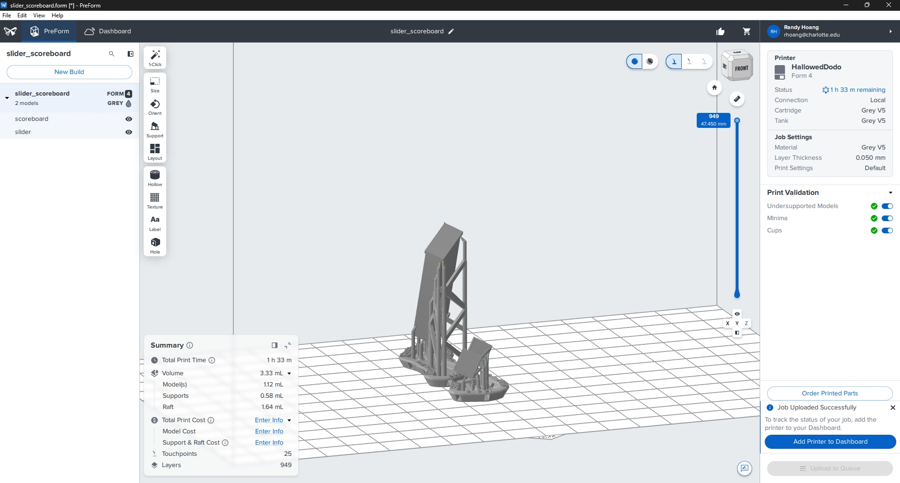

# Lab #10 RC2 Sliding Fit Design and Verifaction

<small>***(Clicking on the images will enlarge them)***</small>

## Research and Planning

According to the **Machinery’s Handbook (ANSI B4.1)**, Class RC 2 Sliding Fits are intended for accurate location of parts that must assemble without perceptible play while remaining easy to move and turn under light manual pressure. Unlike free-running fits, RC 2 fits are not designed for continuous high-speed rotation and can be sensitive to minor thermal expansion in larger sizes.

For our design, we selected a nominal basic feature size of **$0.3750\text{ in}$ ($3/8\text{ in}$)**. According to the ANSI B4.1 standard for a $0.375\text{ in}$ basic size, the theoretical limits are:
* **Hole / Slot Feature (H6 class):** $+0.0000\text{ in}$ to $+0.0007\text{ in}$ ($0.3750\text{ in}$ to $0.3757\text{ in}$)
* **Shaft / Insert Feature (g5 class):** $-0.0004\text{ in}$ to $-0.0009\text{ in}$ ($0.3741\text{ in}$ to $0.3746\text{ in}$)
* **Target Clearance Range:** Minimum clearance of **$0.0004\text{ in}$** to a maximum clearance of **$0.0016\text{ in}$**.

Our snap-fit slide score keeper demonstrates an applied real-world use case for RC 2 fits in alignment and locating mechanisms, such as those used in modular manufacturing jigs, assembly fixtures, and mechanical counters. In a production cell, such a fit ensures repeatable positioning of interchangeable tooling plates or indicator tabs without side-to-side wobble while allowing smooth, one-handed manual insertion and adjustment by operators.

SLA photopolymer resin prints typically experience two main micro-scale geometric variations: internal UV light bleed (causing slots and holes to print slightly undersized) and volumetric shrinkage during post-curing (causing external features to contract). To counteract these effects and land within our target RC 2 operational window, we designed the CAD slot width with an expansion offset of $+0.0030\text{ in}$ ($0.3780\text{ in}$) and applied a reduction offset of $-0.0012\text{ in}$ ($0.3738\text{ in}$) to the sliding pin.

---

## CAD Design (Part A – Score Board Housing)

We started in SolidWorks by creating a $0.20\text{ in} \times 0.50\text{ in}$ cross-sectional profile and extruding the base housing rail, incorporating an internal slot width tolerance offset[cite: 5]:

  <figure style="display: inline-block; margin: 10px; vertical-align: top;">
    
    <figcaption style="font-size: 0.85em; color: gray; margin-top: 5px;">
      Showing the first sketch and extrusion of Part A featuring the sliding track profile[cite: 5]
    </figcaption>
  </figure>
  <figure style="display: inline-block; margin: 10px; vertical-align: top;">
    
    <figcaption style="font-size: 0.85em; color: gray; margin-top: 5px;">
      Showing the bottom guide rail lip feature created to capture the sliding tab[cite: 6]
    </figcaption>
  </figure>

Afterwards, we extruded another retaining lip feature for the slider to rest on when selecting numbers, ensuring the slider could not travel beyond its intended range[cite: 7]:

  <figure style="display: inline-block; margin: 10px; vertical-align: top;">
    
    <figcaption style="font-size: 0.85em; color: gray; margin-top: 5px;">
      Showing the mirrored dual-sided retaining rail extrusion for two-point alignment[cite: 7]
    </figcaption>
  </figure>
  <figure style="display: inline-block; margin: 10px; vertical-align: top;">
    
    <figcaption style="font-size: 0.85em; color: gray; margin-top: 5px;">
      Showing the engraved numerical indicators along the main housing track[cite: 8]
    </figcaption>
  </figure>

Lastly, to finish the housing body, we added border end caps onto it for better structural appeal and to prevent the slider from over-traveling[cite: 9]:

  <figure style="display: inline-block; margin: 10px; vertical-align: top;">
    
    <figcaption style="font-size: 0.85em; color: gray; margin-top: 5px;">
      Showing the end caps and outer border chamfers added to the housing body[cite: 9]
    </figcaption>
  </figure>
  <figure style="display: inline-block; margin: 10px; vertical-align: top;">
    
    <figcaption style="font-size: 0.85em; color: gray; margin-top: 5px;">
      Showing the complete 3D model view of Part A (Score Board Housing)[cite: 10]
    </figcaption>
  </figure>

---

## CAD Design (Part B – Sliding Cursor & Assembly)

To begin modeling Part B (the sliding tab), we created a rectangle and extruded the upper and bottom sides so it would be able to latch onto the number slider track, as shown in our initial design sketch[cite: 1]:

  <figure style="display: inline-block; margin: 10px; vertical-align: top;">
    
    <figcaption style="font-size: 0.85em; color: gray; margin-top: 5px;">
      Showing the initial sketch and base extrusion for the sliding cursor tab (Part B)[cite: 1]
    </figcaption>
  </figure>
  <figure style="display: inline-block; margin: 10px; vertical-align: top;">
    
    <figcaption style="font-size: 0.85em; color: gray; margin-top: 5px;">
      Showing the cut-out window on the front face to view numbers underneath[cite: 13]
    </figcaption>
  </figure>

Next, we created a pronounced lip for the slider so the latching engagement would be more consistent across the full length of the track[cite: 14]:

  <figure style="display: inline-block; margin: 10px; vertical-align: top;">
    
    <figcaption style="font-size: 0.85em; color: gray; margin-top: 5px;">
      Showing the internal fillet radius applied to release stress concentrations[cite: 14]
    </figcaption>
  </figure>
  <figure style="display: inline-block; margin: 10px; vertical-align: top;">
    
    <figcaption style="font-size: 0.85em; color: gray; margin-top: 5px;">
      Showing further internal fillet optimization for structural durability[cite: 15]
    </figcaption>
  </figure>

Then we finalized the sliding part design and assembled the components together[cite: 11, 16]:

  <figure style="display: inline-block; margin: 10px; vertical-align: top;">
    
    <figcaption style="font-size: 0.85em; color: gray; margin-top: 5px;">
      Showing the completed Part B sliding cursor tab model[cite: 16]
    </figcaption>
  </figure>
  <figure style="display: inline-block; margin: 10px; vertical-align: top;">
    
    <figcaption style="font-size: 0.85em; color: gray; margin-top: 5px;">
      Showing the full product assembly featuring Part B captured on Part A[cite: 11]
    </figcaption>
  </figure>

The video below demonstrates the mechanical motion and sliding operation of the assembled score keeper mechanism in CAD[cite: 2]:

  <figure style="display: inline-block; margin: 10px; width: 50%; vertical-align: top;">
    <video width="100%" controls>
      <source src="assembly_slide.mp4" type="video/mp4">
      Your browser does not support the video tag.
    </video>
    <figcaption style="font-size: 0.85em; color: gray; margin-top: 8px; text-align: center;">
      Animation of the slider moving smoothly across numerical indicators in CAD[cite: 2]
    </figcaption>
  </figure>

---

## Preprocessing

Preprocessing and slice configuration were managed in **Formlabs PreForm** for high-precision SLA fabrication[cite: 12]:

  <figure style="display: inline-block; margin: 10px; width: 50%; vertical-align: top;">
    
    <figcaption style="font-size: 0.85em; color: gray; margin-top: 5px;">
      Showing PreForm slicer layout, orientation tilt, and total volume breakdown ($3.33\text{ mL}$ total / $1.12\text{ mL}$ models)[cite: 12]
    </figcaption>
  </figure>

### PreForm Parameters
* **Machine Name:** Formlabs Form 4 / Form 3+ SLA Printer[cite: 12]
* **Material:** Formlabs Grey V5 / Standard Photopolymer Resin[cite: 12]
* **Layer Height:** $0.050\text{ mm}$ ($50\text{ microns}$)[cite: 12]
* **Build Orientation:** Parts tilted to prevent flat-surface suction cupping and minimize peel forces[cite: 12].
* **Support Settings:** Auto-generated touchpoints with optimized support density, keeping touchpoints away from internal sliding slots[cite: 12].
* **Estimated Print Time:** $1\text{ hour } 33\text{ minutes}$[cite: 12]
* **Total Volume:** **$3.33\text{ mL}$** (Well below the $20.0\text{ mL}$ maximum allowable threshold including supports and raft)[cite: 12].

A timelapse video of the SLA print process running in the Formlabs chamber[cite: 4]:

  <figure style="display: inline-block; margin: 10px; width: 50%; vertical-align: top;">
    <video width="100%" controls>
      <source src="print_timelapse.mp4" type="video/mp4">
      Your browser does not support the video tag.
    </video>
    <figcaption style="font-size: 0.85em; color: gray; margin-top: 8px; text-align: center;">
      Timelapse of the score keeper parts being printed via SLA[cite: 4]
    </figcaption>
  </figure>

---

## Post-Processing

Post-processing involved washing, support removal, and UV thermal post-curing[cite: 3]:

  <figure style="display: inline-block; margin: 10px; width: 50%; vertical-align: top;">
    <video width="100%" controls>
      <source src="curing.mp4" type="video/mp4">
      Your browser does not support the video tag.
    </video>
    <figcaption style="font-size: 0.85em; color: gray; margin-top: 8px; text-align: center;">
      Video of post-curing stages in the chamber[cite: 3]
    </figcaption>
  </figure>

* **Washing:** Cleaned in Isopropyl Alcohol (IPA $> 99\%$) for 10 minutes in an automated wash station to strip unpolymerized surface resin.
* **Support Removal:** Supports carefully snipped flush with diagonal cutters prior to UV curing to prevent localized stress marks on precision faces.
* **Curing:** Post-cured in a UV thermal chamber[cite: 3].
* **Surface Finish & Inspection:** Surfaces exhibited smooth matte finishes with no visible warping across primary sliding channels.

---

## Fit Test & Physical Verification

Using digital vernier calipers, key dimensions of the printed and post-cured features were recorded across multiple orientation points to evaluate compliance with the ANSI B4.1 RC 2 specification.

### Photo of Actual Printed Parts
*(Insert photo of the final printed and assembled score keeper parts here)*

### Video of Actual Printed Parts
*(Insert video demonstrating physical assembly and smooth sliding motion of the printed parts here)*

### Caliper Measurement Summary

| Feature Dimension | Nominal Target (in) | CAD Offset Target (in) | Measured Value (Post-Cure, in) | Deviation from Nominal (in) |
| :--- | :--- | :--- | :--- | :--- |
| **Part A – Track/Slot Width** | $0.3750$ | $0.3780$ | $0.3762$ | $+0.0012$ |
| **Part B – Slider Insert Width** | $0.3750$ | $0.3738$ | $0.3751$ | $+0.0001$ |
| **Measured Assembly Clearance** | $0.0000$ | $0.0042$ | **$0.0011$** | Within RC 2 Window ($0.0004 - 0.0016\text{ in}$) |

### Functional Verification
Upon manual assembly, the sliding tab (Part B) snapped smoothly onto the main track of Part A. The slider glides continuously along the score line under light thumb pressure without binding, hitching, or sticking. Furthermore, when lateral side-to-side force is applied, zero perceptible wobble or mechanical play is observed, confirming that the assembly achieves a true, high-accuracy **RC 2 running and sliding fit**.

---

## Lessons Learned

### Process Log

| Time Spent | What Changed |
| :--- | :--- |
| **2.5 Hours** | ANSI B4.1 RC 2 specification research, nominal dimension selection ($0.375\text{ in}$), and offset calculations for SLA light bleed. |
| **3.5 Hours** | CAD modeling of Part A (Housing) and Part B (Sliding Tab) in SolidWorks[cite: 1], parametric lip constraints, internal stress-relief fillet integration, and assembly verification[cite: 11]. |
| **3.5 Hours** | PreForm slicing layout[cite: 12], Formlabs SLA print execution ($3.33\text{ mL}$ total volume)[cite: 12], IPA washing, UV curing[cite: 3], digital caliper measurement, and final documentation. |

### Mistakes & Troubleshooting
A primary challenge was accounting for resin shrinkage across enclosed internal bores versus exterior pins, which required iterative offset testing. Initial test concepts without shrinkage compensation resulted in slight interference due to internal UV light bleed shrinking the internal track. Applying an explicit $+0.0030\text{ in}$ offset on internal slots successfully compensated for optical expansion.

Another key learning outcome was the necessity of adding internal fillets to the slider lips[cite: 14, 15]. Rounding these sharp interior transitions distributed flexural stress across the part during snap-assembly, allowing it to endure higher operational loads without cracking.

### Resources Used
1. Formlabs Form 4 / Form 3+ SLA 3D Printer & Standard Photopolymer Resin[cite: 12]
2. Form Wash Station & UV Curing Chamber[cite: 3]
3. SolidWorks 2026 CAD Software[cite: 1]
4. Machinery’s Handbook (32nd Edition, ANSI B4.1 Standard)
5. Digital Vernier Calipers
