## L10 RC2 - Sliding Fit and Design Verification 

## Research And Planning 

According to the Machinery’s Handbook, Class RC 2 Sliding Fits are intended for accurate location of parts that must assemble without perceptible play while 
remaining easy to move and turn. Unlike running fits, they are not designed for continuous high-speed rotation and can be sensitive to minor thermal expansion
in larger sizes.

For our tolerance range we selected a hole tolerance of +0.3 to ) and  shaft of -0.15 to -0.35. Our snap fit could be useful in the alignment and locating pin
mechanism used in modular manufacturing jigs and assembly fixtures. In a production cell, such a fit ensures repeatable positioning of interchangeable tooling 
plates without side-to-side play while allowing quick manual insertion and removal by operators.

SLA resin prints typically experience volumetric shrinkage during UV post-curing (often resulting in slightly undersized holes and oversized exterior pins).
In order to counteract polymerization shrinkage we had to create a larger offset for our shafts and holes. 

## Cad Design (Part A) 

We started in solid works with a 0.20 in by .50 in rectangle and extruded it allowing for a tolerance of 0.05 as shown below. 

<figure>
  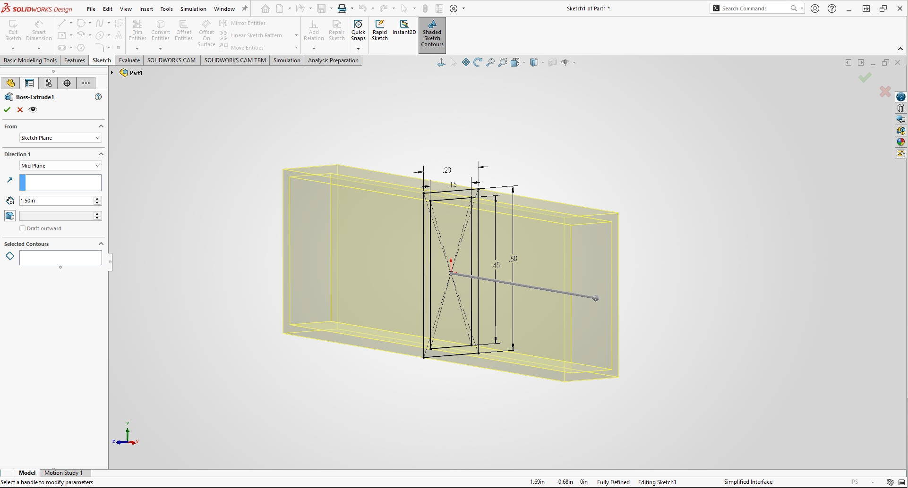
  <figcaption> Showing the first screenshot</figcaption>
</figure>    

Afterwards We extruded another part for the slider to be able to rest on when selecting numbers as shown below, this was needed so the slider couldn't go 
farther than what we needed to go. 

<figure>
  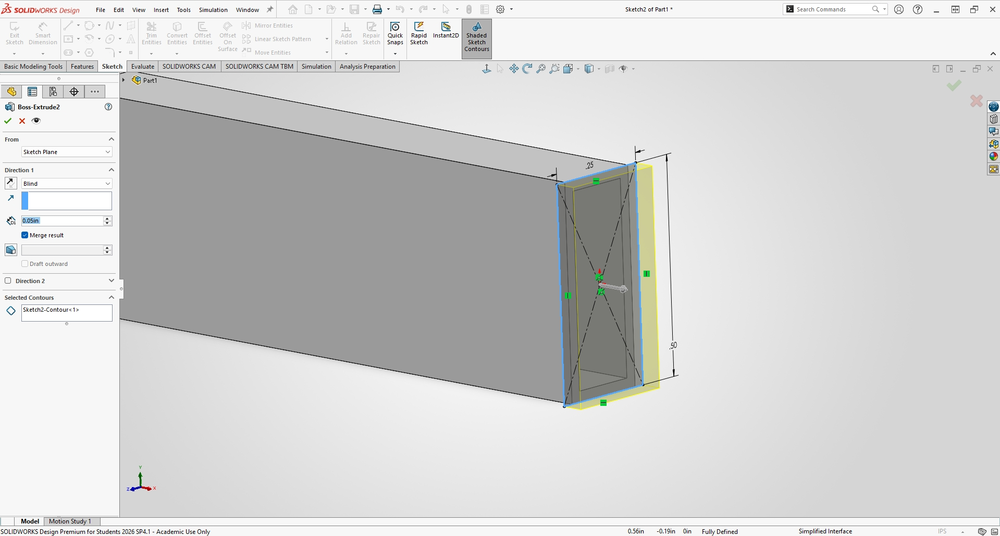
  <figcaption> Showing the second screenshot</figcaption>
</figure>   

Then we Did the same for the other side just to in sure the slider wouldn't fall apart, again required so the slider won't be ajustiable past a certain 
distance. 

<figure>
  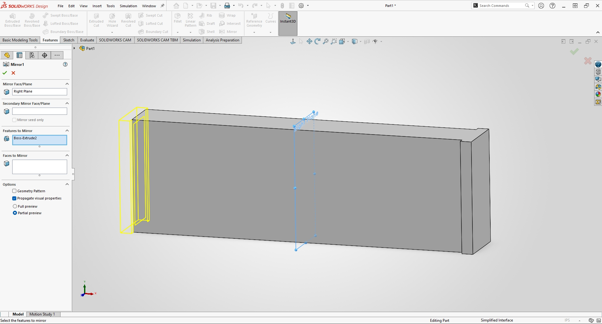
  <figcaption> Showing the third screenshot</figcaption>
</figure> 

Next we engraved the numbers onto the plate so we can keep track with our slider as shown below. 

<figure>
  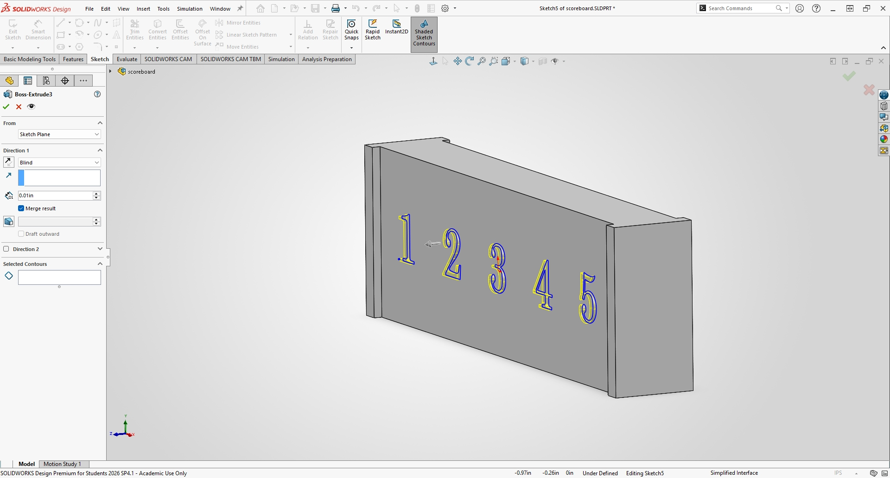
  <figcaption> Showing the forth screenshot</figcaption>
</figure> 

Lastly to finish the shaft we add boarders onto it for better appeal, as shown below. 

<figure>
  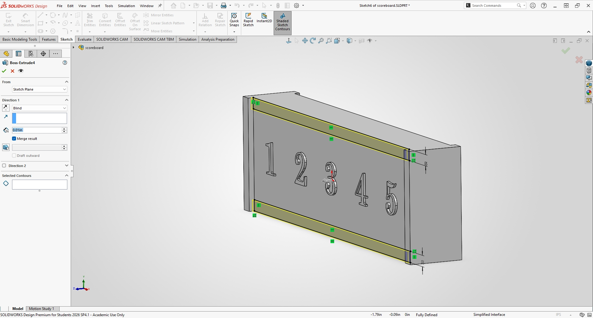
  <figcaption> Showing the fifth screenshot</figcaption>
</figure> 

Picture of the final design 

<figure>
  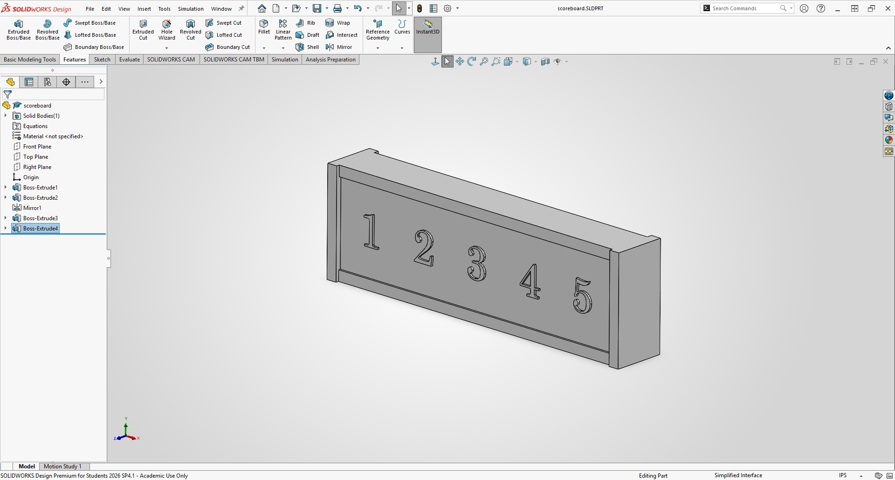
  <figcaption> Showing the sixth screenshot</figcaption>
</figure> 

## Cad Design (Part B) 

To begin we created a rectangle and extruded the upper and bottom sides so it would be able to latch onto the number slider as shown below this is our first
design.

<figure>
  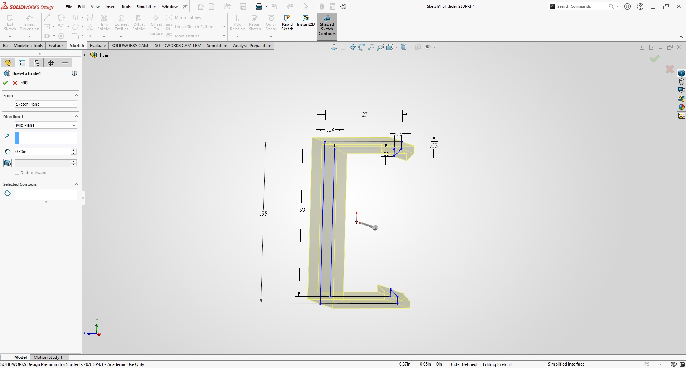
  <figcaption> Showing the seventh screenshot</figcaption>
</figure> 

Next we created an extrude on the front face of this rectangle to remove material and create a way to see the other numbers, as shown below. 

<figure>
  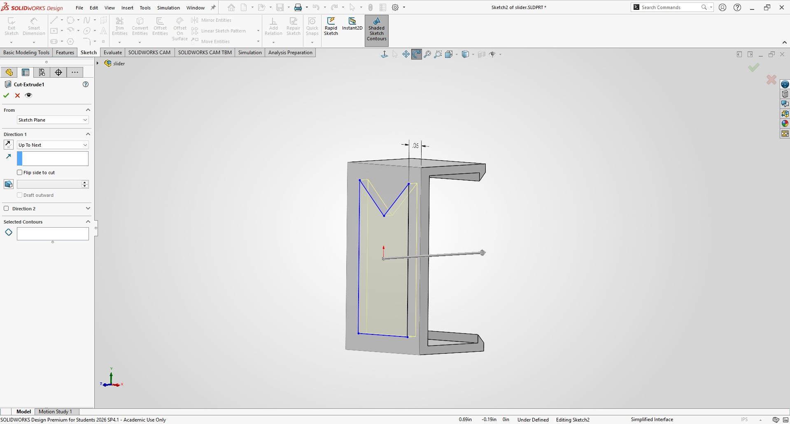
  <figcaption> Showing the eight screenshot</figcaption>
</figure> 

After that we created a harsher lip for the slider so the latching would be more consistent as shown below.  

<figure>
  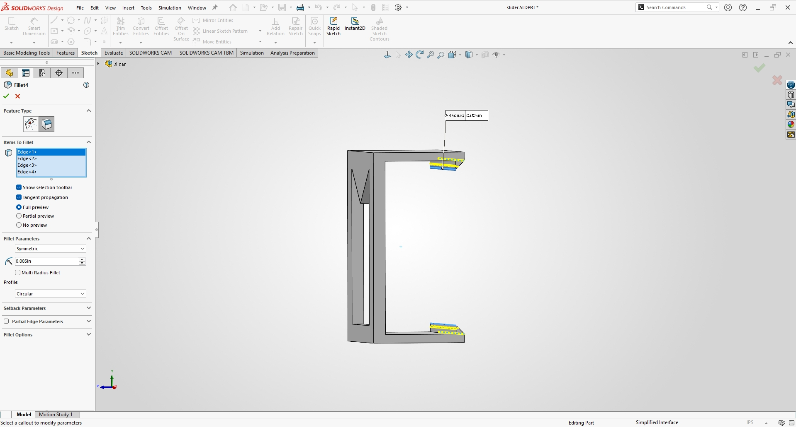
  <figcaption> Showing the ninth screenshot</figcaption>
</figure> 

Then we rounded the inside of this to release some of the stress within the part itself. 

<figure>
  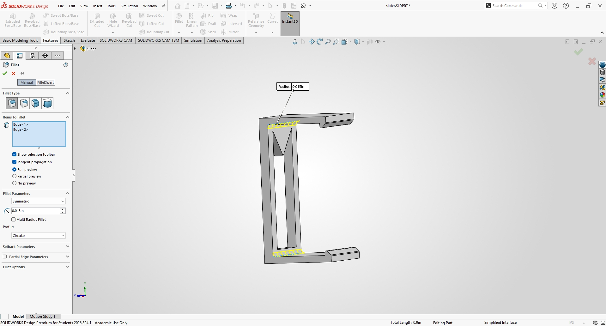
  <figcaption> Showing the tenth screenshot</figcaption>
</figure> 

Final Part design

<figure>
  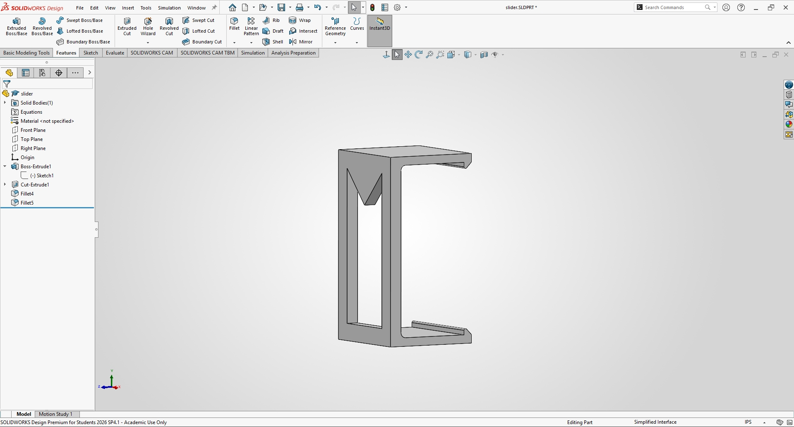
  <figcaption> Showing the tenth screenshot</figcaption>
</figure> 

Final Product design 

<figure>
  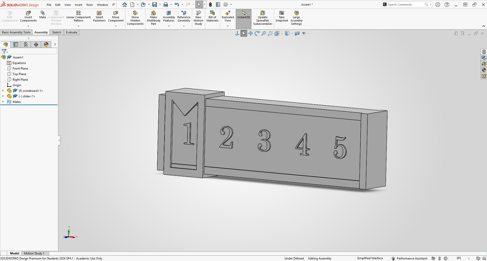
  <figcaption> Showing the tenth screenshot</figcaption>
</figure> 

## Preprocessing 

## Postprocessing 
<ul>
  <li>Washing: Cleaned in Isopropyl Alcohol (IPA > 99%) for 10 minutes in an automated wash station to strip unpolymerized surface resin.  </li>
  <li>Support Removal: Supports carefully snipped flush with diagonal cutters prior to UV curing to prevent localized stress marks on precision faces.  </li>
  <li>Curing: Post-cured in a UV chamber at 60°C for 15 minutes. </li>
  <li>Surface Finish & Inspection: Surfaces exhibited smooth matte finishes.</li>
  <li>No visible warping  was observed across the primary sliding surfaces.</li>
</ul>

## Fit test

## Lessons Learned

<ul>
  <li>A challenge we had was for accounting for resin shrinkage across enclosed internal bores versus exterior pins required iterative offset testing. Initial test prints without shrinkage compensation resulted in slight interference. One thing we learned was the need for the chafers on the part as it allowed the 
  part to endure higher stresses. ~3.5 hours (CAD modeling & tolerance stack-up: 1.5 hrs; Slicing/Printing: 2.0 hrs)</li>
</ul>

## Analyze

## Decide
_Reference your concept selection (Pugh matrix) here. How does this design follow from that decision?_

## Communicate

