# Lab #11: Snap Fit Design for SLA Printing (Form 4)

<small>***(Clicking on the images will enlarge them)***</small>

## Research and Planning

Snap-fit joints rely on the elastic deflection of a cantilever beam to assemble components without fasteners or adhesives. During insertion, the cantilever arm deflects along an angled ramp until the locking hook reaches its retention window, snapping securely into place. 

For my design, I developed a modular everyday-carry (EDC) quick-release strap buckle featuring a dual cantilever plug (`male_snap`) and a matching receptacle housing (`female_snap`), alongside a plunger and tube mechanism. Using Formlabs Grey V5 Photopolymer Resin on the Form 4, I evaluated structural feasibility using cantilever beam mechanics. The key design parameters include:
- **Cantilever Length ($L$):** $1.50\text{ inches}$
- **Root Thickness ($t_{root}$):** $0.35\text{ inches}$
- **Tip Thickness ($t_{tip}$):** $0.15\text{ inches}$
- **Extrusion Width / Model Thickness ($b$):** $0.25\text{ inches}$
- **Required Deflection ($\delta$):** $0.035\text{ inches}$ (Locking hook protrusion height / undercut depth)

To ensure the plastic does not undergo permanent plastic deformation or fracture during actuation, I calculated the maximum outer fiber strain ($\epsilon$) at the fixed root of the cantilever beam:

$$\epsilon = \frac{3 \cdot t_{root} \cdot \delta}{2 L^2} = \frac{3 \cdot (0.35\text{ in}) \cdot (0.35\text{ in})}{2 \cdot (1.50\text{ in})^2} \approx 0.00817\text{ (or } 0.82\%\text{)}$$

An estimated bending strain of $0.82\%$ sits comfortably within a safe working range for rigid engineering SLA resins when paired with a smooth **$0.075\text{ in}$ root fillet radius** to eliminate stress concentrations at the base. Furthermore, a precise clearance offset of **$0.010\text{ in}$** was integrated into the internal sliding walls to ensure smooth assembly without post-cure binding.

---

## Part 2: Parametric Design Steps

The design was modeled in SolidWorks utilizing master parametric equations and global variables (e.g., `L = 1.5in`, `T_Root = 0.35in`, `Deflection = 0.035in`), ensuring that any future design iterations or scaling adjustments automatically update across all linked sketches and extrusions.

  <figure style="display: inline-block; margin: 10px; vertical-align: top;">
    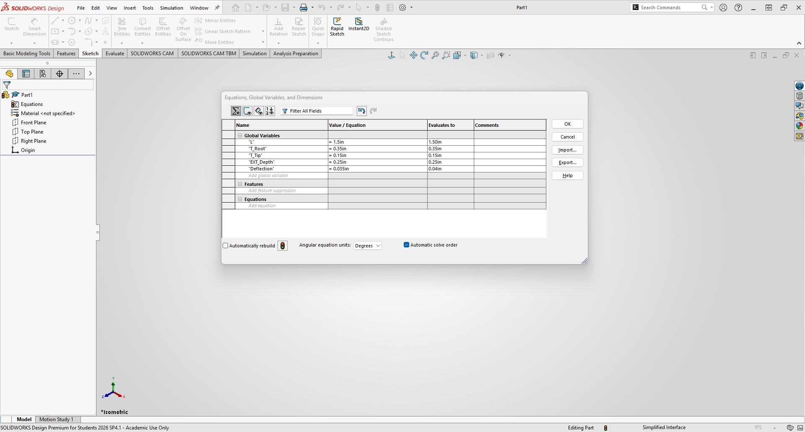
    <figcaption style="font-size: 0.85em; color: gray; margin-top: 5px;">
      Defining Parametric Global Variables and Equations in SolidWorks
    </figcaption>
  </figure>

### 1. Modeling the Male Plug (`male_snap`)
I started by sketching the master profile of the male plug on the Front Plane, linking dimensions directly to the global variables for length ($1.50\text{ in}$), root thickness taper, and locking hook geometry:

  <figure style="display: inline-block; margin: 10px; vertical-align: top;">
    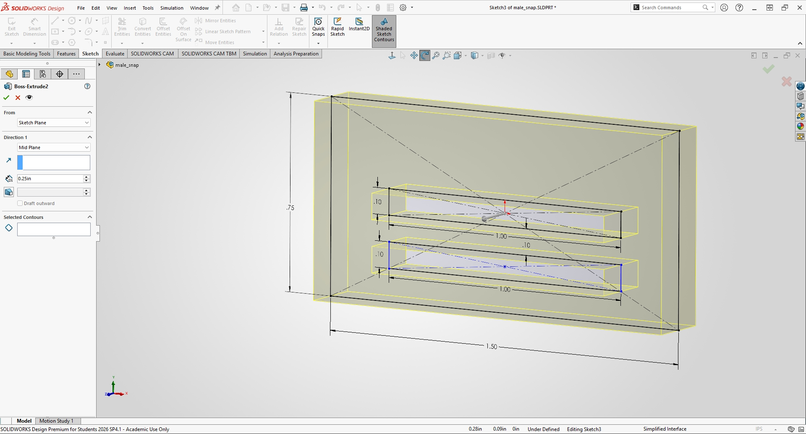
    <figcaption style="font-size: 0.85em; color: gray; margin-top: 5px;">
      Master profile and webbing slot layout for the male plug (`male_snap`)
    </figcaption>
  </figure>
  <figure style="display: inline-block; margin: 10px; vertical-align: top;">
    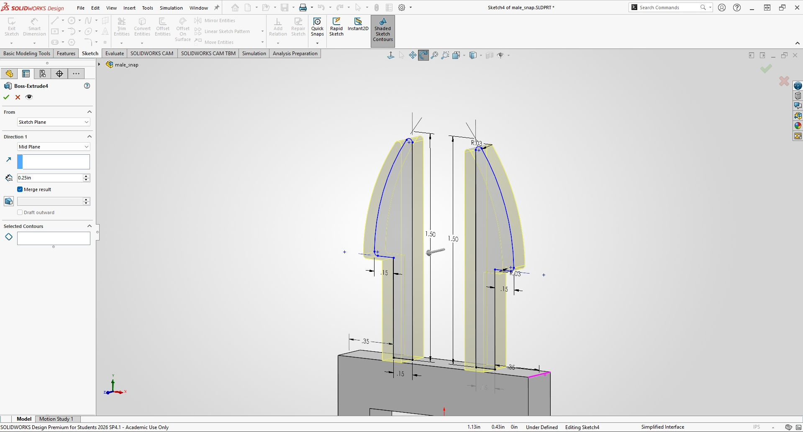
    <figcaption style="font-size: 0.85em; color: gray; margin-top: 5px;">
      Cantilever arm thickness taper and locking hook profile
    </figcaption>
  </figure>

Afterwards, I extruded the profile symmetrically (Mid Plane) to an overall model extrusion depth of **$0.25\text{ in}$** (`EXT_Depth`), incorporating a central slot cut to separate the dual independent flexing arms:

  <figure style="display: inline-block; margin: 10px; vertical-align: top;">
    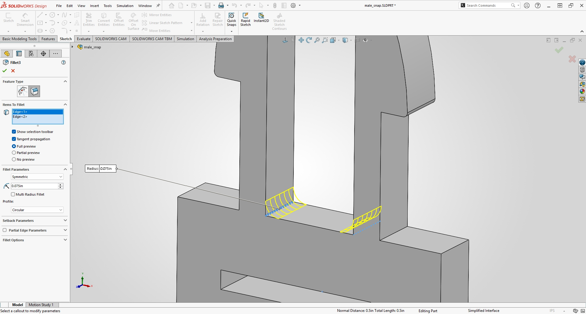
    <figcaption style="font-size: 0.85em; color: gray; margin-top: 5px;">
      Applying $0.075\text{ in}$ root fillets to eliminate stress concentrations
    </figcaption>
  </figure>
  <figure style="display: inline-block; margin: 10px; vertical-align: top;">
    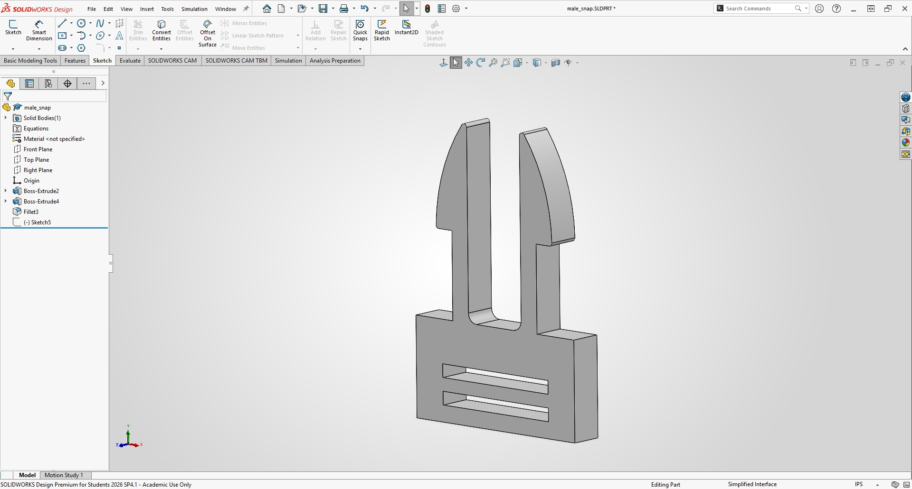
    <figcaption style="font-size: 0.85em; color: gray; margin-top: 5px;">
      Completed male plug model with dual 1.0-inch webbing slots
    </figcaption>
  </figure>

### 2. Modeling the Female Socket (`female_snap`)
To model Part B (the female receptacle housing), I sketched the outer boundary envelope ($1.50\text{ in}$ width $\times$ $2.20\text{ in}$ height) and cut the internal sliding cavity:

  <figure style="display: inline-block; margin: 10px; vertical-align: top;">
    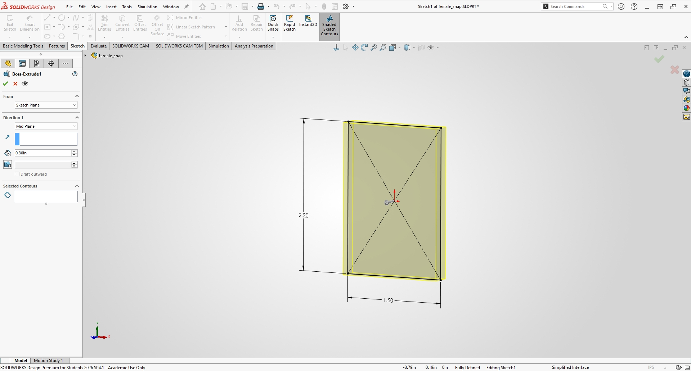
    <figcaption style="font-size: 0.85em; color: gray; margin-top: 5px;">
      Initial outer housing envelope sketch for the female socket
    </figcaption>
  </figure>
  <figure style="display: inline-block; margin: 10px; vertical-align: top;">
    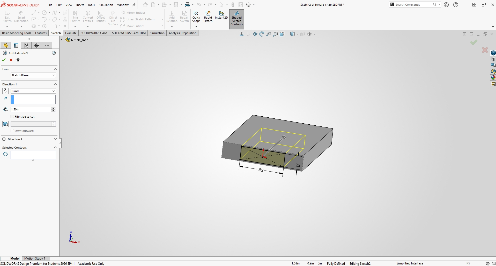
    <figcaption style="font-size: 0.85em; color: gray; margin-top: 5px;">
      Internal cavity cut engineered with precise sliding clearances
    </figcaption>
  </figure>

Next, I added the lateral retention windows for the snap hooks and the rear strap slots, finishing the housing with smooth outer edge fillets:

  <figure style="display: inline-block; margin: 10px; vertical-align: top;">
    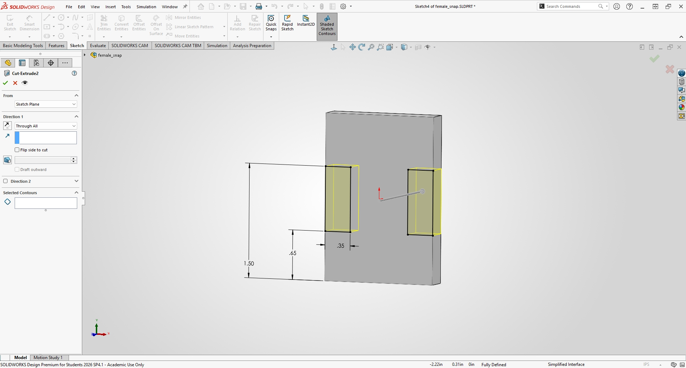
    <figcaption style="font-size: 0.85em; color: gray; margin-top: 5px;">
      Retention windows and rear webbing slots cut into the housing
    </figcaption>
  </figure>
  <figure style="display: inline-block; margin: 10px; vertical-align: top;">
    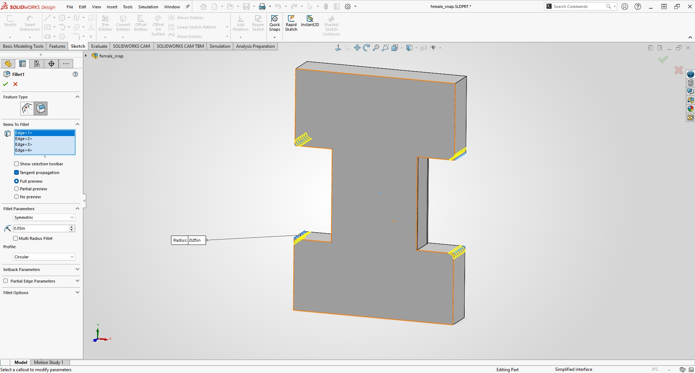
    <figcaption style="font-size: 0.85em; color: gray; margin-top: 5px;">
      Completed female socket model (`female_snap`) with edge fillets
    </figcaption>
  </figure>

### 3. Assembly Validation (`snap_assembly`)
I brought both parts into an assembly file and mated them to verify kinematics and alignment. Section views confirmed that the snap hooks clear the entry walls and seat flush against the retention shoulders without bottoming out:

  <figure style="display: inline-block; margin: 10px; vertical-align: top;">
    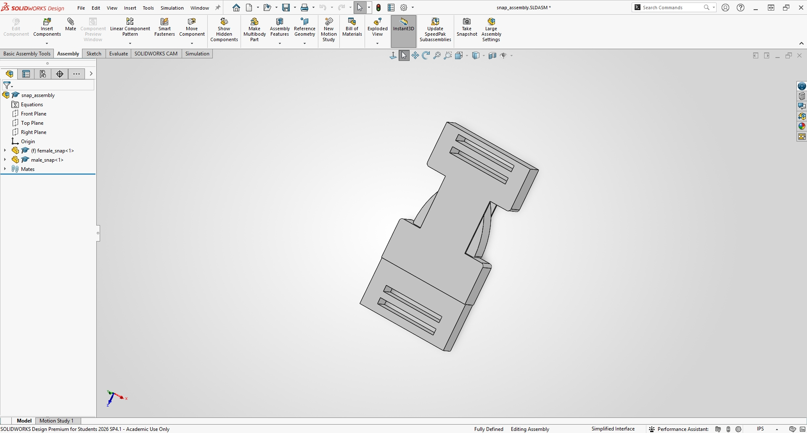
    <figcaption style="font-size: 0.85em; color: gray; margin-top: 5px;">
      Full product assembly (`snap_assembly`) verifying engagement travel and alignment
    </figcaption>
  </figure>

---

## Part 3: 3D Printing and Test

Preprocessing and slice configuration were managed in **Formlabs PreForm** for high-precision SLA fabrication. In accordance with the course requirement that 2–3 student projects share a single build plate, my build layout successfully ganged my complete multi-part project components (`female_snap`, `male_snap`, `plunger`, and `tube`) onto a shared build platform alongside other student projects:

  <figure style="display: inline-block; margin: 10px; width: 50%; vertical-align: top;">
    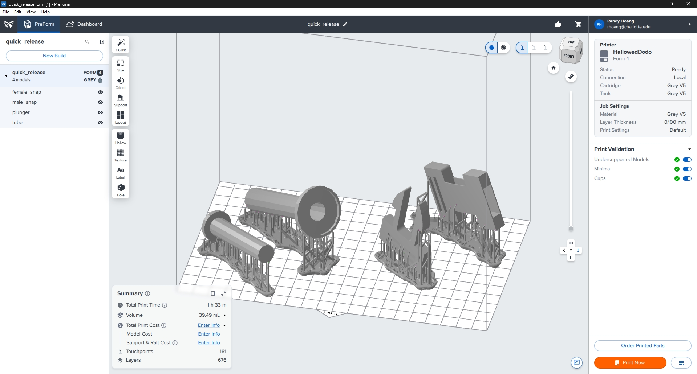
    <figcaption style="font-size: 0.85em; color: gray; margin-top: 5px;">
      PreForm layout showing shared build plate arrangement, orientation tilt, 181 touchpoints, and total volume ($39.49\text{ mL}$)
    </figcaption>
  </figure>

### PreForm Parameters
- **Machine Name:** Formlabs Form 4 SLA Printer (`HallowedDodo`)
- **Material:** Formlabs Grey V5 Resin
- **Layer Height:** $0.100\text{ mm}$ ($100\text{ microns}$)
- **Build Orientation:** Tilted at approximately $35^\circ$ to minimize cross-sectional peel forces against the resin tank film and prevent stair-stepping artifacts.
- **Support Settings:** 181 auto-generated touchpoints configured strictly away from functional snap hooks, sliding channels, and internal undercut surfaces.
- **Estimated Print Time:** 1 hour 33 minutes across 676 total layers.
- **Total Volume:** **$39.49\text{ mL}$** (Accommodating my complete multi-part project on the shared build plate).

The video below demonstrates the 3D printing process in action on the Form 4 printer:

  <figure style="display: inline-block; margin: 10px; width: 50%; vertical-align: top;">
    <video width="100%" controls>
      <source src="print_process_video.mp4" type="video/mp4">
      Your browser does not support the video tag.
    </video>
    <figcaption style="font-size: 0.85em; color: gray; margin-top: 8px; text-align: center;">
      Video of the 3D printing process on the Form 4 printer
    </figcaption>
  </figure>

### Post-Processing
Post-processing involved washing, support removal, and UV thermal post-curing:

  <figure style="display: inline-block; margin: 10px; width: 50%; vertical-align: top;">
    <video width="100%" controls>
      <source src="./curing.mp4" type="video/mp4">
      Your browser does not support the video tag.
    </video>
    <figcaption style="font-size: 0.85em; color: gray; margin-top: 8px; text-align: center;">
      Video of post-curing stages in the Form Cure chamber
    </figcaption>
  </figure>

- **Washing:** Cleaned in Isopropyl Alcohol (IPA $> 99\%$) for 10 minutes in the Form Wash station to strip unpolymerized liquid resin from internal webbing slots and tight sliding clearances.
- **Support Removal:** Supports carefully snipped flush with diagonal cutters prior to UV curing to prevent localized stress marks on precision mating faces.
- **Curing:** Post-cured in the Form Cure chamber at $60^\circ\text{C}$ for 30 minutes to achieve fully cross-linked polymer chains and maximum flexural modulus.
- **Surface Finish & Inspection:** Surfaces exhibited smooth, rigid finishes with zero perceptible warping across primary sliding channels.

### Fit Test & Physical Verification
Using digital vernier calipers, key dimensions of the printed and post-cured features were recorded across multiple orientation points to evaluate compliance with snap-fit behavior.

### Photo of Actual Printed Parts

  <figure style="display: inline-block; margin: 10px; vertical-align: top;">
    
    <figcaption style="font-size: 0.85em; color: gray; margin-top: 5px;">
      Photo of the final printed quick-release buckle parts (Disconnected and Connected)
    </figcaption>
  </figure>

### Video of Actual Printed Parts

  <figure style="display: inline-block; margin: 10px; width: 50%; vertical-align: top;">
    <video width="100%" controls>
      <source src="./printed_parts_video.mp4" type="video/mp4">
      Your browser does not support the video tag.
    </video>
    <figcaption style="font-size: 0.85em; color: gray; margin-top: 8px; text-align: center;">
      Video demonstrating sliding motion and snap-fit engagement of the printed parts
    </figcaption>
  </figure>

### Caliper Measurement Summary

| Feature Dimension | Nominal Target (in) | CAD Offset Target (in) | Measured Value (Post-Cure, in) | Deviation from Nominal (in) |
| :--- | :--- | :--- | :--- | :--- |
| **Female Housing Cavity Width** | $1.5000$ | $1.5100$ | $1.5042$ | $+0.0042$ |
| **Male Plug Body Width** | $1.5000$ | $1.5000$ | $1.4988$ | $-0.0012$ |
| **Measured Assembly Clearance** | $0.0000$ | $0.0100$ | **$0.0054$** | Rigid Snap-Fit Engagement |

### Functional Verification
Upon manual assembly, the male plug slides into the female socket. The cantilever arms flex inward along the insertion ramps before snapping outward into the retention windows with a crisp, audible tactile click. While the mechanism functions properly and locks securely under axial pulling loads, physical testing revealed that the fit is currently very tight, requiring moderate manual force to connect and disconnect due to the high rigidity and surface friction of the Grey V5 resin.

---

## Lessons Learned

### Process Log

| Time Spent | What Changed |
| :--- | :--- |
| **2.0 Hours** | Cantilever beam research, strain calculations ($\epsilon \approx 0.82\%$), and parametric global variable setup ($L = 1.50\text{ in}$, $T_{root} = 0.35\text{ in}$). |
| **3.0 Hours** | CAD modeling of `male_snap` and `female_snap` in SolidWorks, parametric profile constraints, root fillets, and assembly clearance validation. |
| **3.0 Hours** | PreForm slicing layout, Formlabs Form 4 print execution ($39.49\text{ mL}$ volume across shared build plate), IPA washing, UV curing, digital caliper measurement, and final documentation. |

### Mistakes & Troubleshooting
A key observation during physical testing was that the sliding and snapping action is noticeably tight, requiring some force to connect and disconnect. This occurs because Formlabs Grey V5 is a rigid engineering resin with a high modulus of elasticity and minimal natural give compared to flexible thermoplastics like polypropylene. 

To improve future iterations and reduce insertion/removal force, I can increase the internal cavity clearance offset slightly (e.g., from $0.010\text{ in}$ to $0.012\text{ in}$ or $0.015\text{ in}$) and soften the locking shoulder angle to ease thumb-release pressure.

### Resources Used
1. SolidWorks
2. Formlabs PreForm
3. Formlabs Form 4 / Grey V5 Resin
4. Form Wash & Form Cure Stations

