# Project Part 1: Define the Problem and Rough Prototype

<small>***(Clicking on the images will enlarge them)***</small>

## Research and Theoretical Framework

To establish a rigorous engineering foundation for the travel cable winder project, key manufacturing and design methodologies were investigated prior to CAD modeling and fabrication.

### 1. The Spiral Design Process
The Spiral Design Process is an iterative engineering framework divided into four primary quadrants per cycle:
- **Planning:** Defining project objectives, functional requirements, and constraints (e.g., portable cable management, multi-material architecture, and build plate limits).
- **Risk Analysis:** Identifying potential failure modes—such as thread stripping, resin peel forces, structural brittleness, and parasitic torque transmission during cable pulls.
- **Engineering (Prototyping & Modeling):** Executing parametric CAD models in SolidWorks, defining thread profiles (`1/2-13` UNC), and setting up slicing parameters in PreForm.
- **Evaluation:** Testing physical prototypes, measuring dimensional accuracy with calipers, analyzing tribological performance, and refining tolerances.
- **Application:** This iterative spiral guided the transition from initial concept sketches to the final multi-material prototype, allowing successive loops to resolve mechanical binding and thread slippage.

### 2. FDM Anisotropy
Fused Deposition Modeling (FDM) inherently produces anisotropic mechanical properties due to directional layer-by-layer extrusion. Interlayer bonding along the build ($Z$) axis is consistently weaker than intralayer tensile strength along the raster ($X-Y$) paths. 
- **Design Impact:** For the middle guide ring (`middle_layer`), stress concentrations around the cable routing slits risk delamination if subjected to cyclic bending.
- **Mitigation Strategy:** **PETG filament** was selected over PLA. PETG provides superior inter-layer adhesion, higher impact resistance, and greater elastic deformation limits, preventing brittle fracture when cables snap against the slot walls.

### 3. SLA Resin Shrinkage & Dimensional Accuracy
Stereolithography (SLA) resin printing exhibits volumetric and linear shrinkage (typically $1\%$ to $2\%$) as monomers cross-link into polymer chains during UV laser photopolymerization.
- **Key Findings:** Shrinkage is heavily influenced by part geometry, hollow wall thickness, and print orientation relative to the build platform.
- **Compensation Strategies:** To counteract shrinkage and ensure smooth coaxial assembly, precise offset tolerances ($0.015\text{ in}$ to $0.025\text{ in}$ running clearance) were engineered into the mating journals and threaded features of the Formlabs Grey V5 resin caps.

### 4. Laser Cutting Kerf Compensation
Laser cutting removes material along the beam's focal path (the kerf width), which directly affects press-fit and sliding joint tolerances.
- **Compensation Strategy:** While our final prototype relies on FDM and SLA, kerf compensation principles were evaluated for slot dimensions: accounting for half the beam width on internal vs. external cut profiles ensures tight, friction-locked or sliding joints without dimensional drift.

---

## Problem Definition & Selection

### Alternative Problem Definitions (3 Minimum)
1. **Travel Cable Tangling:** Tangled charging and headphone cords in backpacks create daily frustration, knotting, and strain on internal conductor wires.
2. **Hardware Organization:** Loose machine screws, nuts, and washers in mobile workshop bins mix, causing time loss during assembly.
3. **Drafting Tool Storage:** Loose scales, pencils, and erasers roll around in backpacks, leading to broken lead and damaged equipment.

### Problem Selection & Justification
**Selected Problem:** Problem #1 (Travel Cable Tangling). 
- **Justification:** This is a universal, recurring real-world problem experienced personally during travel. It presents an ideal engineering challenge solvable through a multi-material manufacturing approach—leveraging the rigidity of SLA resin for structural threads and the elasticity of FDM PETG for flexible cable retention slots.

*Note on Build Plate Constraints:* While project guidelines initially specified limiting SLA prints to $1/4$ of the Form 4 build plate, functional component sizing, wall thickness requirements, and structural integrity for the threaded shafts necessitated exceeding this initial plate allocation to ensure mechanical reliability.

---

## Concept Development & Parametric Modeling

Initial conceptual sketches explored various winding mechanisms before converging on a coaxial threaded cap design with a free-floating middle spool. The design was modeled entirely in **SolidWorks**, utilizing parametric equations and global variables.

  <figure style="display: inline-block; margin: 10px; vertical-align: top;">
    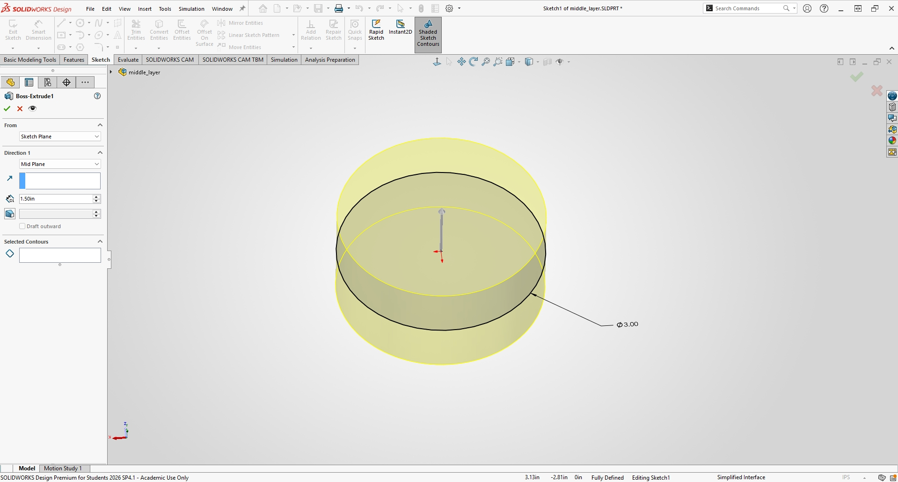
    <figcaption style="font-size: 0.85em; color: gray; margin-top: 5px;">
      Master sketch and outer diameter ($3.00\text{ in}$) definition for the middle guide ring
    </figcaption>
  </figure>
  <figure style="display: inline-block; margin: 10px; vertical-align: top;">
    
    <figcaption style="font-size: 0.85em; color: gray; margin-top: 5px;">
      Applying $0.20\text{ in}$ edge fillets and internal stepped flange recesses
    </figcaption>
  </figure>

### 1. Modeling the Middle Guide Ring (`middle_layer`)
Designed with a $1.50\text{ in}$ width and dual $0.18\text{ in}$ cable routing slits cut through both sides:

  <figure style="display: inline-block; margin: 10px; vertical-align: top;">
    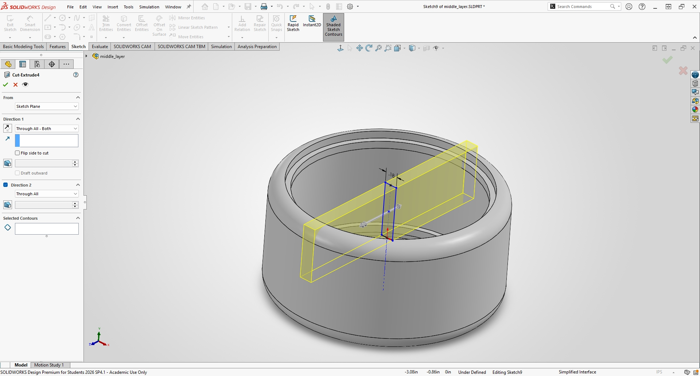
    <figcaption style="font-size: 0.85em; color: gray; margin-top: 5px;">
      Cutting $0.18\text{ in}$ cable routing slots through the PETG ring walls
    </figcaption>
  </figure>
  <figure style="display: inline-block; margin: 10px; vertical-align: top;">
    
    <figcaption style="font-size: 0.85em; color: gray; margin-top: 5px;">
      Completed middle guide ring (`middle_layer.SLDPRT`) ready for FDM slicing
    </figcaption>
  </figure>

### 2. Modeling the Female Outer Cap (`female_outer`)
Incorporates a $2.57\text{ in}$ flange base, a $1.30\text{ in}$ central post, and a tapped `1/2-13` UNC thread profile with reinforcing chamfers:

  <figure style="display: inline-block; margin: 10px; vertical-align: top;">
    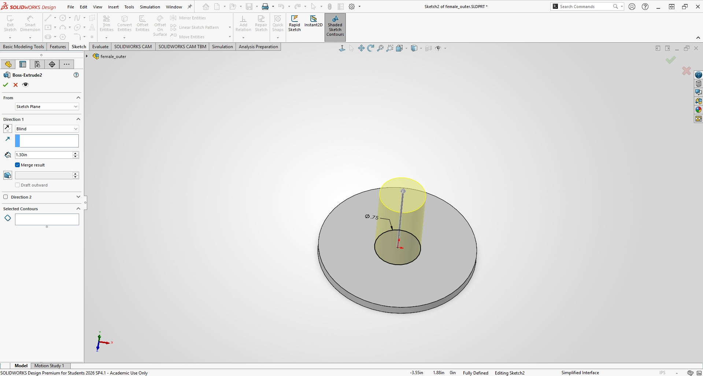
    <figcaption style="font-size: 0.85em; color: gray; margin-top: 5px;">
      Extruding the central cylindrical post ($\varnothing 0.75\text{ in}$) on the female cap
    </figcaption>
  </figure>
  <figure style="display: inline-block; margin: 10px; vertical-align: top;">
    
    <figcaption style="font-size: 0.85em; color: gray; margin-top: 5px;">
      Applying the `1/2-13` inch tap thread feature with a $0.425\text{ in}$ depth
    </figcaption>
  </figure>

### 3. Modeling the Male Outer Cap (`male_outer`)
Features an external `0.5000-13` die thread stud and a thread relief undercut for secure shoulder seating:

  <figure style="display: inline-block; margin: 10px; vertical-align: top;">
    
    <figcaption style="font-size: 0.85em; color: gray; margin-top: 5px;">
      Extruding the male threaded stud ($\varnothing 0.50\text{ in}$)
    </figcaption>
  </figure>
  <figure style="display: inline-block; margin: 10px; vertical-align: top;">
    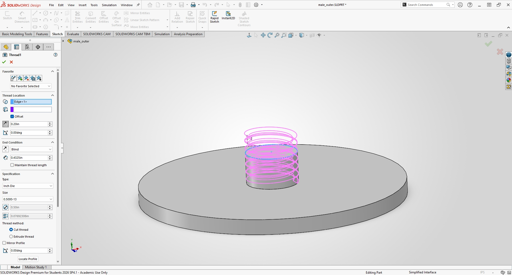
    <figcaption style="font-size: 0.85em; color: gray; margin-top: 5px;">
      Executing the `0.5000-13` Inch Die thread feature on the male stud
    </figcaption>
  </figure>

### 4. Assembly Integration (`cable_wind`)
The fully mated assembly verifies coaxial alignment and running clearance:

  <figure style="display: inline-block; margin: 10px; vertical-align: top;">
    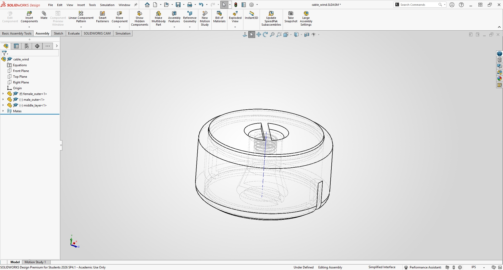
    <figcaption style="font-size: 0.85em; color: gray; margin-top: 5px;">
      Fully mated SolidWorks assembly (`cable_wind.SLDASM`) showing component stacking
    </figcaption>
  </figure>

---

## 3D Printing, Testing, and Video Presentation

### 1. FDM Slicing & Parameters (`middle_layer`)
Build preparation for the FDM middle guide ring was executed in **PrusaSlicer**:

  <figure style="display: inline-block; margin: 10px; width: 60%; vertical-align: top;">
    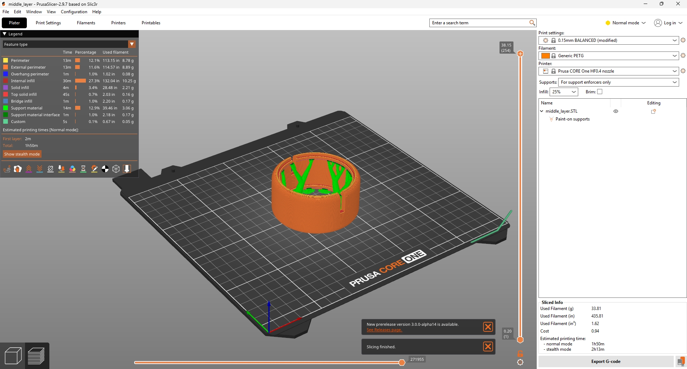
    <figcaption style="font-size: 0.85em; color: gray; margin-top: 5px;">
      PrusaSlicer layout for `middle_layer.STL` on the Prusa CORE One printer using Generic PETG ($0.15\text{ mm}$ Balanced profile, $25\%$ infill, and auto-generated supports consuming $33.81\text{ g}$ / $1\text{h }50\text{m}$ print time)
    </figcaption>
  </figure>

- **Printer:** Prusa CORE One (0.4 mm nozzle)
- **Material:** Generic PETG
- **Layer Height:** $0.15\text{ mm}$ BALANCED (modified)
- **Infill:** $25\%$ Grid
- **Supports:** For support enforcers only / Paint-on supports ($3.06\text{ g}$ support material)
- **Total Estimated Print Time:** 1 hour 50 minutes ($33.81\text{ g}$ total filament usage)

### 2. SLA Slicing & Parameters (Outer Caps)
Build preparation for the SLA outer caps was handled in **Formlabs PreForm**, organizing the layout and supports on the Form 4 printer.

  <figure style="display: inline-block; margin: 10px; width: 50%; vertical-align: top;">
    
    <figcaption style="font-size: 0.85em; color: gray; margin-top: 5px;">
      PreForm layout for SLA outer caps showing orientation, 582 touchpoints, and total volume ($52\text{ mL}$)
    </figcaption>
  </figure>

- **Machine Name:** Formlabs Form 4 SLA Printer (`HallowedDodo`)
- **Material:** Formlabs Grey V5 Resin
- **Layer Height:** $0.100\text{ mm}$ ($100\text{ microns}$)
- **Build Orientation:** Tilted at an optimized angle to minimize peel forces on the resin tank.
- **Support Settings:** 582 auto-generated touchpoints placed away from threaded profiles.
- **Total Volume:** **$52\text{ mL}$** (Including necessary support structures, and exceeding the initial $1/4$ plate constraint to accommodate robust thread walls).

### Printing Process & Machine Setup
The printer setups and active fabrication are captured below:

  <figure style="display: inline-block; margin: 10px; vertical-align: top;">
    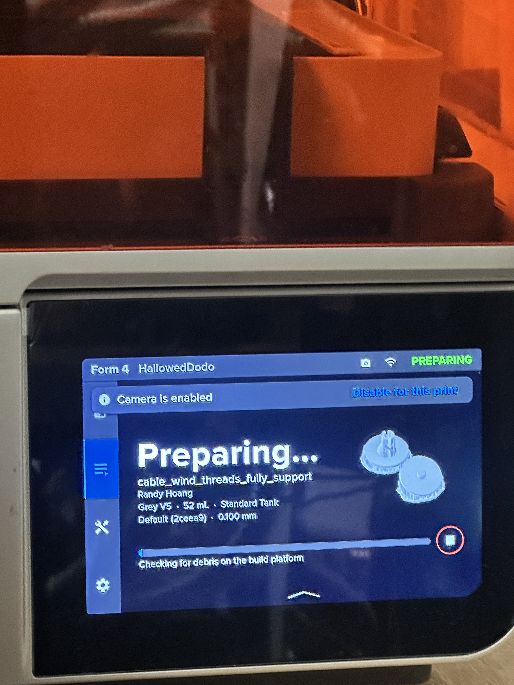
    <figcaption style="font-size: 0.85em; color: gray; margin-top: 5px;">
      Form 4 touch display preparing print job (`cable_wind_threads_fully_support`)
    </figcaption>
  </figure>
  <figure style="display: inline-block; margin: 10px; vertical-align: top;">
    <video width="350" controls preload="metadata" playsinline>
      <source src="sla_printing.MOV" type="video/mp4">
      Your browser does not support the video tag.
    </video>
    <figcaption style="font-size: 0.85em; color: gray; margin-top: 5px;">
      Form 4 SLA printing process in action
    </figcaption>
  </figure>

### Post-Processing (Washing & Curing)
After printing, components underwent washing and curing:

  <figure style="display: inline-block; margin: 10px; width: 50%; vertical-align: top;">
    <video width="100%" controls preload="metadata" playsinline>
      <source src="sla_curing.mp4" type="video/mp4">
      Your browser does not support the video tag.
    </video>
    <figcaption style="font-size: 0.85em; color: gray; margin-top: 8px; text-align: center;">
      Post-curing process in the Form Cure chamber
    </figcaption>
  </figure>

- **Washing:** Cleaned in Isopropyl Alcohol (IPA $>91\%$) for 5 minutes in the Form Wash station.
- **Curing:** Post-cured in the Form Cure chamber at $60^\circ\text{C}$ for 30 minutes.
- **FDM Fabrication:** Middle ring fabricated in PETG filament for optimal elastic flexibility.

### Photos of Printed Components

  <figure style="display: inline-block; margin: 10px; vertical-align: top;">
    
    <figcaption style="font-size: 0.85em; color: gray; margin-top: 5px;">
      Fabricated SLA resin outer caps featuring precision `1/2-13` threads
    </figcaption>
  </figure>
  <figure style="display: inline-block; margin: 10px; vertical-align: top;">
    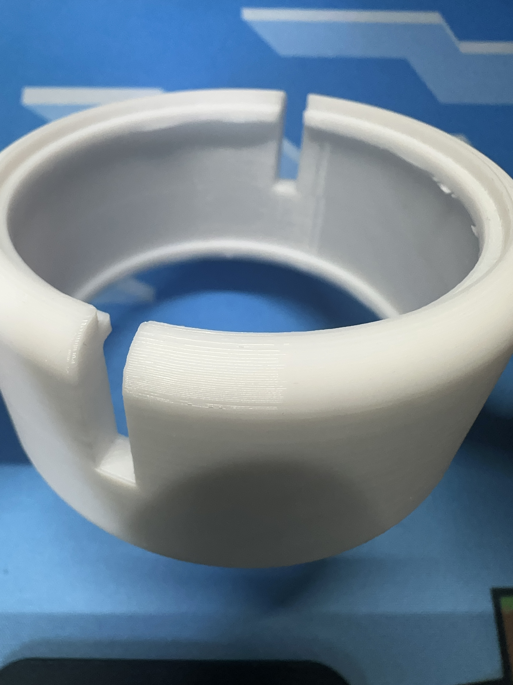
    <figcaption style="font-size: 0.85em; color: gray; margin-top: 5px;">
      FDM PETG middle guide ring with integrated cable slits
    </figcaption>
  </figure>

### Functional Testing & Tribology Verification
Initial testing and winding evaluation were recorded to verify smooth operation:

  <figure style="display: inline-block; margin: 10px; width: 50%; vertical-align: top;">
    <video width="100%" controls preload="metadata" playsinline>
      <source src="wind_testing.mp4" type="video/mp4">
      Your browser does not support the video tag.
    </video>
    <figcaption style="font-size: 0.85em; color: gray; margin-top: 8px; text-align: center;">
      Functional cable winding and pull test evaluation
    </figcaption>
  </figure>

Initial testing revealed that when a cable snagged during rapid pulls, frictional drag transmitted parasitic torque through the pinched PETG ring, inadvertently screwing or unscrewing the coaxial threads. 
- **The Mechanical Fix:** Implemented an axial running clearance gap ($0.015\text{ in}$ to $0.025\text{ in}$) on the central bearing journal. When outer caps bottom out against each other rather than clamping the middle ring, it floats freely and spins independently.

### 30-Second Video Presentation

  <figure style="display: inline-block; margin: 10px; width: 50%; vertical-align: top;">
    <video width="100%" controls preload="metadata" playsinline>
      <source src="part1-video.mp4" type="video/mp4">
      Your browser does not support the video tag.
    </video>
    <figcaption style="font-size: 0.85em; color: gray; margin-top: 8px; text-align: center;">
      Video Presentation
    </figcaption>
  </figure>

---

## Lessons Learned & Reflection

### Process Log

| Time Spent | What Changed |
| :--- | :--- |
| **2.5 Hours** | Spiral Design Process research, problem definition (3 options), conceptual sketching, and build constraint evaluation. |
| **4.0 Hours** | SolidWorks parametric modeling of `middle_layer`, `female_outer`, and `male_outer` with custom `1/2-13` threads and clearances. |
| **3.5 Hours** | PreForm layout, Form 4 SLA printing ($51.46\text{ mL}$), IPA wash, cure, FDM PETG printing, assembly testing, and parasitic torque troubleshooting. |

### Mistakes & Troubleshooting
- **Build Plate Constraint:** Exceeding the initial $1/4$ SLA plate constraint was necessary to provide adequate wall thickness around the threaded posts and prevent resin peel failures.
- **Support Volume Consideration:** Accounting for the required auto-generated support structures brought total resin consumption to approximately $52\text{ mL}$, highlighting the importance of optimizing orientation to minimize unnecessary support mass.
### Resources Used
1. SolidWorks
2. Formlabs PreForm & Form 4 SLA Printer (Grey V5 Resin)
3. FDM 3D Printer (PETG Filament)
4. Form Wash & Form Cure Stations
5. YouTube Reference Tutorials:
   - [How To 3D Print Perfect Threads: A Step By Step Guide](https://www.youtube.com/watch?v=JIMfW6bMgE0)
   - [3D Printed USB Cable Reel](https://www.youtube.com/watch?v=_EzQU2ZlJFI)

# Project Part 2: Enhance the Prototype

<small>***(Clicking on the images will enlarge them)***</small>

## 1. Peer Feedback & Individual Reflections

During the Week 2 review, feedback was collected from two peers using the Sophomore Design L3D Peer Feedback Worksheets (`peer1.pdf` and `peer2.pdf`).

  <figure style="display: inline-block; margin: 10px; vertical-align: top;">
    <embed src="peer_feedback_maxwell.pdf" type="application/pdf" width="350" height="450">
    <figcaption style="font-size: 0.85em; color: gray; margin-top: 5px;">
      Peer feedback worksheet completed by Maxwell McFarlane (<a href="peer_feedback_maxwell.pdf">peer_feedback_maxwell.pdf</a>)
    </figcaption>
  </figure>
  <figure style="display: inline-block; margin: 10px; vertical-align: top;">
    <embed src="peer_feedback_atiba.pdf" type="application/pdf" width="350" height="450">
    <figcaption style="font-size: 0.85em; color: gray; margin-top: 5px;">
      Peer feedback worksheet completed by Atiba Johnson (<a href="peer_feedback_atiba.pdf">peer_feedback_atiba.pdf</a>)
    </figcaption>
  </figure>

### Peer Feedback Summary
- **Maxwell McFarlane (`peer_feedback_maxwell.pdf`):**
  - *Clarity & Functionality:* Noted that the problem statement and proposed design solution are clear and functional, with minimal tolerance concerns.
  - *Creativity & UX:* Commended the circular three-piece layout and recommended incorporating a handle—specifically a larger handle to improve turning leverage.
  - *Iteration Focus:* Emphasized refining handle/grip ergonomics and accommodating varying cable slot thicknesses.
- **Atiba Johnson (`peer_feedback_atiba.pdf`):**
  - *Clarity & Functionality:* Confirmed that the cord-tangling problem and proposed solution align well with the selected manufacturing processes, identifying resin printing and handling as primary considerations.
  - *Creativity & UX:* Identified the crank/winding mechanism as an intuitive and creative feature, suggesting improvements to reduce frame crowding and support multiple cables rather than a single cord at a time.
  - *Iteration Focus:* Recommended multi-cable capability, faster cranking/winding mechanics, and improved overall ergonomics.

### Individual Reflection
Reviewing both worksheets confirmed that while the core cord-management problem and multi-material strategy were well received, the initial prototype remained overly bulky and limited in practical everyday use. Feedback from Maxwell and Atiba directly guided the v2 refinement direction: improving crank and grip accessibility, reducing overall profile bulk, and enabling practical multi-cable transport without jamming a single spool. Rather than forcing multiple cables into a single slot or stacking components vertically, pairing two slimmer FDM winder bodies back-to-back with a double-sided SLA threaded cap provides a clean, modular way to carry two cables in a compact travel form factor.

---

## 2. Refinement & Parametric Design

### Design Enhancements from Feedback & Testing
1. **Slimmer Overall Profile:** Dimensions and proportions from Part 1 were refined to produce a noticeably sleeker, more portable form factor while maintaining adequate structural wall thickness and thread engagement.
2. **Print-in-Place FDM Body & Crank/Slot Architecture:** The FDM print-in-place architecture was centered around a compact body (`base.SLDPRT` / `body.STL`) and contoured slotted spool (`slot.SLDPRT`) incorporating curved routing channels and smooth edge chamfers/fillets to improve cable guidance and handling.
3. **Double-Sided SLA Threaded Cap (`cap.SLDPRT` / `cap.form`):** The Formlabs Form 4 SLA component was kept compact (`21.76 mL` total volume compared to `52 mL` in Part 1), utilizing `2.5000-12` Inch Die thread geometry and three `Ø0.75 in` cutouts spaced at `120°` for component engagement and finger/grip access.
4. **SLA Shrinkage & Form 4 Build Plate Compliance:** The SLA geometry was kept compact well within roughly one-quarter of the Form 4 build plate, sliced at a `0.100 mm` layer height in Grey V5 resin with thread offset and clearance allowances (`0.025 in` on `base` and `0.15 in` on `cap`) to compensate for resin shrinkage and support smooth assembly.

### Parametric Design Feature
SolidWorks **Equations and Global Variables** were applied across the parts and assembly (`base.SLDPRT`, `cap.SLDPRT`, `slot.SLDPRT`, and `Assem1.SLDASM`), centered on a global variable `"spool_diameter"` (`1.50 in`) to govern key sizing relationships and support rapid dimensional updates while maintaining a compact profile.

  <figure style="display: inline-block; margin: 10px; width: 55%; vertical-align: top;">
    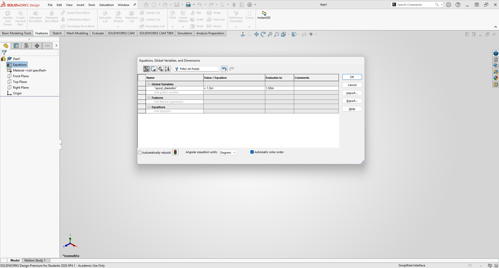
    <figcaption style="font-size: 0.85em; color: gray; margin-top: 5px;">
      SolidWorks Equations and Global Variables (&quot;spool_diameter&quot; = 1.50in) driving a slimmer, compact winder profile
    </figcaption>
  </figure>

### CAD Modeling & Slicing Progression

#### A. Base Modeling (`base.SLDPRT`)

  <figure style="display: inline-block; margin: 10px; vertical-align: top;">
    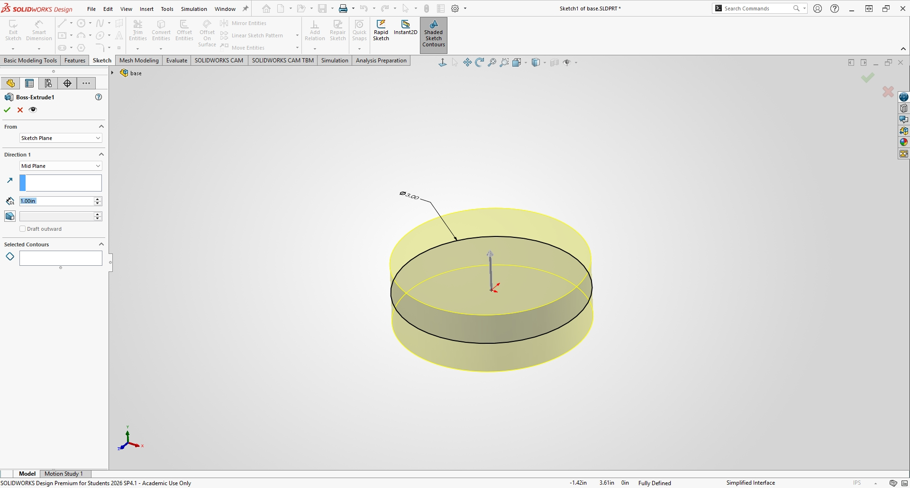
    <figcaption style="font-size: 0.85em; color: gray; margin-top: 5px;">
      Initial extrusion in `base.SLDPRT` establishing the base profile
    </figcaption>
  </figure>
  <figure style="display: inline-block; margin: 10px; vertical-align: top;">
    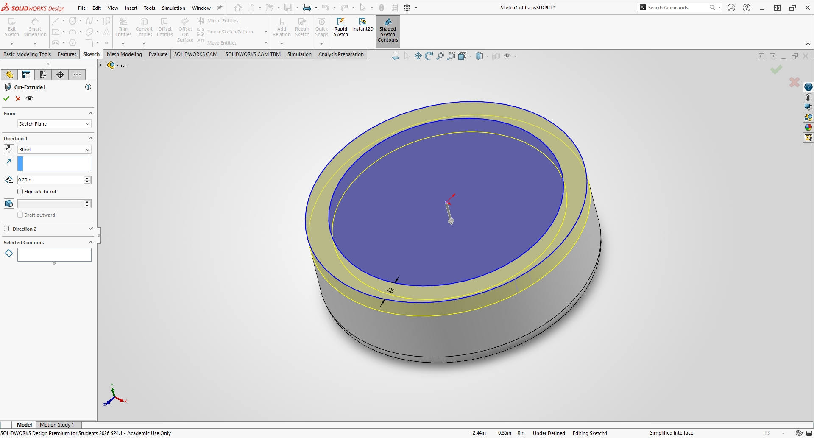
    <figcaption style="font-size: 0.85em; color: gray; margin-top: 5px;">
      Sketch and profile setup in `base.SLDPRT`
    </figcaption>
  </figure>
  <figure style="display: inline-block; margin: 10px; vertical-align: top;">
    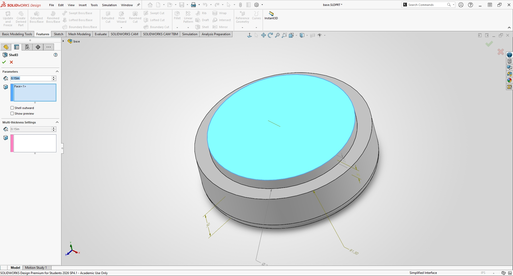
    <figcaption style="font-size: 0.85em; color: gray; margin-top: 5px;">
      Intermediate feature progression in `base.SLDPRT`
    </figcaption>
  </figure>

  <figure style="display: inline-block; margin: 10px; vertical-align: top;">
    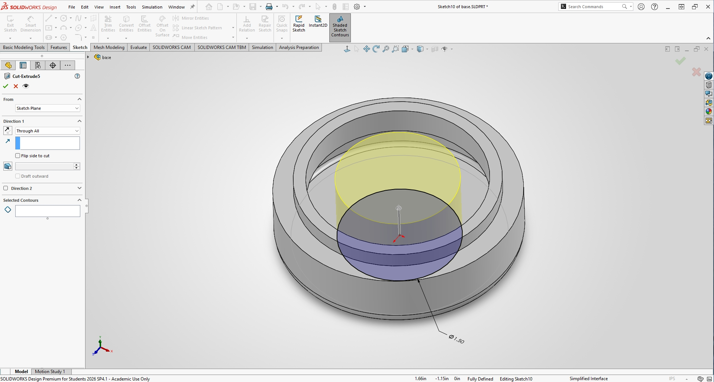
    <figcaption style="font-size: 0.85em; color: gray; margin-top: 5px;">
      Intermediate geometry refinement in `base.SLDPRT`
    </figcaption>
  </figure>
  <figure style="display: inline-block; margin: 10px; vertical-align: top;">
    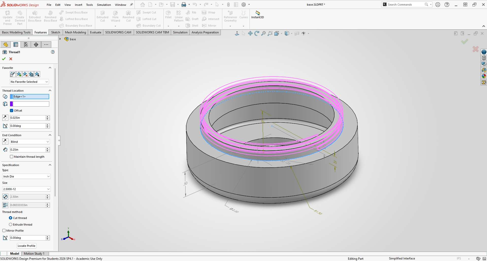
    <figcaption style="font-size: 0.85em; color: gray; margin-top: 5px;">
      `Thread1` in `base.SLDPRT` applying `2.5000-12` Inch Die threads (`0.025 in` offset, `0.25 in` blind)
    </figcaption>
  </figure>
  <figure style="display: inline-block; margin: 10px; vertical-align: top;">
    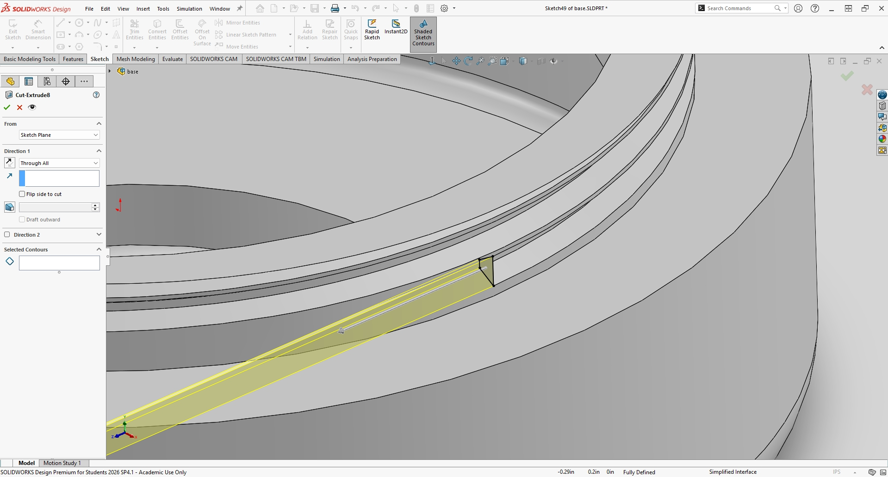
    <figcaption style="font-size: 0.85em; color: gray; margin-top: 5px;">
      Feature tree and body progression in `base.SLDPRT`
    </figcaption>
  </figure>

  <figure style="display: inline-block; margin: 10px; vertical-align: top;">
    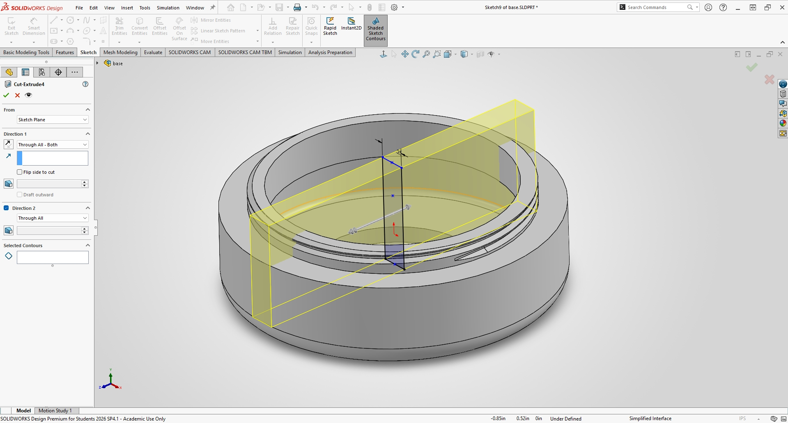
    <figcaption style="font-size: 0.85em; color: gray; margin-top: 5px;">
      Slot and collar feature progression in `base.SLDPRT`
    </figcaption>
  </figure>
  <figure style="display: inline-block; margin: 10px; vertical-align: top;">
    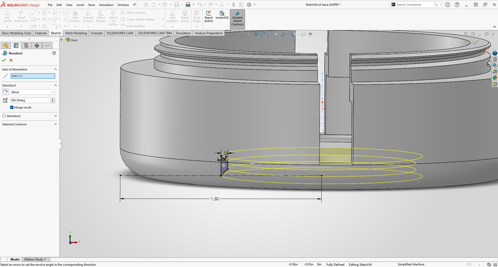
    <figcaption style="font-size: 0.85em; color: gray; margin-top: 5px;">
      Edge and clearance detailing in `base.SLDPRT`
    </figcaption>
  </figure>
  <figure style="display: inline-block; margin: 10px; vertical-align: top;">
    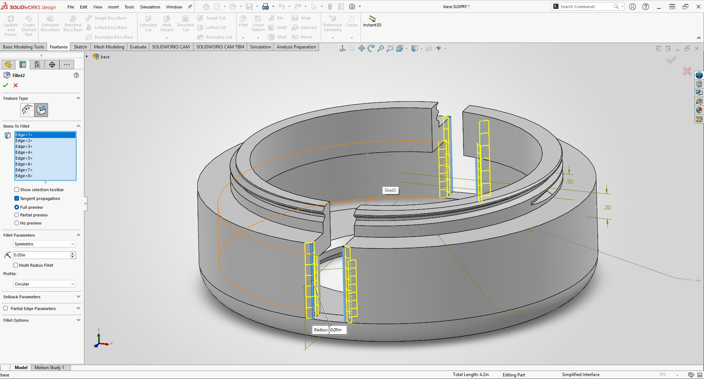
    <figcaption style="font-size: 0.85em; color: gray; margin-top: 5px;">
      Pre-completion geometry check in `base.SLDPRT`
    </figcaption>
  </figure>

  <figure style="display: inline-block; margin: 10px; width: 45%; vertical-align: top;">
    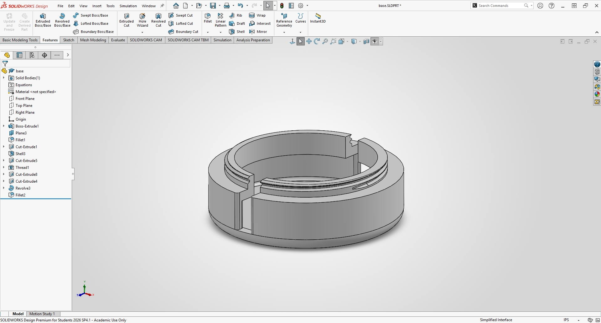
    <figcaption style="font-size: 0.85em; color: gray; margin-top: 5px;">
      Completed `base.SLDPRT` feature tree and geometry with slotted wall and threaded collar
    </figcaption>
  </figure>

#### B. Cap Modeling (`cap.SLDPRT`)

  <figure style="display: inline-block; margin: 10px; vertical-align: top;">
    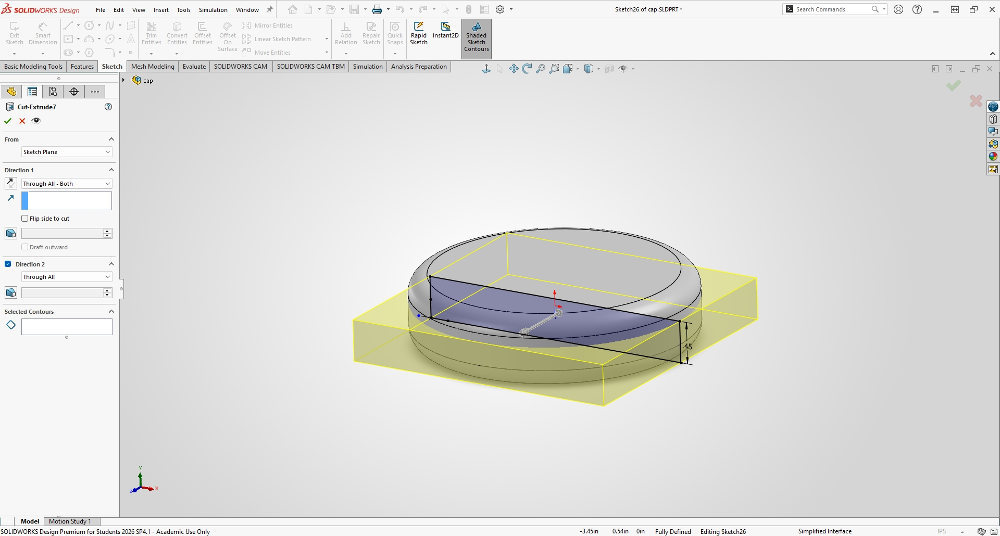
    <figcaption style="font-size: 0.85em; color: gray; margin-top: 5px;">
      Initial sketch and profile setup in `cap.SLDPRT`
    </figcaption>
  </figure>
  <figure style="display: inline-block; margin: 10px; vertical-align: top;">
    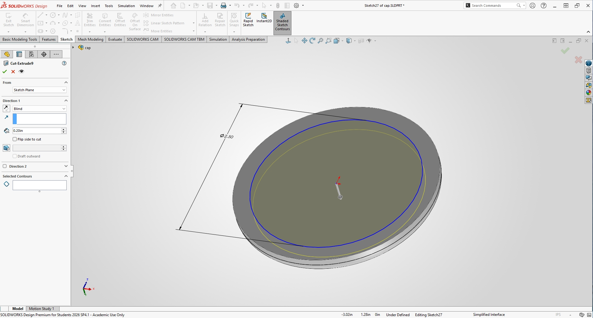
    <figcaption style="font-size: 0.85em; color: gray; margin-top: 5px;">
      Body and collar progression in `cap.SLDPRT`
    </figcaption>
  </figure>
  <figure style="display: inline-block; margin: 10px; vertical-align: top;">
    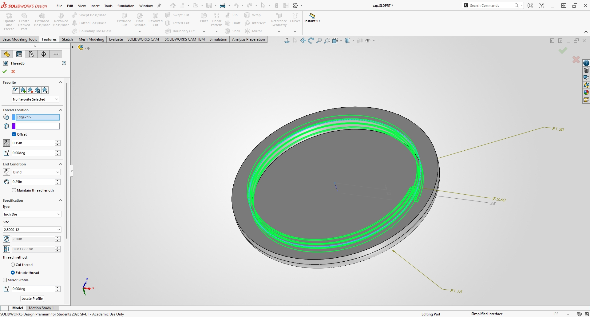
    <figcaption style="font-size: 0.85em; color: gray; margin-top: 5px;">
      `Thread5` in `cap.SLDPRT` configured with `2.5000-12` Inch Die threads (`0.15 in` offset, `0.25 in` blind)
    </figcaption>
  </figure>

  <figure style="display: inline-block; margin: 10px; vertical-align: top;">
    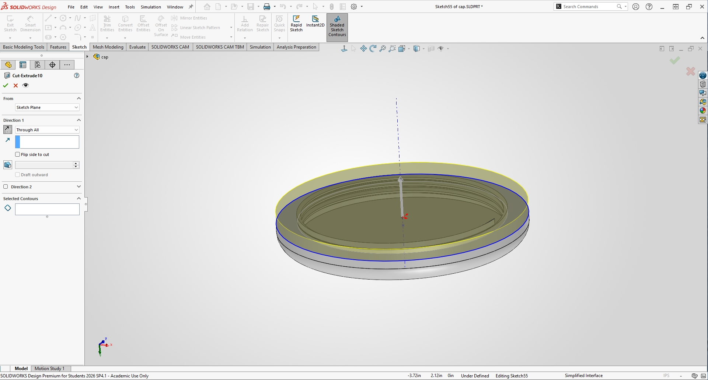
    <figcaption style="font-size: 0.85em; color: gray; margin-top: 5px;">
      Cutout layout and feature progression in `cap.SLDPRT`
    </figcaption>
  </figure>
  <figure style="display: inline-block; margin: 10px; vertical-align: top;">
    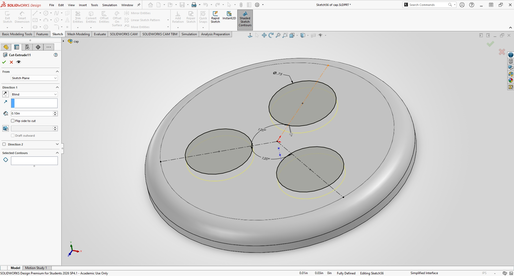
    <figcaption style="font-size: 0.85em; color: gray; margin-top: 5px;">
      `Cut-Extrude11` in `cap.SLDPRT` forming three `Ø0.75 in` cutouts spaced `120°` apart (`0.10 in` blind)
    </figcaption>
  </figure>
  <figure style="display: inline-block; margin: 10px; vertical-align: top;">
    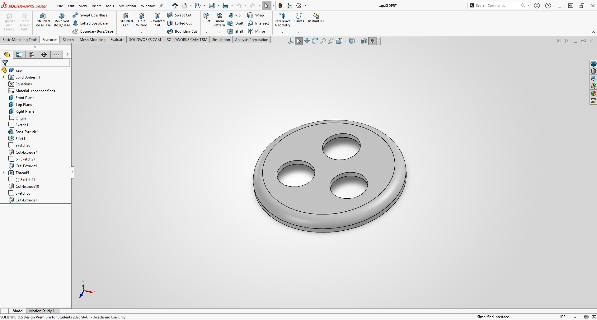
    <figcaption style="font-size: 0.85em; color: gray; margin-top: 5px;">
      Completed `cap.SLDPRT` feature tree and solid body
    </figcaption>
  </figure>

#### C. Slot Hub, Winding Mechanism & Assembly (`slot.SLDPRT` & `Assem1.SLDASM`)

  <figure style="display: inline-block; margin: 10px; vertical-align: top;">
    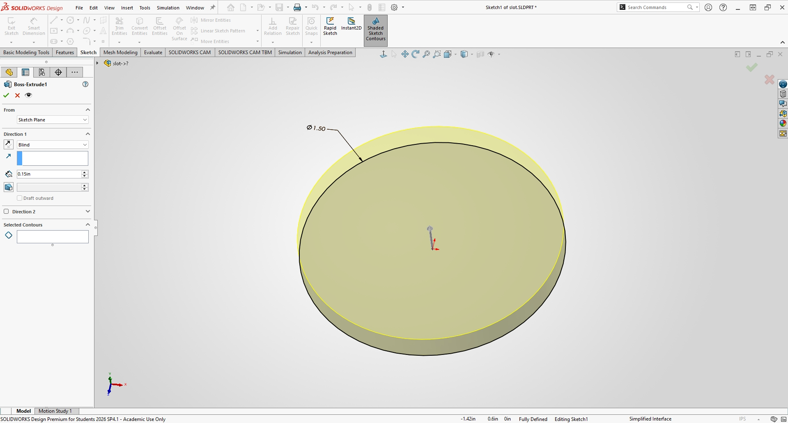
    <figcaption style="font-size: 0.85em; color: gray; margin-top: 5px;">
      Initial sketch profile in `slot.SLDPRT`
    </figcaption>
  </figure>
  <figure style="display: inline-block; margin: 10px; vertical-align: top;">
    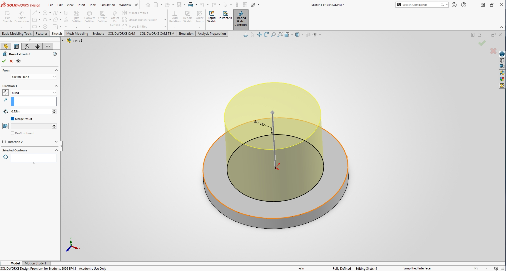
    <figcaption style="font-size: 0.85em; color: gray; margin-top: 5px;">
      Hub extrusion progression in `slot.SLDPRT`
    </figcaption>
  </figure>
  <figure style="display: inline-block; margin: 10px; vertical-align: top;">
    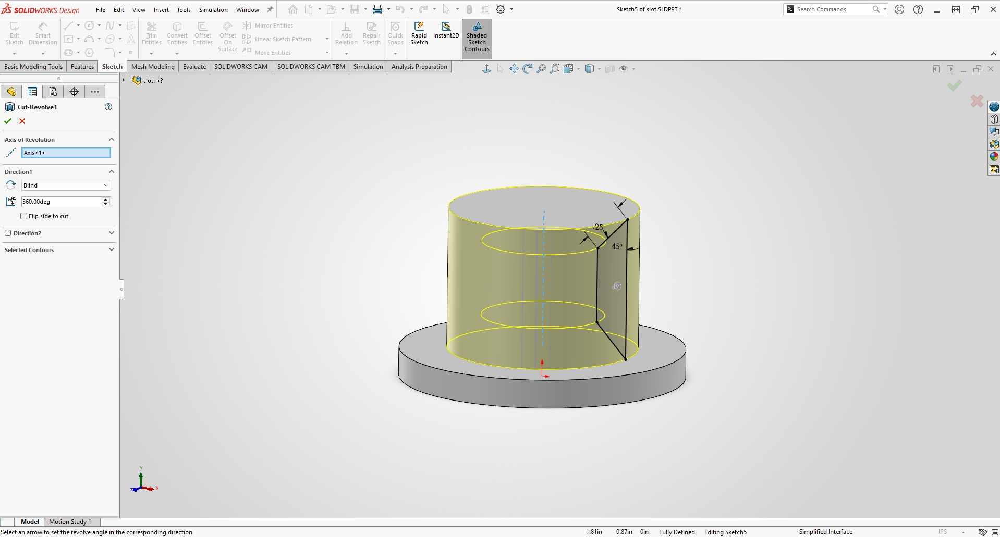
    <figcaption style="font-size: 0.85em; color: gray; margin-top: 5px;">
      Slot geometry setup in `slot.SLDPRT`
    </figcaption>
  </figure>

  <figure style="display: inline-block; margin: 10px; vertical-align: top;">
    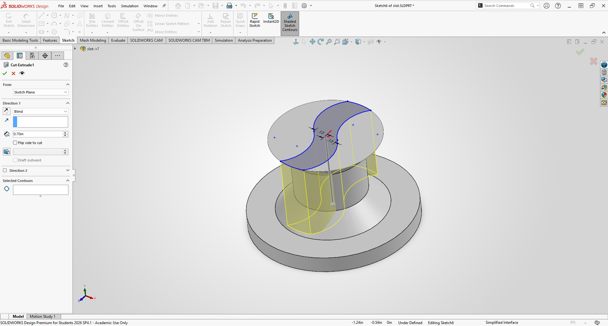
    <figcaption style="font-size: 0.85em; color: gray; margin-top: 5px;">
      `Cut-Extrude1` in `slot.SLDPRT` (`0.70 in` blind) forming curved cable channels through the central hub
    </figcaption>
  </figure>
  <figure style="display: inline-block; margin: 10px; vertical-align: top;">
    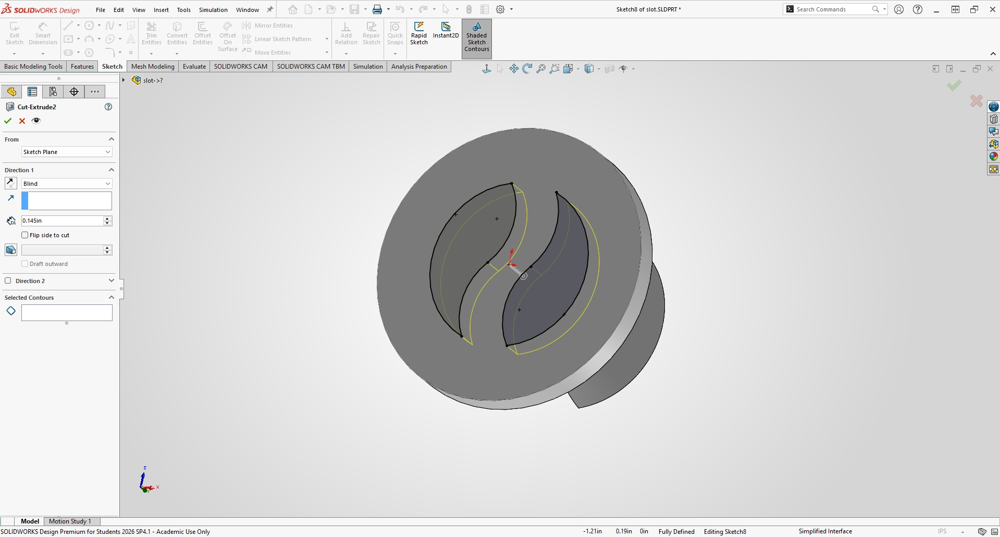
    <figcaption style="font-size: 0.85em; color: gray; margin-top: 5px;">
      Modeling the winding/crank feature used to assist with cable winding
    </figcaption>
  </figure>
  <figure style="display: inline-block; margin: 10px; vertical-align: top;">
    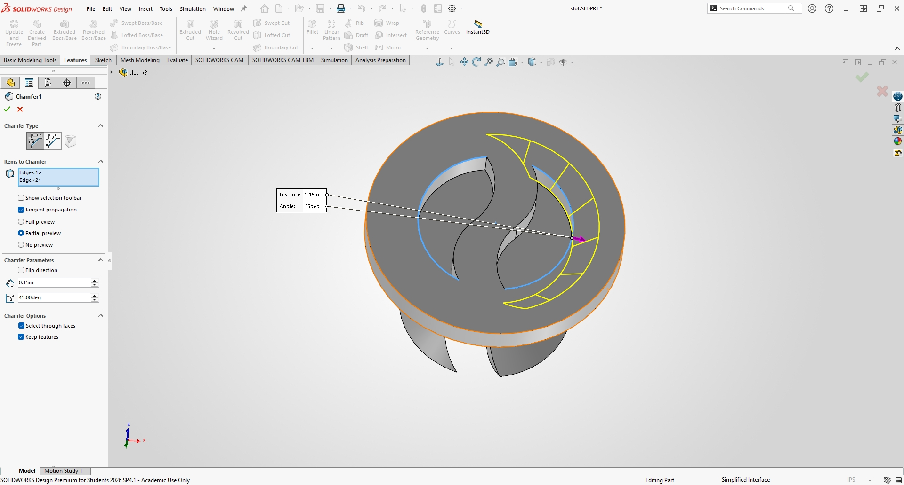
    <figcaption style="font-size: 0.85em; color: gray; margin-top: 5px;">
      Refining the winding/crank geometry for smooth turning and cable handling
    </figcaption>
  </figure>

  <figure style="display: inline-block; margin: 10px; vertical-align: top;">
    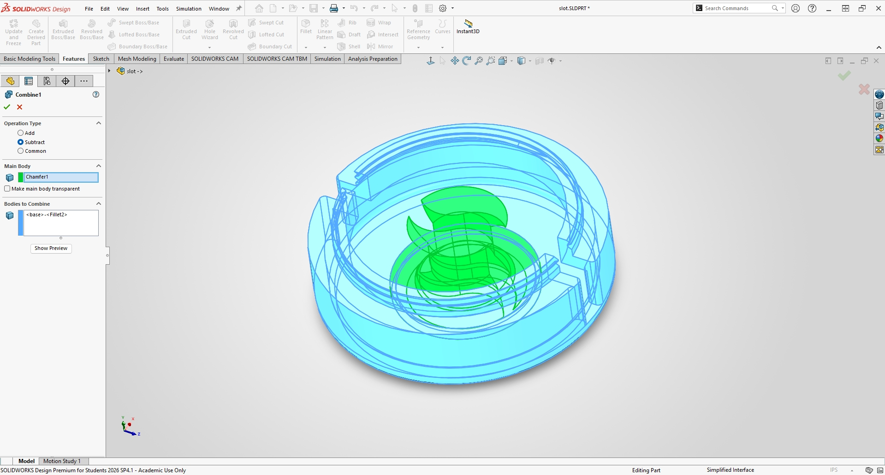
    <figcaption style="font-size: 0.85em; color: gray; margin-top: 5px;">
      Combining base components to establish the print-in-place fit
    </figcaption>
  </figure>
  <figure style="display: inline-block; margin: 10px; vertical-align: top;">
    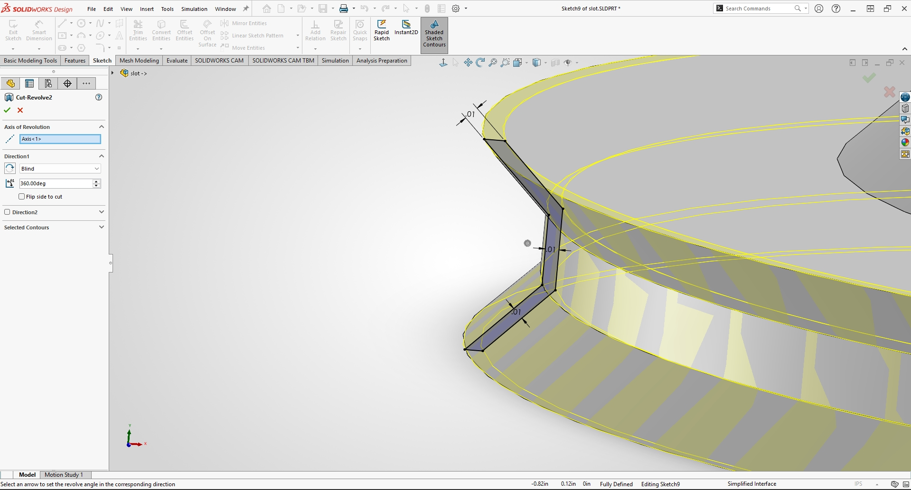
    <figcaption style="font-size: 0.85em; color: gray; margin-top: 5px;">
      Setting print-in-place fit tolerances on the base geometry
    </figcaption>
  </figure>
  <figure style="display: inline-block; margin: 10px; vertical-align: top;">
    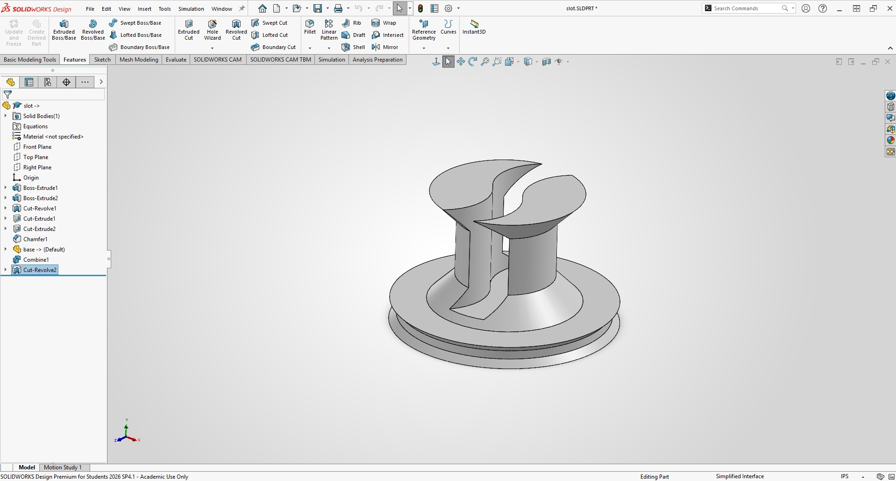
    <figcaption style="font-size: 0.85em; color: gray; margin-top: 5px;">
      Completed `slot.SLDPRT` featuring a contoured neck groove and dual curved routing channels
    </figcaption>
  </figure>

  <figure style="display: inline-block; margin: 10px; width: 55%; vertical-align: top;">
    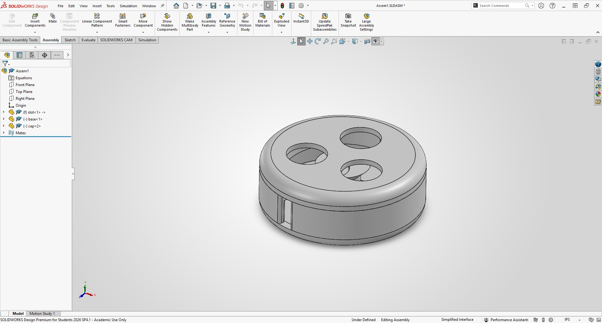
    <figcaption style="font-size: 0.85em; color: gray; margin-top: 5px;">
      `Assem1.SLDASM` integrating `slot<1>`, `base<1>`, and `cap<2>`
    </figcaption>
  </figure>

#### D. Slicer Preparation (PrusaSlicer & PreForm)

  <figure style="display: inline-block; margin: 10px; vertical-align: top;">
    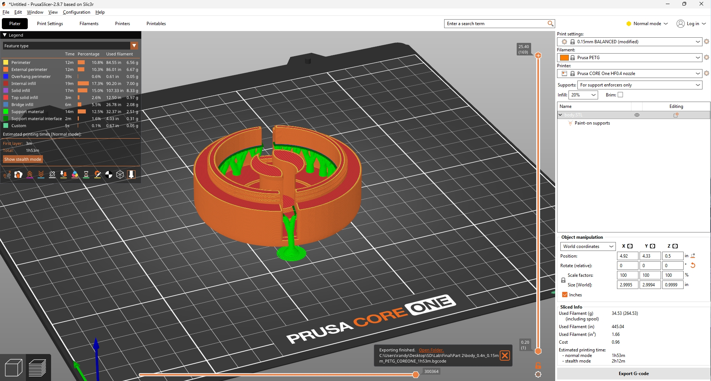
    <figcaption style="font-size: 0.85em; color: gray; margin-top: 5px;">
      PrusaSlicer (`body.STL`) on Prusa CORE One HF0.4 nozzle (`0.4 mm`), Prusa PETG, `0.15mm BALANCED (modified)`, `20%` infill, `For support enforcers only`, `2.9995 in` × `2.9994 in` × `0.9999 in`, `34.53 g`, `1h53m` normal (`2h12m` stealth)
    </figcaption>
  </figure>
  <figure style="display: inline-block; margin: 10px; vertical-align: top;">
    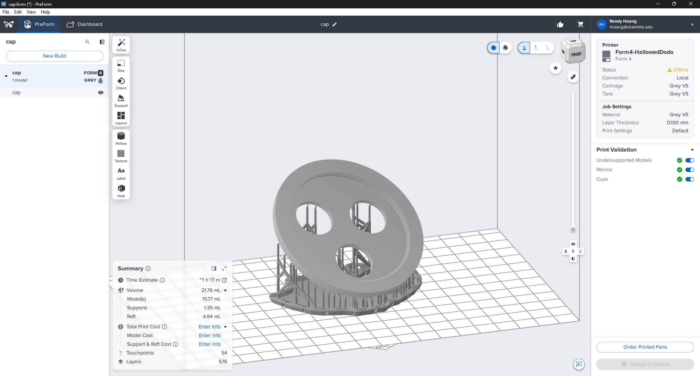
    <figcaption style="font-size: 0.85em; color: gray; margin-top: 5px;">
      PreForm (`cap.form`) on Form 4 (`Form4-HallowedDodo`), Grey V5, `0.100 mm`, `21.76 mL` total (`15.77 mL` model, `1.35 mL` supports, `4.64 mL` raft), `~1 h 17 m`
    </figcaption>
  </figure>

---

## 3. Final Prototype Documentation & Instructions

### Fabrication & Printing Process

  <figure style="display: inline-block; margin: 10px; vertical-align: top;">
    <video width="350" controls preload="metadata" playsinline>
      <source src="v2_fdm_printing.mp4" type="video/mp4">
      Your browser does not support the video tag.
    </video>
    <figcaption style="font-size: 0.85em; color: gray; margin-top: 5px;">
      FDM printing process on Prusa CORE One in Prusa PETG (`1h53m` normal mode)
    </figcaption>
  </figure>
  <figure style="display: inline-block; margin: 10px; vertical-align: top;">
    <video width="350" controls preload="metadata" playsinline>
      <source src="v2_sla_printing.mp4" type="video/mp4">
      Your browser does not support the video tag.
    </video>
    <figcaption style="font-size: 0.85em; color: gray; margin-top: 5px;">
      SLA printing process on Formlabs Form 4 in Grey V5 resin
    </figcaption>
  </figure>

### Final Printed Prototype Photos

  <figure style="display: inline-block; margin: 10px; vertical-align: top;">
    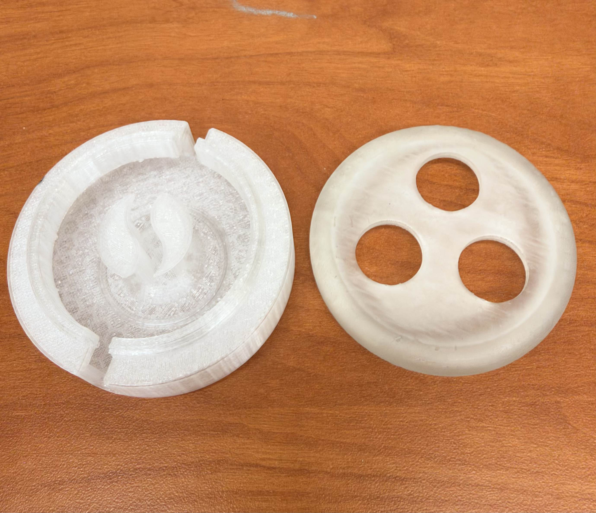
    <figcaption style="font-size: 0.85em; color: gray; margin-top: 5px;">
      Unassembled FDM PETG and Form 4 SLA Grey V5 components after support removal, washing, and curing
    </figcaption>
  </figure>
  <figure style="display: inline-block; margin: 10px; vertical-align: top;">
    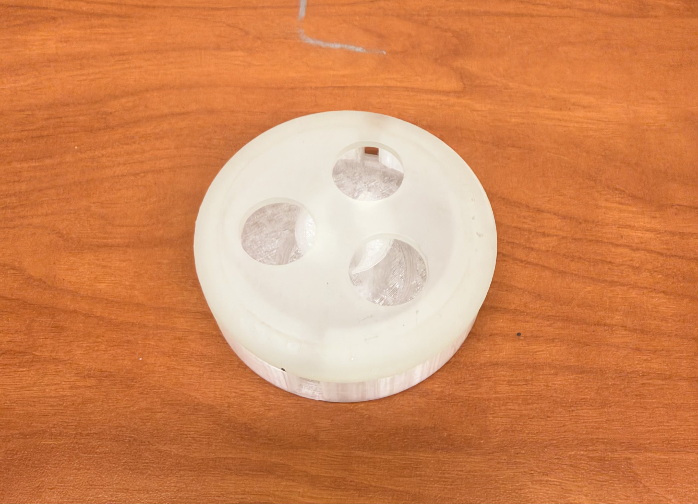
    <figcaption style="font-size: 0.85em; color: gray; margin-top: 5px;">
      Assembled v2 travel cable winder prototype ready for use
    </figcaption>
  </figure>

### Assembly Instructions
1. **Inspect & Clean Parts:** Remove support material from the FDM PETG components and wash and post-cure the Form 4 Grey V5 SLA cap; inspect threads and slots for debris or cured resin lipping.
2. **Seat the Internal Spool/Slot Component:** Align the slotted spool/hub (`slot.SLDPRT`) cleanly inside the body (`base.SLDPRT`) so the cable routing channels and groove remain unobstructed.
3. **Thread & Pair Components:** Engage the threaded cap (`cap.SLDPRT`) onto the mating threads (`2.5000-12` profile) carefully to avoid cross-threading, pairing components while maintaining smooth clearance.

### Use Instructions
1. **Insert Cable:** Feed the cable into the routing slot or channel so it seats cleanly inside the winding cavity without sharp bends or kinks.
2. **Wind Cable:** Hold the outer body steady and rotate the crank/cap assembly to wrap the cable evenly around the spool.
3. **Dispense & Store:** Draw out the cable smoothly when needed, rewind after use, and store the slim winder in a travel bag or pouch.

---

## 4. Presentation Preparation & Final Video

  <figure style="display: inline-block; margin: 10px; vertical-align: top;">
    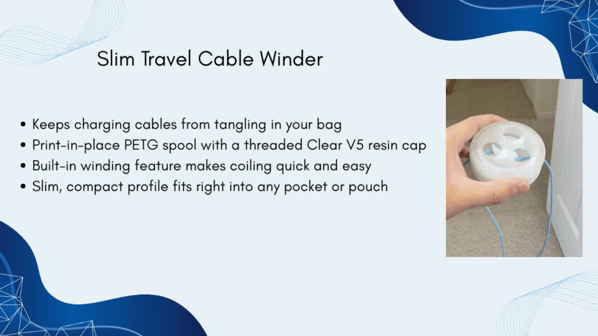
    <figcaption style="font-size: 0.85em; color: gray; margin-top: 5px;">
      One-slide project overview
    </figcaption>
  </figure>
 <figure style="display: inline-block; margin: 10px; vertical-align: top;">
    <iframe
      src="https://drive.google.com/file/d/1LhM5D0tyqwLsaMbhblgVQ4WUfY-knQ9X/view?usp=sharing"
      width="400"
      height="225"
      style="border: none;"
      allow="autoplay; fullscreen"
      allowfullscreen>
    </iframe>
    <figcaption style="font-size: 0.85em; color: gray; margin-top: 5px;">
      Final project presentation video (<a href="https://drive.google.com/file/d/1LhM5D0tyqwLsaMbhblgVQ4WUfY-knQ9X/view?usp=sharing" target="_blank" rel="noopener">Open in Google Drive</a>)
    </figcaption>
  </figure>

---

## 5. Lessons Learned & Time Log

### Time Log

| Time Spent | What Changed |
| :--- | :--- |
| **1.5 Hours** | Reviewed Week 2 peer feedback worksheets from Maxwell McFarlane and Atiba Johnson and planned v2 design refinements. |
| **4.5 Hours** | Refined SolidWorks parametric models (`"spool_diameter" = 1.50 in`), winding/crank feature, `2.5000-12` threads, `120°` cap cutouts, base combine, and print-in-place fit tolerances. |
| **3.0 Hours** | Sliced `body.STL` in PrusaSlicer (`34.53 g`, `1h53m` normal mode) and `cap.form` in PreForm (`21.76 mL`, `~1 h 17 m`), completed FDM/SLA printing, post-processed parts, assembled/tested the prototype, and recorded the presentation video. |

### Lessons Learned
- **Parametric Control Speeds Up Iteration:** Driving dimensions with a global variable (`"spool_diameter" = 1.50 in`) made resizing and tightening up the winder profile much cleaner and faster than adjusting individual features one by one.
- **Print-in-Place Clearances Matter:** Combining the base geometry and tuning print-in-place tolerances upfront helps prevent fused surfaces and keeps moving/winding features free-moving after printing.
- **Compact SLA Sizing Saves Resin and Time:** Keeping the Form 4 Grey V5 cap compact (`21.76 mL` total volume vs. `52 mL` in Part 1) stayed well within roughly one-quarter of the build plate while preserving thread engagement and grip cutouts.
