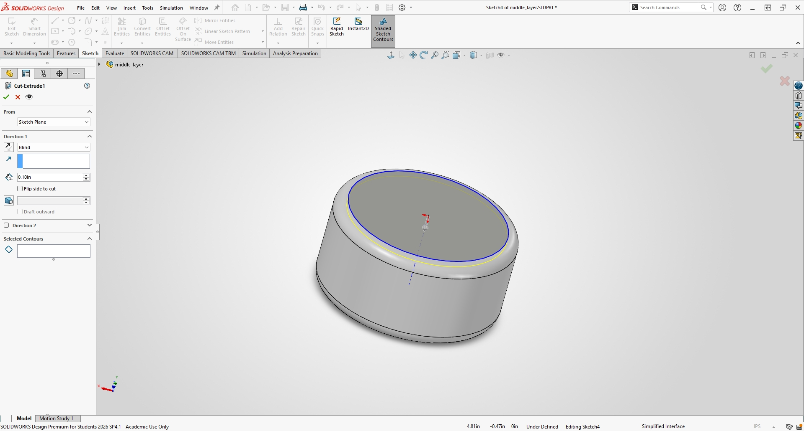
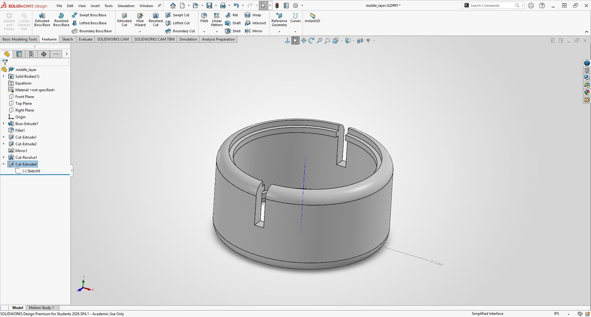
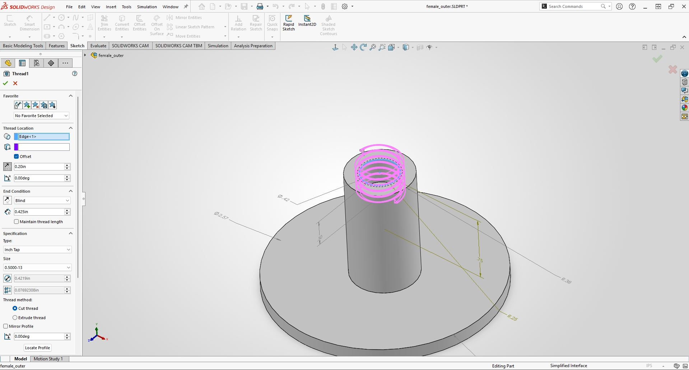
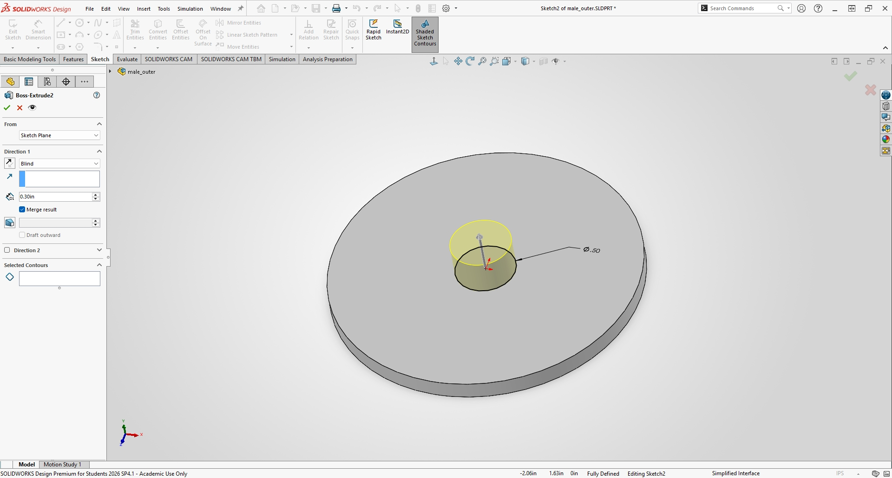
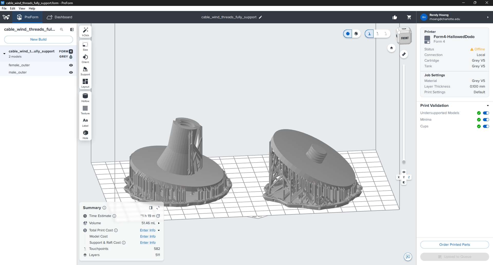

# Project Part 1: Define the Problem and Rough Prototype

<small>***(Clicking on the images will enlarge them)***</small>

## Research and Theoretical Framework

To establish a rigorous engineering foundation for the travel cable winder project, key manufacturing and design methodologies were investigated prior to CAD modeling and fabrication.

### 1. The Spiral Design Process
The Spiral Design Process is an iterative engineering framework divided into four primary quadrants per cycle:
- **Planning:** Defining project objectives, functional requirements, and constraints (e.g., portable cable management, multi-material architecture, and build plate limits).
- **Risk Analysis:** Identifying potential failure modes—such as thread stripping, resin peel forces, structural brittleness, and parasitic torque transmission during cable pulls.
- **Engineering (Prototyping & Modeling):** Executing parametric CAD models in SolidWorks, defining thread profiles (`1/2-13` UNC), and setting up slicing parameters in PreForm.
- **Evaluation:** Testing physical prototypes, measuring dimensional accuracy with calipers, analyzing tribological performance, and refining tolerances.
- **Application:** This iterative spiral guided the transition from initial concept sketches to the final multi-material prototype, allowing successive loops to resolve mechanical binding and thread slippage.

### 2. FDM Anisotropy
Fused Deposition Modeling (FDM) inherently produces anisotropic mechanical properties due to directional layer-by-layer extrusion. Interlayer bonding along the build ($Z$) axis is consistently weaker than intralayer tensile strength along the raster ($X-Y$) paths. 
- **Design Impact:** For the middle guide ring (`middle_layer`), stress concentrations around the cable routing slits risk delamination if subjected to cyclic bending.
- **Mitigation Strategy:** **PETG filament** was selected over PLA. PETG provides superior inter-layer adhesion, higher impact resistance, and greater elastic deformation limits, preventing brittle fracture when cables snap against the slot walls.

### 3. SLA Resin Shrinkage & Dimensional Accuracy
Stereolithography (SLA) resin printing exhibits volumetric and linear shrinkage (typically $1\%$ to $2\%$) as monomers cross-link into polymer chains during UV laser photopolymerization.
- **Key Findings:** Shrinkage is heavily influenced by part geometry, hollow wall thickness, and print orientation relative to the build platform.
- **Compensation Strategies:** To counteract shrinkage and ensure smooth coaxial assembly, precise offset tolerances ($0.015\text{ in}$ to $0.025\text{ in}$ running clearance) were engineered into the mating journals and threaded features of the Formlabs Grey V5 resin caps.

### 4. Laser Cutting Kerf Compensation
Laser cutting removes material along the beam's focal path (the kerf width), which directly affects press-fit and sliding joint tolerances.
- **Compensation Strategy:** While our final prototype relies on FDM and SLA, kerf compensation principles were evaluated for slot dimensions: accounting for half the beam width on internal vs. external cut profiles ensures tight, friction-locked or sliding joints without dimensional drift.

---

## Problem Definition & Selection

### Alternative Problem Definitions (3 Minimum)
1. **Travel Cable Tangling:** Tangled charging and headphone cords in backpacks create daily frustration, knotting, and strain on internal conductor wires.
2. **Hardware Organization:** Loose machine screws, nuts, and washers in mobile workshop bins mix together, causing time loss during assembly.
3. **Drafting Tool Storage:** Loose scales, pencils, and erasers roll around in backpacks, leading to broken lead and damaged equipment.

### Problem Selection & Justification
**Selected Problem:** Problem #1 (Travel Cable Tangling). 
- **Justification:** This is a universal, recurring real-world problem experienced personally during travel. It presents an ideal engineering challenge solvable through a multi-material manufacturing approach—leveraging the rigidity of SLA resin for structural threads and the elasticity of FDM PETG for flexible cable retention slots.

*Note on Build Plate Constraints:* While project guidelines initially specified limiting SLA prints to $1/4$ of the Form 4 build plate, functional component sizing, wall thickness requirements, and structural integrity for the threaded shafts necessitated exceeding this initial plate allocation to ensure mechanical reliability.

---

## Concept Development & Parametric Modeling

Initial conceptual sketches explored various winding mechanisms before converging on a coaxial threaded cap design with a free-floating middle spool. The design was modeled entirely in **SolidWorks**, utilizing parametric equations and global variables.

  <figure style="display: inline-block; margin: 10px; vertical-align: top;">
    
    <figcaption style="font-size: 0.85em; color: gray; margin-top: 5px;">
      Master sketch and outer diameter ($3.00\text{ in}$) definition for the middle guide ring
    </figcaption>
  </figure>
  <figure style="display: inline-block; margin: 10px; vertical-align: top;">
    
    <figcaption style="font-size: 0.85em; color: gray; margin-top: 5px;">
      Applying $0.20\text{ in}$ edge fillets and internal stepped flange recesses
    </figcaption>
  </figure>

### 1. Modeling the Middle Guide Ring (`middle_layer`)
Designed with a $1.50\text{ in}$ width and dual $0.18\text{ in}$ cable routing slits cut through both sides:

  <figure style="display: inline-block; margin: 10px; vertical-align: top;">
    
    <figcaption style="font-size: 0.85em; color: gray; margin-top: 5px;">
      Cutting $0.18\text{ in}$ cable routing slots through the PETG ring walls
    </figcaption>
  </figure>
  <figure style="display: inline-block; margin: 10px; vertical-align: top;">
    
    <figcaption style="font-size: 0.85em; color: gray; margin-top: 5px;">
      Completed middle guide ring (`middle_layer.SLDPRT`) ready for FDM slicing
    </figcaption>
  </figure>

### 2. Modeling the Female Outer Cap (`female_outer`)
Incorporates a $2.57\text{ in}$ flange base, a $1.30\text{ in}$ central post, and a tapped `1/2-13` UNC thread profile with reinforcing chamfers:

  <figure style="display: inline-block; margin: 10px; vertical-align: top;">
    
    <figcaption style="font-size: 0.85em; color: gray; margin-top: 5px;">
      Extruding the central cylindrical post ($\varnothing 0.75\text{ in}$) on the female cap
    </figcaption>
  </figure>
  <figure style="display: inline-block; margin: 10px; vertical-align: top;">
    
    <figcaption style="font-size: 0.85em; color: gray; margin-top: 5px;">
      Applying the `1/2-13` inch tap thread feature with a $0.425\text{ in}$ depth
    </figcaption>
  </figure>

### 3. Modeling the Male Outer Cap (`male_outer`)
Features an external `0.5000-13` die thread stud and a thread relief undercut for secure shoulder seating:

  <figure style="display: inline-block; margin: 10px; vertical-align: top;">
    
    <figcaption style="font-size: 0.85em; color: gray; margin-top: 5px;">
      Extruding the male threaded stud ($\varnothing 0.50\text{ in}$)
    </figcaption>
  </figure>
  <figure style="display: inline-block; margin: 10px; vertical-align: top;">
    
    <figcaption style="font-size: 0.85em; color: gray; margin-top: 5px;">
      Executing the `0.5000-13` Inch Die thread feature on the male stud
    </figcaption>
  </figure>

### 4. Assembly Integration (`cable_wind`)
The fully mated assembly verifies coaxial alignment and running clearance:

  <figure style="display: inline-block; margin: 10px; vertical-align: top;">
    
    <figcaption style="font-size: 0.85em; color: gray; margin-top: 5px;">
      Fully mated SolidWorks assembly (`cable_wind.SLDASM`) showing component stacking
    </figcaption>
  </figure>

---

## 3D Printing, Testing, and Video Presentation

Build preparation for the SLA outer caps was handled in **Formlabs PreForm**, organizing the layout and supports on the Form 4 printer.

  <figure style="display: inline-block; margin: 10px; width: 50%; vertical-align: top;">
    
    <figcaption style="font-size: 0.85em; color: gray; margin-top: 5px;">
      PreForm layout for SLA outer caps showing orientation, 582 touchpoints, and total volume ($51.46\text{ mL}$)
    </figcaption>
  </figure>

### PreForm Parameters
- **Machine Name:** Formlabs Form 4 SLA Printer (`HallowedDodo`)
- **Material:** Formlabs Grey V5 Resin
- **Layer Height:** $0.100\text{ mm}$ ($100\text{ microns}$)
- **Build Orientation:** Tilted at an optimized angle to minimize peel forces on the resin tank.
- **Support Settings:** 582 auto-generated touchpoints placed away from threaded profiles.
- **Total Volume:** **$51.46\text{ mL}$** (Exceeding the initial $1/4$ plate constraint to accommodate robust thread walls).

### Printing Process & Machine Setup
The printer setup and active fabrication on the Form 4 are captured below:

  <figure style="display: inline-block; margin: 10px; vertical-align: top;">
    
    <figcaption style="font-size: 0.85em; color: gray; margin-top: 5px;">
      Form 4 touch display preparing print job (`cable_wind_threads_fully_support`)
    </figcaption>
  </figure>
  <figure style="display: inline-block; margin: 10px; vertical-align: top;">
    <video width="350" controls preload="metadata" playsinline>
      <source src="sla_printing.mp4" type="video/mp4">
      Your browser does not support the video tag.
    </video>
    <figcaption style="font-size: 0.85em; color: gray; margin-top: 5px;">
      Form 4 SLA printing process in action
    </figcaption>
  </figure>

### Post-Processing (Washing & Curing)
After printing, components underwent washing and UV thermal curing:

  <figure style="display: inline-block; margin: 10px; width: 50%; vertical-align: top;">
    <video width="100%" controls preload="metadata" playsinline>
      <source src="sla_curing.mp4" type="video/mp4">
      Your browser does not support the video tag.
    </video>
    <figcaption style="font-size: 0.85em; color: gray; margin-top: 8px; text-align: center;">
      Post-curing process in the Form Cure chamber
    </figcaption>
  </figure>

- **Washing:** Cleaned in Isopropyl Alcohol (IPA $>91\%$) for 5 minutes in the Form Wash station.
- **Curing:** Post-cured in the Form Cure chamber at $60^\circ\text{C}$ for 30 minutes.
- **FDM Fabrication:** Middle ring fabricated in PETG filament for optimal elastic flexibility.

### Photos of Printed Components

  <figure style="display: inline-block; margin: 10px; vertical-align: top;">
    
    <figcaption style="font-size: 0.85em; color: gray; margin-top: 5px;">
      Fabricated SLA resin outer caps featuring precision `1/2-13` threads
    </figcaption>
  </figure>
  <figure style="display: inline-block; margin: 10px; vertical-align: top;">
    
    <figcaption style="font-size: 0.85em; color: gray; margin-top: 5px;">
      FDM PETG middle guide ring with integrated cable slits
    </figcaption>
  </figure>

### Functional Testing & Tribology Verification
Initial testing and winding evaluation were recorded to verify smooth operation:

  <figure style="display: inline-block; margin: 10px; width: 50%; vertical-align: top;">
    <video width="100%" controls preload="metadata" playsinline>
      <source src="wind_testing.MOV" type="video/mp4">
      Your browser does not support the video tag.
    </video>
    <figcaption style="font-size: 0.85em; color: gray; margin-top: 8px; text-align: center;">
      Functional cable winding and pull test evaluation
    </figcaption>
  </figure>

Initial testing revealed that when a cable snagged during rapid pulls, frictional drag transmitted parasitic torque through the pinched PETG ring, inadvertently screwing or unscrewing the coaxial threads. 
- **The Mechanical Fix:** Implemented an axial running clearance gap ($0.015\text{ in}$ to $0.025\text{ in}$) on the central bearing journal. When outer caps bottom out against each other rather than clamping the middle ring, it floats freely and spins independently.

### 30-Second Video Presentation Script
- **0:00 – 0:10:** *"Do you struggle with untangling your cables like I do? Every single time I reach into my bag, it’s a complete mess—and honestly, I’m over it."*
- **0:10 – 0:13:** *"So, I designed my own fix."*
- **0:13 – 0:35:** *"I modeled and 3D-printed this travel winder from scratch. You just drop the cord in, screw the caps together, and because the middle piece floats freely, you can just hold onto it and spin the cap to wind everything up. Toss it in your bag, and whenever you need it, it pulls straight out—zero tangles, super simple."*

---

## Lessons Learned & Reflection

### Process Log

| Time Spent | What Changed |
| :--- | :--- |
| **2.5 Hours** | Spiral Design Process research, problem definition (3 options), conceptual sketching, and build constraint evaluation. |
| **4.0 Hours** | SolidWorks parametric modeling of `middle_layer`, `female_outer`, and `male_outer` with custom `1/2-13` threads and clearances. |
| **3.5 Hours** | PreForm layout, Form 4 SLA printing ($51.46\text{ mL}$), IPA wash, cure, FDM PETG printing, assembly testing, and parasitic torque troubleshooting. |

### Mistakes & Troubleshooting
- **Parasitic Thread Rotation:** Cable snags initially caused threads to bind due to high sliding friction. Solved by introducing positive axial running clearance so the middle guide ring floats freely.
- **Build Plate Constraint:** Exceeding the initial $1/4$ SLA plate constraint was necessary to provide adequate wall thickness around the threaded posts and prevent resin peel failures.

### Resources Used
1. SolidWorks
2. Formlabs PreForm & Form 4 SLA Printer (Grey V5 Resin)
3. FDM 3D Printer (PETG Filament)
4. Form Wash & Form Cure Stations
5. **YouTube Reference Tutorials:** SolidWorks Custom Thread Modeling (Helix and Sweep tool methods), Thread Relief Undercut Design, and SLA Resin Print Clearance & Tolerance Optimization Guides.

